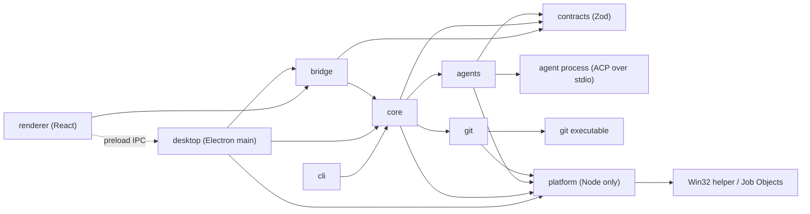

# Architecture

Status: implemented (first version). Code60 has two interfaces: the Electron desktop app and the headless `code60` command-line tool.

## What it does

`code60` runs coding agents in parallel on one Git repository. Each run gets its own worktree, so the agents cannot overwrite each other. When the agents finish, you review each worktree's diff and decide what to keep.

Git is not required for headless CLI runs. Desktop project workers require a Git repository with an initial commit. In the CLI, outside a Git repository, or in a repository with no commits yet, every run works directly in the current directory instead (see [Runs without a worktree](#runs-without-a-worktree)).

That is the whole product. The tool talks to agents over the [Agent Client Protocol](https://agentclientprotocol.com) (ACP), runs them from an Electron and React desktop app or headless from the CLI, and keeps only the plain files it needs to show what happened.

## Non-goals

Exception for orchestrator plans: a conversation may save Markdown task lists in
`<chat working directory>/plans`, with versioned private records in `.code60/plans`.
Only a human Accept action authorizes the displayed revision. The orchestrator reports
completion with evidence notes; this does not approve or merge worker changes. Drafts
block new worker work in that conversation. Plans use existing between-turn delivery,
not a durable job queue; restart never restores execution authority. Failed or paused
execution requires explicit continuation. Plan tabs share the Chat side panel and show
an equally weighted completed/total progress bar and “X out of Y” outside the document.


Exception for Chat review: desktop-only review records, immutable bounded file snapshots,
human review decisions and editable pending feedback are persisted beneath the private
`.code60_workspace/reviews` directory beside the project database. This is not a general
job queue. Restart never automatically delivers saved feedback or grants worker authority.
Users explicitly reconnect saved reviews to a current chat. Review does not apply, commit,
merge or approve changes on the user's behalf. CLI records and database schema are unchanged.

Chat review groups workers by the human request that dispatched them. A Changes tab shares
the Chat side panel with project and revision-specific file tabs. Overlapping paths in
different workers remain distinct. Git snapshots use a temporary index and immutable blob
content, with limits and explicit unavailable/partial states. Revision selection remains
stable as new captures arrive. Feedback anchors carry revision, worker, path, side and lines;
changed content invalidates reviewed state and marks earlier anchors outdated. Only humans
resolve feedback or mark files reviewed. Pending feedback is delivered through the conversation
coordinator between turns, with explicit status, retry and withdrawal. Saved provenance never
authorizes a worker mutation; existing ownership, scope and recovery checks still apply.

These are deliberately out of scope. Add one back only when a real user needs it.

- Merging, committing worker changes, pushing, or deciding whether a task succeeded. The user does this with Git. Explicit guided initial commits are the sole exception described below.
- Retries, durable task queues, and exactly-once execution. A failed run is reported, and the user starts a new one.
- Automatic crash recovery. After a crash, the tool lists what was left behind; recovery starts only when the user sends a new message to an ended session in the desktop app.
- Storing credentials. Agents log in through their own CLIs. The CLI passes the environment through unchanged; desktop startup enriches only PATH to discover installed tools.
- Settings profiles, workspace trust, imported project settings, and settings export. The desktop app's saved run configurations (see [Desktop app](#desktop-app)) are the one exception: named batch settings stored in the project database, never applied to the CLI or the config file.
- CLI orchestration services, external ACP servers, and arbitrary agent-to-agent communication. Only the desktop Orchestration Chat may dispatch and control its own workers in the open project through the scoped MCP tools described below.
- Agent-controlled session save and fork; steering (prompting an agent in the middle of a turn); and mid-run model changes. Follow-up prompts between turns are supported in the desktop app only. Explicit ACP restoration of ended desktop runs is described in [Ended-run recovery](#ended-run-recovery).
- Budgets, cost tracking, and usage totals. The desktop shows only the current context occupancy reported by the harness.
- Workspace capacity limits, retention, and Worktrunk hooks. The read-only Worktrees tab measures logical file sizes when it is opened and in the background while it is visible, but does not enforce limits.
- File watching. The desktop app polls external state on a schedule (see [Polling](#polling)) instead.
- Shared or remote Code60 servers, and coordination across machines. User-configured remote MCP tool servers are supported as described below.
- Sandboxing. A worktree is not a security boundary, and the agent runs with the user's permissions.
- Windows ARM64 and Windows versions older than Windows 11. Windows desktop distribution targets x64 only.

## Modules

| Module | Source | Responsibility |
| --- | --- | --- |
| CLI | `src/cli` | Argument parsing, headless output, signals, and exit codes. |
| Desktop | `src/desktop` | Electron main process: the window, native dialogs, the IPC handlers, one workspace with multiple independent run batches, and shutdown. |
| Bridge | `src/bridge` | The typed IPC contract between `desktop` and `renderer`, and validation of every request from the renderer. |
| Renderer | `src/renderer` | The React interface, built with Vite. It runs sandboxed, with no Node.js or Electron access. |
| Contracts | `src/contracts` | Browser-safe Zod schemas, shared value definitions, and the prompt templates sent to agents; no application or platform dependencies. |
| Core | `src/core` | Runs, the parallel scheduler, permission policy, run records, and leftover detection. |
| Agents | `src/agents` | Starting an agent process, the ACP client, translating ACP updates into run events, cancelling, and killing the process. |
| Git | `src/git` | Creating, listing, and removing worktrees, measuring their logical file sizes, diffs, and status, using the `git` executable. |
| Platform | `src/platform` | Node-only leaf module for executable/environment resolution, owned process trees, native identity, path identity, and private storage. Uses the first-party `native/windows` helper on Windows, never an ABI-dependent addon. |



- `cli` depends only on `core`. `core` exports the event and run types the CLI and desktop app render.
- `desktop` depends on `core`, `bridge`, and `platform`. `bridge` and `renderer` may import only types from `core`; neither may import `platform`. The renderer reaches the main process only through the preload bridge. Only `desktop` imports Electron, and only `renderer` imports React.
- `agents` and `git` never import each other or `core`. `core` receives them as injected interfaces, so tests can use fakes.
- `core`, `bridge`, and `agents` may import `contracts` through its index. `contracts` imports only Zod, never application modules or Node.js. It owns shared IDs, tool kinds, stop reasons, duration rules, and the [prompt templates](#prompt-templates). Record schemas live in `core`, IPC schemas in `bridge`, and config schemas in `core`. Zod code generation is disabled before schema construction to preserve the renderer CSP.
- Domain logic lives in `core` and runs without the desktop app.
- `core`, `agents`, `git`, and `desktop` may import `platform` only through its index. `platform` imports no application modules, Electron, React, or provider SDKs. Bridge, renderer, and contracts remain browser-safe.

### Native Windows contracts

On Windows, all agent roles use a first-party helper executable outside ASAR.
It creates agents suspended, assigns them to exclusive kill-on-close Job Objects
with no breakaway, restricts inherited handles to ACP stdio, and then resumes
them. A separate authenticated control pipe and an owner-process handle stop
the job on owner/control loss. Root exit also terminates descendants. Startup
has a five-second deadline and job exit verification a five-second deadline.
ACP cancellation and its ten-second wait are unchanged. Windows then terminates
the owned job, without emulating SIGTERM. POSIX retains its existing grace.

Optional native identities contain creation time, owner SID, and agent job name.
Legacy records remain readable. Windows never authorizes a leftover stop using
command text or a PID alone. Missing, inaccessible or mismatched identities
block continuation/discard and unsafe stops; only a verified absent owned job
authorizes writing to its worktree again. Owner access failures are conservative.
Recovery remains explicit and ACP once-only permission rules are unchanged.

Windows desktop discovery reads inherited, user and machine PATH and documented
installation directories, separated with semicolons. It never runs shell profiles.
Environment names are case-insensitive on Windows; absolute executable commands
remain authoritative. Standard npm/npx shims resolve to their CLI JavaScript and
a matching Node executable. Other batch launchers use one rejecting adapter,
never blanket shell mode. Prompts stay on ACP stdin.

Browser-relative file paths remain slash-separated. Windows previews/listings
hold non-delete-sharing handles for every ancestor, reject every reparse point,
and bound reads. Local absolute drive paths are supported; device/drive-relative
paths, alternate streams and unsupported long paths fail clearly. Filesystem
identity uses canonical spelling, not globally lowercased paths. XDG/home config
and state defaults remain unchanged. New private objects receive restrictive
owner/SYSTEM ACLs at creation; existing user parent ACLs are never rewritten.
An unsafe existing Code60-private ACL fails closed. Atomic rename retries only
Windows EBUSY, asynchronously for at most 500 ms, never delete-then-write.

## A run

A run is one agent session in one new worktree (or, [without a worktree](#runs-without-a-worktree), directly in the current directory). It starts with one prompt (in the desktop app, the prompt is optional; see [Desktop app](#desktop-app)). In the desktop app, you can send follow-up prompts after each turn, and the agent keeps its context. A headless run is exactly one turn.

1. **Create the worktree.** Core creates a run ID, then, when the run has a worktree, `git` runs `git worktree add -b code60/<run-id> <path> <base>`. `<base>` defaults to `HEAD`. Worktrees go in `<repo-parent>/<repo-name>.worktrees/<run-id>` unless the config says otherwise.
2. **Start the agent.** `agents` spawns the configured command with the worktree as its working directory, in its own process group. It initializes ACP, creates a session rooted at the worktree, and sends the prompt.
3. **Stream events.** ACP session updates become run events (see [Run events](#run-events)). Core appends each event to the run's event log and forwards it to the CLI.
4. **Answer permission requests.** Core applies the [permission policy](#permissions). The desktop app may ask the user. Headless mode never waits.
5. **End the turn.** In headless mode, the turn's stop reason decides the run's final status, and `agents` stops the agent process. In the desktop app, the run becomes `idle` instead (see [Follow-up turns](#follow-up-turns)).
6. **Review.** `code60 diff <run-id>` shows the worktree's changes against `<base>`, including untracked files and any commits the agent made. The user keeps the work by committing or merging with Git, or removes it with `discard`.

The tool advertises no ACP file-system or terminal client capabilities. Agents use their own tools inside the worktree, and permission requests are the only point where the tool approves anything.

If an agent requires ACP authentication, the run fails with a message telling the user to log in through that agent's own CLI.

### Runs without a worktree

In the CLI, when the current directory is not inside a Git repository (or `git` is missing), or `HEAD` resolves to no commit because the repository has none yet, the runs have no worktree. The agent starts directly in the current directory, and nothing is created, initialized, or committed for it.

- The CLI says so on standard error before the runs start. With more than one run, it warns that the runs share the directory and can overwrite each other's changes.
- `--base` still requires a commit and is a usage error (exit code 2) when it cannot be resolved.
- The record has `base` and `branch` set to `null`, and `worktree` is the directory the agent ran in. `--json` reports `"branch": null` and `"changedFiles": null`.
- `diff` and `discard` refuse (exit code 1), because there is no separate worktree or branch. Review and undo the changes in the directory itself. `list` and `stop` work as usual.

### Run statuses

| Status | Meaning |
| --- | --- |
| `queued` | Waiting for a free slot under the parallel limit. |
| `running` | The agent is working. |
| `waiting` | A permission request is waiting for the user (desktop app only). |
| `idle` | A turn ended, and the agent is waiting for a follow-up prompt or for you to finish the run (desktop app only). The agent process stays alive. |
| `finished` | The last turn ended normally (`end_turn`). This is not a check that the task succeeded. |
| `failed` | The worktree or agent failed to start, the agent exited, ACP failed, or the last turn stopped for any reason other than `end_turn` or `cancelled`. The reason is recorded. |
| `cancelled` | The last turn was cancelled by the user, or the process received SIGINT or SIGTERM. |
| `timed_out` | The last turn exceeded the turn timeout. |
| `interrupted` | Found after a crash: the run was active, but the process that owned it is gone. |

### Parallelism

`run` accepts several agents. Each `--agent` flag creates one run, and the same agent may be named more than once. When only one agent is named (or none, meaning the default agent), `--parallel <n>` starts `n` runs of it, all at once, up to 32. With several `--agent` flags, `--parallel` instead overrides `maxParallel` for that invocation. Core keeps an in-memory queue and starts runs up to `maxParallel` (default 4). An `idle` run keeps its slot, because its agent process is still alive; finish it to free the slot. A failed run does not affect the others. Nothing is queued across process restarts.

Two `code60` processes can work on the same repository at the same time. Run IDs, branches, worktree paths, and record directories are all unique per run, so the processes never write to the same files.

The desktop app can also run multiple independent batches in the current project. Each batch has its own orchestrator and selected parallel limit, not a project-wide limit. New sessions do not inherit earlier sessions' ACP context or worktree changes; each isolated worktree starts from its selected base revision. Without worktrees, sessions necessarily share the folder's changes.

### Follow-up turns

In the desktop app, a turn that ends for any reason other than an agent exit or ACP failure moves the run to `idle`. From `idle` you can:

- **Reply.** Type a prompt and send it. Core sends it as a new `session/prompt` on the same session, and the run returns to `running`. A new prompt is sent only after the previous turn has ended.
- **Finish.** End the run. `agents` stops the agent process, and the last turn's stop reason sets the final status, using the same rules as headless mode.

Core never reads an agent's message to decide whether it asked a question. You read it and decide whether to reply. An `idle` run has no timeout. Quitting the desktop app finishes every `idle` run.

### Ended-run recovery

Recovery is explicit and desktop-only. It never starts automatically after a crash. Sending a new message from the chat composer continues any ended run (`finished`, `failed`, `cancelled`, `timed_out`, or `interrupted`) in the open workspace. Resume in the actions menu or command palette only opens the chat and focuses its composer; it starts no agent. Queued, running, and waiting runs are already active; an `idle` run already has a live session that accepts replies. Continuation is disabled while the ended run's recorded agent process group is alive, or after its worktree was deleted. The user must stop a leftover process before trying again; core checks the process group again before starting a writer.

When the record has an ACP session ID, sending the message launches the configured agent in the existing worktree and initializes ACP. It calls `session/resume` when advertised, otherwise `session/load` when advertised. Transcript updates replayed by `session/load` are suppressed because the append-only event log already contains them. A successful restore keeps the run ID, branch, worktree, and history, records a reconnection note, and sends only the new message, without resending any prior prompt.

If the record has no ACP session ID, the agent does not advertise restore, or ACP restoration fails, the same send action starts a fresh ACP session in the same worktree without a confirmation modal. Code60 builds a deterministic handoff summary of at most 12,000 characters from the `handoffSummary` [prompt template](#prompt-templates) from saved prompts, agent messages, tool-call summaries, and run state. It tells the new agent to inspect the worktree and verify completed work instead of blindly repeating prior requests. The first ACP prompt combines that summary and the user's new message. The transcript records only the new message as a prompt, and records the reason for the handoff as a note with an expandable Handoff summary. A failed agent start leaves the previous status unchanged. Handoff reuses the existing run record, branch, worktree, and event log; it creates no replacement run or worktree.

### Cancellation and timeouts

The turn timeout (`turnTimeout`, default 30 minutes) applies to each turn, not to the time a run spends `idle`.

Cancelling a turn, whether by the Cancel turn command (context menu or command palette) or timeout, sends ACP `session/cancel` and waits up to 10 seconds for the turn to end. In the desktop app, a turn that ends within that time leaves the run `idle`, so you can reply or finish. In headless mode, or when the turn does not end in time, the run ends: the agent's process group gets SIGTERM, followed by SIGKILL after 5 seconds. Killing the whole group also stops the tool processes the agent started. The worktree is always kept.

On SIGINT or SIGTERM, the CLI cancels every active turn and ends every run. It waits for the agents to stop and exits with code 130. The desktop app does the same on these signals, then quits. A second signal skips the grace periods.

## Permissions

ACP permission requests carry a tool-call kind: `read`, `edit`, `delete`, `move`, `search`, `execute`, `think`, `fetch`, `switch_mode`, or `other`. A request with a missing or unknown kind is treated as `other`. The policy maps each kind to `allow`, `deny`, or `ask`:

```json
{ "read": "allow", "search": "allow", "think": "allow", "edit": "allow", "default": "ask" }
```

- `ask` prompts in the desktop app. In headless mode, `ask` means deny.
- `--allow <kind>` (repeatable) and `--allow-all` override the policy for one invocation.
- Core picks the agent's "once" option when allowing (`allow_once`) and when denying (`reject_once`). It never picks the "always" options, so the agent keeps no lasting grant. If the agent offers no matching "once" option, the request is answered as cancelled.
- Every decision is recorded as a `permission` event, with who decided it (`policy` or `user`) and the options offered by the agent.

## Run events

```ts
type RunEvent = { runId: string; at: string } & (
  | { type: "status"; status: RunStatus; reason?: string; turn?: number; completedAt?: string }
  | { type: "prompt"; turn: number; text: string; origin?: "automatic" }
  | { type: "note"; text: string; detail?: string }     // Reconnection or handoff explanation
  | { type: "message"; text: string }
  | { type: "thought"; text: string }
  | { type: "toolCall"; toolCallId: string; title: string; kind: string; status: string }
  | { type: "permission"; toolCallId: string; title: string; kind: string;
      decision: "allowed" | "denied"; by: "policy" | "user";
      options?: { optionId: string; name: string; kind: string }[] }
  | { type: "turnEnd"; turn: number; stopReason: StopReason;
      completedAt?: string; outcome?: "finished" | "cancelled" | "timed_out" | "failed" | "interrupted" }
  | { type: "sessionState"; state: SessionState } // Model, context occupancy and harness modes
  | { type: "acp"; update: string; payload: string; size: number; truncated?: true }
  | { type: "stderr"; text: string }   // Written once when the run ends: up to 64 KiB of scrubbed stderr
);
```

Every ACP session update is recorded as a raw `acp` event, including updates that also produce typed events and updates the tool does not understand (plans, non-text content, tool inputs/outputs, and other provider fields). `update` is the ACP update name, `payload` is its JSON text, and `size` is its original UTF-8 byte count. Payload text is capped at 256 KiB per update, clipped at a complete UTF-8 code point with `truncated: true`; clipped payloads are not necessarily valid JSON. Unrecognized updates are never treated as errors or approvals. Raw and typed transcript updates replayed by `session/load` are suppressed to avoid duplicating history. Session metadata is collected during setup/replay and published once as current state after the setup response. Each completed ACP prompt response records its turn number and stop reason as `turnEnd`; transport failures instead retain the run's failure status/reason.

### Session information and harness modes

Orchestrator and worker composers share a compact footer: the current mode on the left; context donut, read-only model name, 20px harness logo and Send/Stop on the right. Metadata formerly below the composer is inside it. Missing reports use **N/A**; zero capacity has no percentage. The donut uses dark charcoal for used capacity against a light track, clamps its visual fraction to 0–100%, and exposes reported token counts and percentage in a mouse/keyboard tooltip. Long model names truncate with full-name tooltips; unknown harnesses use a Carbon terminal icon. The footer wraps on narrow composers. Context usage may decrease after compaction and is never inferred from transcript length. The model label is read-only. Ended sessions retain read-only values identified as **Last reported** in their tooltips.

To change a mode, wait until the session is idle and use the custom popover menu above its trigger. It preserves advertised controls and option groups, uses radio semantics and checkmarks, supports arrow/Home/End/Enter/Space navigation and Escape/outside dismissal, and restores trigger focus. Busy, inactive, ended, session replacement and new mode reports dismiss an open menu. The visible Harness Mode label is omitted, with an accessible label retained. Names, ordering and groups come from that harness; Code60 does not impose universal approval levels. **Code60 auto-approval**, shown in the mode trigger tooltip, is a separate policy. Orchestration chats and their workers keep it on: selecting an Ask mode does not turn off Code60's automatic once-only answers to permission requests. The harness determines the effects of its modes, including any sandbox behavior; Code60 forwards the selected value.

The stable ACP v1 adapter prefers categorized select `configOptions` and uses legacy `modes` only when config options are absent. It does not advertise boolean-config support or interpret provider metadata. New/load/resume responses and pushed config, mode and usage notifications feed a bounded, validated session snapshot. Updates before a new session's ID arrives are limited to 128 metadata notifications / 256 KiB and matched to the returned ID. Usage has safe nonnegative integer counts; malformed/unsupported controls cannot grant capabilities.

Optional `sessionState` in `run.json` and `RunView` retains model, usage, mode controls and report timestamps. Deduplicated `sessionState` events use existing ordered writes and snapshot revisions, without polling, SQLite changes or a record-format bump. Older records remain readable. Fresh handoffs clear old values; restored connections use newly reported state without reapplying a saved mode. State events do not become conversation text, unread replies, timing activity or worker summaries. CLI JSON output omits this added record metadata.

The existing worker/chat IPC action unions accept a narrow `set-mode` action with a run ID and `{source, configId, value}`. Main-process ownership and core idle-state checks apply, and values must match current advertised choices. Core exposes a pending mode-change flag, rejects overlapping prompts/changes, and automatic worker delivery waits until it clears. The controller releases its action queue while awaiting the RPC so shutdown and other sessions remain responsive. Requests time out after 15 seconds; local waits abort on shutdown. A rejected change retains reported state; a timeout labels mode unconfirmed until a subsequent report or successful retry. No failure claims to roll back the harness.

## Files

Project run records live inside the repository's Git directory, so they travel with the repository. The desktop orchestration conversation instead keeps its records in `.code60_workspace/<chat-folder>/.code60/runs` beside the connected database. Outside a Git repository, they live in `$XDG_STATE_HOME/code60/dirs/<key>/runs/` (default `~/.local/state`), where `<key>` is the first 16 hex digits of the SHA-256 of the directory's absolute path. `list` and the other commands look in the same place for the directory they run in.

```text
<git-common-dir>/code60/runs/<run-id>/
  run.json       Run record: status, agent, first prompt, turn count, base, branch, worktree, PIDs,
                 the agent's command line, times, last stop reason, and when it was discarded
  events.jsonl   Append-only run events, for display and review
```

- `run.json` is replaced atomically (written to a temporary file, then renamed). `events.jsonl` is append-only.
- Records and events are validated when read, including agreement with the requested run ID. Malformed records are omitted from listings; directly reading a malformed record or event log reports an error without including its contents. Unknown metadata fields are ignored, and older records without optional recovery fields remain readable. Event readers skip unknown string event types after checking their run ID; known types still require valid fields. Older releases reject logs containing `acp` or `turnEnd`, so this run-record change requires a major release.
- Both files are created with mode `0600`. The event log can contain anything the agent printed, so it is treated as sensitive. It never leaves the machine.
- Raw ACP updates preserve provider content as well as the typed display events, so logs grow faster and may contain sensitive tool inputs and outputs. The 256 KiB raw-payload cap applies per update, not per log; no total-size limit or retention policy is enforced. Stderr retains up to 64 KiB of scrubbed text, written when the run ends; oversized lines are omitted.
- The platform diagnostic utility redacts common credentials before clipping operational errors and stderr. ACP provider errors become generic failures instead of echoing provider text. This is best-effort protection, not PII anonymization: prompts, messages, tool payloads and raw ACP transcripts remain intact, and existing records are not rewritten. See [the security policy](SECURITY.md#local-data-and-sensitive-records) before sharing records.
- The first prompt is stored in `run.json` so `list` can show it. `run.json` also stores the optional ACP session ID for desktop recovery; older records without it remain readable. Every prompt, including follow-ups, is a `prompt` event in `events.jsonl`. Logs on standard error never include prompts.
- These files are records, not a recovery mechanism. If they are lost, only history is lost.

Configuration is one JSON file at `$XDG_CONFIG_HOME/code60/config.json` (default `~/.config/code60/config.json`). It is read-only to the tool; the user edits it.

```json
{
  "defaultAgent": "claude",
  "maxParallel": 4,
  "turnTimeout": "30m",
  "worktreeDir": null,
  "mcpServers": {},
  "permissions": { "read": "allow", "search": "allow", "think": "allow", "edit": "allow", "default": "ask" },
  "agents": {
    "claude":   { "command": ["npx", "-y", "@agentclientprotocol/claude-agent-acp"] },
    "codex":    { "command": ["npx", "-y", "@agentclientprotocol/codex-acp"] },
    "opencode": { "command": ["opencode", "acp"] },
    "droid":    { "command": ["droid", "exec", "--output-format", "acp"] }
  },
  "prompts": {
    "handoffTurn": "{{summary}}\n\nThe user's new message follows. Check the worktree first, then respond to it.\n\n{{message}}"
  }
}
```

Every key is optional. `permissions`, `agents`, and `prompts` are merged over the defaults shown above, one kind, agent, or template at a time. Unknown keys (including inside agent definitions) and invalid values are a configuration error (exit code 2). Durations use the same grammar in CLI configuration and saved desktop configurations, and must total a positive safe integer number of milliseconds.

The model is part of an agent's command or of the agent's own configuration. The tool does not pick models; the desktop displays the model reported through ACP configuration.

### User MCP servers

The optional top-level `mcpServers` map defaults to empty. See [MCP configuration](MCP.md)
for stdio, HTTP and SSE examples. Each definition has an explicit `type`: stdio
accepts only `command`, `args` and `env`; HTTP/SSE accept only `url` and `headers`.
Names and commands must be nonempty, arguments and environment/header values must
be strings, and URLs must use HTTP(S). Omitted `args`, `env` and `headers` become
empty collections. Unknown fields and the reserved server name `code60` are usage
errors (exit code 2). MCP validation and malformed-JSON errors never echo values.

The distributed `mcp.default.json` is an opt-in starter containing pinned stdio
Playwright MCP (isolated/headless) and Context7 definitions without credentials.
It ships in the CLI package root and desktop resources, but is never loaded
automatically or copied over user configuration. Users explicitly merge selected
entries into `config.json`; runtime defaults remain empty.

The default orchestration contract permits explicitly requested tasks through
user-configured MCP tools, while project edits still go to workers. It follows
the provider's tool catalog, including OpenCode's Code Mode `execute` wrapper;
inner MCP tool names are not assumed to be direct top-level tools. This guidance
grants no new main-process authority and does not authorize shell commands.

Tool-call events may include optional `mcp: { server?: string }` attribution.
The agents adapter recognizes documented structured programmatic MCP tool names
and Claude ACP metadata, never free-text titles, arguments or configured-server
presence. Partial updates retain attribution; corrected names may replace it.
Only the marker and bounded server label enter typed history and snapshots.
Legacy history remains readable without attribution. Both chat renderers show a
shared MCP badge and server label; Events adds a category-filterable Server column.
Unknown explicit MCP calls say Unknown; ordinary tools remain unlabelled.
Attribution is presentation metadata, never authority or evidence of success.
The built-in worker transcript projection flattens attribution to `mcp` and
`server` fields, keeping its scalar-only contract.

Core resolves a detached server list when preparing headless CLI runs, desktop
manual runs, dispatched workers, orchestration chats and explicit ended-run
recovery. Only chats also receive their own built-in Code60 stdio gateway.
Workers, CLI and manual sessions receive configured servers without that gateway.
Setup/connection probes, episodic-memory extraction and search-summary helpers
receive neither user servers nor the gateway.

The ACP adapter sends definitions on `session/new`, `session/load` and
`session/resume`, translating maps to ACP environment/header entries and omitting
the stdio `type` on the wire. After initialization it requires the provider's
`agentCapabilities.mcpCapabilities.http` or `.sse` to be `true` for every configured
remote transport. Missing support fails session startup explicitly and follows
normal connection/process cleanup; servers are never silently dropped.
Stdio requires no optional capability.

Config reloads do not restart or alter active sessions, including idle sessions.
Later runs/workers, new/retried chats and explicit recovery use the newly resolved
configuration. Restoration and fresh handoffs do not use saved server definitions.
Definitions stay in main-process memory and ACP setup requests, not run records,
transcripts, renderer snapshots or CLI results. The agent owns MCP connections and
stdio children; Code60 retains its existing agent process-tree cleanup and
once-only permission policies. This is not a new sandbox or a permission grant.

Configuration stays user-managed and read-only, without a Settings editor,
credential writes, OAuth implementation or environment-variable interpolation.
Users must trust their providers and servers: configured environment/header values
are sent to the selected provider, and agent/tool output can still contain sensitive
content in ordinary transcripts. Keep the config private and out of source control.

### Prompt templates

Orchestration and recovery prompts that Code60 writes itself are templates in `src/contracts/prompts.ts`. Dedicated memory extraction and search overview helpers use fixed prompt-rendering functions in `contracts`; these are not orchestration template overrides. A template marks merge fields as `{{name}}` (spaces inside the braces are allowed). `prompts` in `config.json` may replace any template by its ID. The `operatingContract` is injected before each user message in the orchestration chat; its text is not recorded as if the user wrote it. ACP v1 has no stable system-prompt field, so this context is included in the prompt sent to the selected provider.

The orchestration chat uses the connected database's saved Operating Contract edit first, then `config.json`, then the built-in template, on each new turn. Desktop handoffs resolve each template the same way; edits apply only to later handoffs, never a turn already in progress. Edits are shared by every project in that database. The CLI does not read database edits and never sends these templates.

| Template | Sent | Merge fields |
| --- | --- | --- |
| `handoffSummary` | The summary of an ended run for a fresh handoff session, truncated to 12,000 characters after merging. | `status`, `turns`, `agent`, `branch` and `base` (`none` without a worktree), `worktree`, `reason` (`none` when not recorded), `prompts` (one `- ` line each), `messages` (one line each), `toolCalls` (`- title (kind, status)` for the latest state of each call); lists are `(none)` when empty |
| `handoffTurn` | The first prompt of a handoff session. | `summary` (the merged `handoffSummary`), `message` (the user's new message, required) |
| `operatingContract` | Prepended to each user turn in the app-wide orchestration chat. | none |
| `workerUpdates` | Automatic worker turn-end and failure updates, delivered between orchestration chat turns. | `updates` (required; worker states and bounded reply excerpts) |

- A template is at most 8,000 characters and not empty. An unknown or malformed merge field, an unknown template ID, or a missing required field is a configuration error (exit code 2).
- Merging is one pass: values are inserted as they are, never escaped and never scanned for further merge fields. Saved prompts and agent output are untrusted text inside the prompt.
- Automatic orchestration turns also receive the Operating Contract, with an explicit automatic-update heading. Their prompt events carry `origin: "automatic"`; older/user prompt events omit it. Saved Operating Contract edits are preserved, with a warning when they retain the old prohibition against controlling runs.
- The CLI's own prompts are exactly the user's text, so headless runs use no template.

## Leftovers after a crash

`run.json` records the PID of the owning `code60` process and of the agent's process group. When the tool starts, and whenever you run `list`:

- A run that was `queued`, `running`, `waiting`, or `idle` when its owning process disappeared is marked `interrupted`.
- If the agent process for an ended run still exists, `list` says so and shows its command line.
- `stop <run-id>` kills that process group, but only after confirming that the live process's command line still matches the recorded one, which guards against reused PIDs. The recorded command line is what `ps` reported right after the agent started, because launchers such as `npx` change how their command line looks. If it does not match, the tool refuses and prints the PID so the user can decide.
- Worktrees are never removed automatically.
- In the desktop app, an ended run with its worktree intact may be continued by sending a message after its leftover agent is stopped. It attempts ACP restoration first, then starts a handoff if needed as described above. This is not automatic crash recovery.

## CLI

```text
code60 run [prompt] [--prompt-file <path>] [--agent <name>]... [--base <rev>]
           [--turn-timeout <duration>] [--parallel <n>] [--allow <kind>]... [--allow-all]
           [--headless] [--json]
code60 list [--json]
code60 diff <run-id>
code60 discard <run-id> [--yes]
code60 stop <run-id>
code60 --version
```

- `run` is always headless and runs exactly one turn per run. It reads the prompt from the argument, `--prompt-file`, or standard input, and exactly one of them must be given. Standard input is read only when neither of the others is given and it is not a TTY. `--headless` is accepted for compatibility and changes nothing. Use the desktop app for interactive runs.
- In headless mode, progress goes to standard error: status changes, new tool calls, and permission decisions, without tool/permission titles or status reasons that may echo task content. `--json` writes one result object to standard output, `{"runs": [...]}`, with every run's ID, agent, status, reason, branch, worktree, and changed-file count. Diagnostic reasons receive best-effort credential redaction; fields and exit-code semantics stay unchanged. Without `--json`, a short table goes to standard output.
- `discard` refuses while the run is active or its agent process is alive. It shows the files that would be lost, then removes the worktree and its `code60/<run-id>` branch. It asks for confirmation in a TTY and requires `--yes` otherwise.

### Exit codes

When runs end with different statuses, the code earliest in this table wins:

| Code | Meaning |
| --- | --- |
| 2 | Invalid usage or configuration, including an unknown run ID. |
| 130 | Cancelled by a signal, or at least one run was cancelled by the user. |
| 124 | At least one run timed out. |
| 1 | At least one run failed or was interrupted. |
| 0 | Every run finished. |

## Desktop app

The Code60 desktop app is the interactive interface. It is a standalone Electron app with a React interface. `npm run dev` builds and starts it, rebuilding on changes; `npm start` starts the built app. It is not packaged or signed in this version.

- **Orchestration Chat.** Chat is the default page after the splash and renderer reload, and the first alphabetical sidebar entry. Once setup is complete and a database and enabled orchestration provider are available, the main process automatically creates an initial fresh ACP session in a generated UUID subfolder of `.code60_workspace` beside the database. **New chat** creates and selects another independent session; the expandable Chat group in the primary sidebar switches conversations without stopping background turns. An icon-only, accessible Carbon plus action sits immediately left of the Chat dropdown chevron, outside the tab button and available even while the Chat group is collapsed. It creates a conversation and reveals the group. Only labelled conversation buttons are nested beneath Chat, with selection, activity and failure indicators. Creation and selection share an in-flight guard and visible failure feedback. Expansion is remembered, external navigation reveals the selected conversation, and collapse never changes it. Each chat has its own working directory, transcript, draft, scroll position, worker ownership, authenticated gateway and automatic-update inbox. New directories use mode `0700`; existing folders and legacy workspace contents are retained, with no Git initialization or branch creation. Sessions start idle without a prompt and use the fixed allow-all, once-only permission policy. They stay alive across page and project switches; changing databases, provider, or its configured command ends all chats and starts a fresh conversation. Renderer reloads reuse all main-process sessions and the selected conversation, never creating another. Conversations are independent of project batches, tables and search. Run and event records live privately in `.code60_workspace/<chat-folder>/.code60/runs`, outside SQLite; each app launch starts fresh, retaining previous folders on disk without automatically restoring them. The empty conversation shows “Give Code60 a task.” The header retains connection controls. The page presents user messages on the right and streamed replies on the left; thoughts, tools, permissions and session notes appear in inline activity dropdowns toggled by the live activity icon/status or completed turn timing. Errors stay visible. A persistent composer has square corners, a visible 1px border and no resting or focused shadows. It and both sidebars use the main app surface rather than a contrasting background fill, including resting controls and file previews. Focus replaces the normal border color with the focus color, without a separate inset line or layout shift, including system colors in forced-color mode. Worker composers use the same border replacement when Focus highlight border is enabled. The current provider logo appears inside the composer footer; connection, cancel and retry controls remain in the header. It shows explicit semantic activity below the latest transcript message. Neither chat composers nor sidebar entries show striped loading lines. Current-project worker counts remain in the activity tooltip, supplied by main-process ownership snapshots even when automatic updates are paused. These counts never change orchestrator sendability or Stop semantics. Enter sends, Shift+Enter inserts a newline, Stop cancels that chat's turn, and failed/stopped sessions offer Retry, which replaces only that conversation. The main process validates every action against an existing chat run ID; stale requests cannot target replacement sessions. Paths are generated only in the main process, never supplied by the renderer or agents. Existing core startup and turn timeouts, permission handling, cancellation and process-group cleanup apply. Stop all and every shutdown path stop every chat; quitting warns when any chat is starting or working, and idle orchestrators alone do not trigger a confirmation. Each chat's draft survives switching conversations, pages and renderer reloads for the current run. Initial database connection is available from Chat when needed.

- **Agent setup.** Every installation, including existing users with a legacy provider preference, must complete the desktop wizard once. The desktop-owned catalog presents Antigravity, Claude, Codex, Copilot, Droid, Kiro and OpenCode alphabetically with bundled logos in button cards that start detection and connection immediately on click or keyboard activation, without radio inputs or a Continue step. Wizard headings are 16px and text/controls 13px, independent of larger page-title preferences. Choose a Primary / Orchestrator, detect its executable and prerequisites, then initialize ACP and create a session without a prompt. Successful candidates can be followed by additional agents one at a time; duplicates are rejected and additions preserve the primary. Only Detected and Connected label agent status; progress and failures are separate. Settings offers Add agents and Change primary. Changing primary requires all active orchestration work to finish or stop; adding agents preserves live chats. Settings remain active until Finish setup commits the new membership.

- **Setup transaction and probes.** The main process owns the candidate, role, phase, errors and verified set, recovered through snapshots after renderer reload. A single attempt runs at a time. Detection refreshes desktop PATH and checks provider-specific prerequisites; npx alone does not establish Claude/Codex detection. Configured command overrides remain authoritative. Existing npx adapters may download when connecting; Code60 never installs provider CLIs or stores login credentials. A probe initializes ACP and creates a session in a generated private `code60-agent-probe-*` temporary directory independent of the database. It sends no prompts and creates no runs, transcripts or worktrees. The existing 15-second timeout and process cleanup apply; stop the process before removing the directory. Cancellation, dismissal, config changes, renderer loss/reload and shutdown cancel attempts and discard stale completions. Completed verification stays in memory until committed or abandoned.

- **Enabled agents.** Finish setup atomically writes `agentSetup` version 1 to desktop preferences: primary provider, enabled IDs and SHA-256 identities of verified command argument arrays. Legacy preferences never satisfy this gate and available agents are never imported automatically. Persisted membership means configured, not a live connection. Automatic chat startup, manual and MCP worker dispatch, continuation, and saved run configuration validation require completed setup and an enabled provider with an unchanged command identity. Snapshots and MCP provider lists contain only enabled agents. Changing a verified command requires verification again. Core accepts an optional resolved configuration for desktop launches/recovery; the headless CLI still uses its original config, defaults, flags and lifecycle. Native desktop defaults add `agy acp`, `copilot --acp --stdio`, and `kiro-cli acp`, retaining Claude/Codex npx adapters and the existing Droid/OpenCode commands.

- **Visual system.** Light uses white surfaces except for colored user bubbles, including resting controls, table headers and rows, code blocks, disabled controls, and the footer. Fine borders separate fields, buttons and sections; existing restrained shadows distinguish groups and overlays. Hover uses pale viridian fills without adding borders; selection uses neutral gray. Teal primary actions remain. Dark and System dark mirror the white-surface treatment with jet black (`#000000`) resting surfaces throughout, including table headers and every row. Main text is white, muted text is `#aaaaaa`, subtle borders are `#444444`, control borders are `#888888`, and selection uses `#303030`. Fine borders separate controls and fields; disabled stripes are transparent. Primary actions and user bubbles use a lighter verdigris (`#77ccc8`), with related shades for focus and hover. Status signals remain opt-in. The sidebar is square and has no outer border; main page surfaces use square corners without an outer border. Other passive containers are square. The D-DIN Regular Code60 logo has a small 45-degree chamfer at the upper-right of its colored 60 block. All UI elements use zero border radius, including buttons, messages, panels, vendor overlays and canvas table controls. Inputs, checkbox marks, scrollbars and passive containers stay square. The Focus highlight border appearance switch controls focus outlines and their glow app-wide, including composite prompt editors and worker composers; the main Chat composer and independent icon actions always retain visible keyboard focus. The switch defaults off, applies immediately, and persists locally as `code60.focusHighlight`. When enabled, outlines follow control geometry; explicit selection, validation, approval and failure cues remain. Standalone buttons have no trailing-edge border effect. Related controls form seamless groups with square outer corners and straight internal separators, with no overlapping hit areas. A fine outer border and restrained shadow distinguish control groups; their fill is white in Light and black in Dark. Standard groups use 28px controls (30px including the frame); compact groups use 24px controls. Menus, dialogs, chat windows, the palette and toasts use restrained overlay shadows. Icons remain locally bundled 16px IBM Carbon glyphs in DOM and canvas, except for compact 12px message Copy icons. Six configurable text roles retain their independent choices. Status labels and symbols carry meaning with optional signal colors; nothing blinks. Reduced motion disables functional animation; forced colors retain visible control edges and selection. Scrollbars use subtle theme-relative thumbs and a stronger hover tone app-wide; forced colors retain native contrast. No decorative dots or middle-dot delimiters are added outside the explicitly requested dotted preview frame.
- **Overlays.** Buttons with an accessible label or a `data-tooltip` show an inverted tooltip after a 500ms hover, or at once on keyboard focus or a quick move from another tooltip; Escape hides it. Tooltips prefer to sit above their control with a 2px stem pointing at it, flip below near the top edge, appear beside menus for menu items, and show shortcuts (from `data-tooltip-keys`) at the right. Unavailable menu items and buttons explain why in their tooltip. Cmd+K (Ctrl+K) opens a command palette, unless a dialog is open. An empty query lists every command in groups: Pages (Chat, File Explorer, and the remaining page tabs, including Prompt Editor and Settings), Project (New agent session, Open project, Connect to database, Poll project data, Stop all runs), Appearance (each theme, Signal colors, and Inline charts, with checkmarks on the current choices), and Session (commands for the selected session). Typing switches to one ranked list: label prefixes first, then word starts, then substrings, then matches in the group or run context, with matched letters bold and underlined. Arrow keys move, Enter runs, Escape closes and restores focus, and the footer counts the results. Unavailable commands are listed but disabled, following the same rules as the buttons they mirror. Right-clicking a session row, pressing the Context Menu key or Shift+F10 on the grid, or activating its Actions cell opens the same actions menu: Open chat and Review changes; Cancel turn, Finish run, Resume, and Stop leftover agent; and Delete worktree last under a 2px rule. Actions menus never have title strips. Items have Carbon icons; unavailable items keep their place, hatched, and say why in a tooltip. Arrow keys, Home, End, and typing a letter move between items; Escape or Tab closes the menu and restores focus, while an outside click, resizing, or window blur closes it without moving focus. Resume is unavailable while the recorded process group is alive or the worktree was deleted; it only opens the chat and focuses the composer. Toasts appear 16px from the window's bottom-left corner, newest at the bottom, at most three (a fourth displaces the oldest). Each has a Carbon icon, a written tone, and a 3px left rule: Note (4 seconds), Done (6 seconds), Warning (8 seconds), and Error (stays until dismissed or displaced). A bottom bar shows the time remaining; hover or focus pauses it, and the dismiss button or Escape closes a focused toast. Notes, Done, and Warning are announced politely; errors use `role="alert"`. Approvals stay in place until handled.
- **Splash.** At launch, the window shows the Code60 D-DIN wordmark. Completed agent setup with an available verified primary is required for entry. If missing, the shared agent setup wizard opens automatically; dismissing it leaves the splash blocked with Set up agents. A stale reload marker, legacy provider or open project cannot bypass setup. After completion, Continue <project name>? offers Yes to open the last project and No or Escape to leave it closed. Without a recent project, Start enters the app. Renderer reloads skip the splash only after validating completed setup.
- **Database.** Edit > Database Connection… in the native application menu, or Connect to database on the start screen, opens a Select database dialog to open an existing SQLite file or create a new one with the native file pickers. The database stores the history of opened project folders (canonical path and last-opened time), saved run configurations, and prompt template edits; run records stay where they are. New databases use schema 3. Schema 1 and 2 databases are upgraded in place in one transaction by adding the prompt-template table; schema 1 also gets the run-configuration table. Opening projects requires a connection. The app remembers the selected database in `$XDG_STATE_HOME/code60/desktop.json` and reconnects on launch; a saved database that is missing or unusable is reported, never recreated. Only empty files and Code60 databases are accepted, and other databases are never modified. Switching databases requires every run to have ended and closes the open project.
- **Workspace.** File > Open Project… in the native application menu (Cmd+O or Ctrl+O) is enabled while a database is connected and no batch is active. Open Project shows a dialog with the connected database's project history, newest first. Choosing an entry opens that folder; Open Folder picks an existing folder with the native folder picker, without creating files or initializing Git. Each opened folder is recorded once. Remove takes one project out of the history, and Clear history removes them all after a confirmation; neither touches the folders or their runs. A folder that no longer exists is reported and stays in the history. Run records are found the same way as for the CLI, so the app shows the folder's earlier runs as history. Switching projects requires every run to have ended.
- **Run batches.** The sessions table's New agent session add row (see [Tables](#tables)), or New agent session in the command palette, starts one batch with an optional first prompt, one or more agents (the same agent may repeat), a parallel count with the same meaning as `--parallel`, and advanced options for the base revision, turn timeout, and per-kind permission overrides. Validation and defaults are the same as for `run`. Additional independent batches can start while earlier sessions are running, waiting for approval, or idle. Parallel limits apply per batch. The controller tracks each batch and its subscriptions, routes actions and approvals to its owner, and combines snapshots and sequenced events without clearing earlier transcripts. Completion history reads are serialized with starts and refreshes so overlapping batches cannot overwrite newer history or a switched workspace. Project and database switches stay blocked until all batches have ended; Stop all and every shutdown path stop all batches, including forced shutdown. Without a first prompt, each run goes straight to `idle` ("no prompt yet"), and the first prompt you send becomes turn 1 and the run's first prompt. Finishing a run that never got a prompt gives `finished` with the reason "no prompt was sent".
- **Database workspace directory.** Whenever the desktop app successfully opens or reconnects to a Code60 SQLite database, it creates `.code60_workspace` in the database file’s parent directory if missing, using private directory permissions. Existing contents are preserved. This includes startup reconnection and databases selected after launch. A file conflict or filesystem error follows the existing database connection error path.
- **Episodic Memory experiment.** Settings → Advanced → Experiments → Episodic Memory extracts important details from the open project's recorded events with the configured orchestration provider. A **Maximum events** field beside the centered extraction button accepts a whole number from 1 to 10,000, defaults to 10,000, and remembers the last valid value locally. The cap follows the existing session order and takes each session’s earliest recorded events until reached; a larger limit processes all available events. The button count reflects the capped selection. Invalid limits disable extraction, and the limit cannot change during a run. Clear retains both the prompt and the limit. The **Extract from N events** button captures the displayed per-session event counts, waits for complete transcript reads, and displays each returned natural-language statement as a separate cloud, with softly rounded edges, two subtle lobes, and a continuous contrasting outline around the filled shape. Clouds flow side by side and wrap onto new rows with a 35ch maximum width, 28px vertical/32px horizontal padding, and text at least 16px. Light mode uses a diagonal white-to-light-blue fill and dark text. Dark mode uses the gradient only in a thick 4px outline, with a transparent interior and the normal foreground text color. The silhouette keeps fixed-size lobes as text grows; forced-colors mode uses system colors and a plain outline. Completion reports the end-to-end elapsed time measured with a monotonic clock, including startup and cleanup; Clear and a new extraction reset the timing status. **Edit prompt** opens an inline editor; edits persist locally, **Reset prompt** restores the default instructions, and **Clear** removes results and status while retaining the prompt. Results remain in memory across page switches and reset on project/database changes or renderer reload. Extraction may be rerun with a revised prompt. Empty input, unavailable providers, incomplete reads, invalid responses, and errors are explicit; failed or cancelled runs do not publish partial results.
  - The main process validates the request ID, project directory, session membership, prompt size (8,000 characters), and event counts. It reads the selected event prefixes itself, including live events not yet written to disk; later events are left for the next extraction. A request supports up to 10,000 events and 1,000,000 serialized characters, with explicit errors rather than silent truncation. Core divides input into excerpts of at most 32,000 characters and uses one fresh ACP session per excerpt, validates JSON statements, and deduplicates identical text ignoring case and repeated whitespace. Responses are bounded to 64,000 characters and 500 statements per excerpt, 2,000 characters per statement, and 2,000 combined statements.
  - Extraction is single-flight, has a five-minute deadline, and runs in a temporary directory with no Code60 MCP server. Its fixed prompt treats event text as data and prohibits tool use; permission requests are denied. This uses the existing agent process model, not a sandbox. It does not add project runs, feed the orchestration Chat, or save extracted statements. The process group is stopped and the temporary directory removed on completion or failure. **Cancel extraction**, Stop all, project/database/provider changes, and shutdown cancel outstanding work; stale cancellation IDs cannot stop another extraction. The two fixed preload methods use the ordinary sender checks and strict bridge validation.

- **Prompt Editor.** A permanent sidebar page lists the handoff templates, worker-update template and Operating Contract, with each effective source (Saved edit, config.json, or Built-in). Each template has a monospace editor, a merge-field dropdown when fields exist, inline validation, and a live preview with fixed sample values, never real run data. The page also documents each MCP tool, distinguishes read-only tools from worker mutations, and explains the shared tool contract. Invalid templates cannot be saved. Unsaved drafts are kept per template through page switches; Discard changes restores the effective text. Save stores an edit in the connected database. Reset to default confirms before removing the saved edit and restores the config.json template, or the built-in template when no config override exists; its tooltip names that source. The page offers Connect to database when disconnected. Saved edits load on connection and with the run-configurations poll; invalid or unknown saved templates are skipped with a warning.
- **Run configurations.** A permanent Configurations tab shows a table like the sessions table with Name, Preset Provider (every distinct agent in the configuration), # Agents (sessions the configuration creates), Uses, and Last Used (local time, or Never). Its New run configuration add row opens the run configuration editor; it is unavailable while another action is in progress. An Actions column after Name works like the sessions table's: clicking its cell, or pressing Enter on it, opens a menu with Edit and Delete for that configuration; deleting asks for confirmation and never affects sessions. A configuration holds the batch settings from the run form (agents, parallel count, base revision, turn timeout, and permission overrides), never a task prompt or project path. Names are unique within the database, ignoring case, and configurations are shared by every project in it. When saved, a missing parallel count or turn timeout is filled in from the current defaults; an empty base revision stays empty, so the configuration also works without Git. New agent session first lists the configurations and a Do not use a run configuration option. Choosing a configuration opens the run form prefilled with its settings and an empty prompt; changes apply only to that batch. Back returns to the list and keeps the draft. A batch counts as one use of its configuration once it has started; declined and invalid starts do not count. After a batch starts, a confirmation reports how many sessions started and has an unchecked Save Run Configuration checkbox. Checking it shows a name field, and saving stores the batch's settings as a new configuration with one use, without starting agents again. Each batch can be saved once; a failed save can be retried.
- **Git readiness.** Desktop dispatch, manual launch and continuation require Git and an initial HEAD commit. Core preparation revalidates required isolation before creating records or workers. Existing non-isolated runs remain readable and stoppable, but cannot receive prompts or resume, even after Git setup. Their review says “No baseline was captured for this run” and offers project browsing and setup where needed; Refresh cannot reconstruct it. CLI defaults remain unchanged.
- **Tables.** The Sessions, Messages, Events, Configurations, Worktrees, and Polling tables share one Glide Data Grid component and its built-in interactions. Each grid has a page title on the left and one right-aligned, joined button group containing Search, Filters (and Unapply when active), Columns, Settings, and any table-wide actions. The area behind the group is transparent; there is no separate toolbar above it. Search, or Cmd+F (Ctrl+F) while that table's page is visible and no dialog is open, opens Glide's search overlay for that table only; Escape closes it and returns focus to the grid. Each column heading except Actions has a Glide header menu (also reachable from the Column picker by keyboard) with Sort ascending, Sort descending, and a filter. Text columns offer Contains, Is, Is not, Is empty, and Is present; category columns such as Agent and Status choose Is or Is not from the column's values; number and date columns add At least and At most (on or after and on or before for dates). Filters on several columns combine with AND. While column filters apply, their Clear buttons and Clear all filters join the same table control group; a compact status below reports N of M rows. Ad hoc column filters are kept in memory for the open database and project only, and reset when either changes; Polling result rows always stay under their source. The Settings button opens a labelled native modal dialog for that table: Row density, Row lines, Column lines, Heading lines, Fit columns to width, Visible columns (at least one stays visible), Inline charts on the sessions table, and Reset to defaults. The modal uses an 880px maximum width, 32px viewport margins, fixed header/footer, and a scrollable body. Its four-row Glide preview uses fictional sample data with the current table's headings, order and widths, shared typography and theme, and sample Sessions charts. Draft edits update only the preview until Apply; Cancel, Escape and the close button discard them and return focus to the trigger. Reset changes the draft to inherited defaults; Apply then removes the saved override unless the user edits the reset draft. Turning off charts preserves at least one ordinary visible column. Workspace/table replacement discards an open draft. The preview has an orange dotted outer frame and a plain Preview heading. Visible columns lives in a closed-by-default dropdown above it; Escape closes the dropdown before the modal, and outside clicks or moving focus outside the dropdown dismiss it. Display settings use two columns of On/Off toggles with no row dividers, stacking only on very small windows. Column visibility also uses toggles. The preview has no editing, sorting, resizing, or row actions. Column widths from resizing and the column order from dragging headings are saved with these choices by stable column ID, per table, in local storage under `code60.tableView.v1:<table>`; a table without saved choices follows the Settings page's Table defaults. Legacy session-filter storage is preserved; the new named-filter workflow uses its own versioned schema. The sessions and run configuration tables end with Glide's sticky, tinted add row (New agent session and New run configuration); activating it opens the existing creation form and never creates a row inline. A labelled button with the same name, visible on keyboard focus, does the same, and both are disabled under the same conditions. Selection stays with the row's ID through sorting, filtering, and data updates.
- **Named filters.** Every existing table has a Named filters dialog for creating, inspecting, editing, deleting, applying and unapplying a definition. Conditions use stable column IDs and typed comparisons with Match all/any, including relative minutes for date columns. A preview counts matching parent rows after ad hoc column filters. Only one named filter is active per table and it intersects with existing column filters; edits apply immediately, unapply removes only its effect, and deletion clears its selection. Versioned local storage scopes definitions and selection to table plus database/project (Polling uses the database). Unknown columns/types/operators/versions are explained and never silently rewritten. Malformed libraries are retained until the user explicitly resets them.
- **Consolidated Search.** Search starts with the Code60 wordmark above a centered, 560px-wide search form and an explicit Search button. Enter or Search submits the query, moves the form into a compact header and reveals Type and Sort controls. Type and Sort apply on the next submission; typing alone starts no worker. Clearing the query cancels generation and returns to the entry view. Reduced motion skips transitions. Search covers the current project's documentation and source files as well as its identity, run metadata, prompts, messages and thoughts. The shared transcript cache settles pending reads before capturing an immutable submitted result set, preserving partial-read errors and retry. Literal session results require all terms case-insensitively; title and exact identifier matches rank ahead of content, with newest sorting available. If a natural-language question has no literal match, the overview uses relevant saved context ranked by meaningful query words, then recent context. Every submitted question starts an overview, including an empty-evidence question, for which the worker must report the missing evidence. Results form a single column below an AI overview, with highlighted excerpts and local metadata. Clicking a title or activating it by keyboard opens its source; transcript results retain the first event's address. Arrow keys, Home and End move between result actions. Search remains mounted across page switches.

  The overview uses one dedicated background ACP helper with the configured orchestration provider, independent of conversations and ordinary workers. A narrow validated bridge accepts a unique request ID, the current directory as a scope check, the query, and up to 20 saved-result excerpts of 4,000 characters each, including an empty list; source session IDs must belong to the open project. An optional includeFiles flag defaults on; All types and File searches enable it. The main process independently gathers project file evidence through the Files reader, visiting at most 32 directories (four levels deep), examining at most 24 text files and returning at most ten excerpts. It prioritizes documentation, manifests and query-relevant paths/content and skips hidden paths, generated/dependency folders, symlinks, binary/oversized files, lockfiles and known credential filenames. Up to ten saved excerpts plus ten file excerpts form the evidence when files are available; otherwise up to twenty saved excerpts are retained. No caller-selected file path is accepted by the summary endpoint. The result returns the exact numbered evidence; file result/citation actions open the existing read-only project preview. Source results remain visible beside the overview even when they were retrieved as context rather than literal matches. The main process generates a private temporary working directory, never uses a caller path as the helper's working directory, passes no Code60 MCP gateway, and denies permission requests. The contracts module owns the evidence-only prompt. This is a prompt/permission policy, not a filesystem sandbox. Only the completed plain-text answer is shown; validated in-range numeric citations open the captured local sources. Queries are bounded at 2,048 characters, replies at 16,000 characters and generation at five minutes including startup. Empty literal matches still start the helper; missing evidence is explicit in its response. Generation uses a search-only 12px striped loading-line animation, inset one pixel inside the search field's top edge and spanning only the field width. It preserves reduced-motion and forced-color behavior, with an accessible status announcement. Errors offer Retry while results remain usable. Stop cancels generation. Only one helper is active; replacement waits for cleanup. Project/database/provider or provider-command changes, renderer reload, Stop all and shutdown cancel it. Every exit stops the process and releases listeners, timers and the temporary directory. Helpers create no run records, worktrees, sidebar conversation or chat-dock entry; summaries are not persisted.
- **Shared transcripts.** Search, Messages and Events share a renderer-owned cache for each database/project. Reads use the existing validated `events` action, run at most four concurrently, deduplicate in-flight/cached requests and invalidate changed run versions. Project switches dispose the old cache and stop queued reads; late results cannot publish into the new project. Loading, per-run partial failures, retry and empty states are visible. Live events supersede cached history. No CLI or IPC capability is added.

- **Sessions table and chat.** A Glide Data Grid table fills the window. There is no app header. Stop leftover agent and Stop all runs (while a batch is active) join the shared table control group; refresh is in the application footer polling widget. Rows are numbered on the left, with white backgrounds in Light and black backgrounds in Dark; clicking a row number opens that session's chat like any other cell. Sortable, resizable columns show Agent, Actions, Status (including discarded runs), Turns, Approvals (blank at zero), ID (last six characters), PID (the agent's process group, blank before the agent starts), Branch (`none` without a worktree), and Started (local time). Clicking a session's Actions cell, or pressing Enter on it, opens the actions menu described under Overlays instead of the chat. Sorted columns show a Carbon arrow in the heading. Newest sessions appear first by default. Status is text, not only color: the Status column draws each state's 16px Carbon icon and 12px label in a 128px slot, following the emphasis rules under Visual system. With Inline charts on (the default), three more columns draw on the canvas from the run's recorded events: Turn time (a line of the last six completed turns, prompt to turn end, with the latest duration), Events, 5 min (bars for ten 30-second buckets of non-status events, with the total), and Last 2 min (a strip of state spans, solid while working and hatched while awaiting approval). Each column shares one scale across rows (at least 0 to 20 seconds and 0 to 8 events); a run without samples shows Unavailable rather than zero, and the cells' text gives the same values in words. The charts redraw on the chart ticker, every five seconds by default (see [Polling](#polling)), and only while the Sessions tab and window are visible. Context usage, ratings, tags, and owners are not shown, since Code60 does not record them. The application footer polling widget shows an eye icon and scoped agent-message age above its Pause/Start and Refresh buttons. Search, column filters, and table settings work as described under Tables. Click a row, or press Enter on the focused cell, to select the session and open its chat.

All current-project sessions, including history, appear beneath Chat in the primary sidebar. Orchestrator-owned workers nest beneath their controlling chat, using the current snapshot's ownership IDs; manual sessions and history without a known owner appear directly under Chat. Ownership is not inferred or persisted across app restarts. Orchestrator rows show a Carbon branch icon and worker rows show a Carbon terminal icon before the name, independently of status and unread indicators. A separate disclosure controls each orchestrator's workers. New children expand their parent without selecting a conversation or stealing focus; otherwise manual collapse is retained. External worker navigation reveals Chat and its parent. Up/Down traverse visible controls, Right expands or enters workers, and Left collapses or returns to the parent. Collapse never changes selection.

One selected conversation fills the normal Chat workspace beside the shared file panel. Sessions, Events, Search, Open chat and Resume all navigate there, never into a popup. Worker selection does not change backend orchestrator selection, ownership, automatic updates, sendability or Stop semantics. The footer retains polling, updates and an actionable approval count, but no chat dock. Opening a session preserves other conversations' drafts and scroll positions. New or discovered sessions never replace the selected conversation. Worker drafts survive renderer reload for the same run; reload otherwise starts on the selected orchestrator. Workspace changes clear worker selection and view state. Historical transcripts are loaded on demand through the existing bounded, project-scoped cache, with retryable failures. Agent output remains plain text; thoughts, tools, permissions and recovery notes are in expandable Activity. Copy and turn timing use the shared components.
- **Controls.** Worker composers send follow-ups to idle runs or explicitly continue ended runs using existing ACP restoration/handoff safeguards. Enter sends and Shift+Enter adds a line. Stop cancels the selected worker's active turn; Finish run, leftover stop and worktree deletion remain in session actions. Deleted worktrees show an inactive message; other blockers explain why sending is unavailable. Approvals retain Allow once and Deny, with other runs continuing independently. Chat no longer has window, minimize, close, fullscreen or dock-reordering controls.

- **Review.** Review Changes opens a Changes tab beside orchestrator Chat, showing captured worker revisions, file diffs, review decisions and anchored feedback. It includes untracked files and retains branch/worktree provenance. Delete Worktree is enabled once the session has ended and its agent is gone. Delete Worktree and Stop leftover agent use the same core commands and safeguards as `discard` and `stop`; discard lists the files that will be lost in a native confirmation dialog.
- **Worktrees.** A permanent Worktrees tab lists every existing Git worktree registered with the currently open repository, including worktrees created outside Code60. Each row shows its path, an Actions menu with Browse project files, branch (or detached), filesystem creation time, repository name, and logical size. Creation time uses the directory's birth time when available. Size is the sum of regular-file byte sizes, excluding symlinks and the top-level `.git` entry so shared Git objects are not attributed to one worktree; inaccessible or missing values show as unknown. The shared table header names the page; refresh uses the application footer. The tab scans when selected and then polls in the background while it and the window stay visible; the listing arrives in the revisioned snapshot. A failed scan keeps the last listing and shows the error. It never changes, removes, or prunes worktrees. A non-Git project shows an explanatory empty state.
- **Events.** A permanent Events table consolidates all recorded events from every run in the open project, newest first. Every log entry stays separate, including streamed chunks, intermediate tool states, raw ACP updates and turn-end outcomes. Columns show time, agent, full session ID, event type, status or outcome (including permission decision and stop reason), ACP update name, tool kind, tool-call ID, and payload details as plain text. Raw ACP details show their JSON text directly, with an explicit marker and original byte size when clipped at 256 KiB; other details are JSON fields. Selecting a row opens its session chat at that event; raw ACP and turn-end events do not create duplicate chat blocks. It uses the shared table search, typed column filters, named filters and saved presentation settings, and shares the project transcript cache with Search and Messages, including loading, partial errors and retry. The orchestration chat can read and search these same source rows through `code60_read_events` and `code60_search_events`; no new IPC is added. Raw ACP and turn-end events are excluded from activity chart counts to avoid double-counting typed events.
- **Messages.** A permanent Messages tab lists every prompt, agent message, and thought from every run in the open project. Adjacent streamed message and thought updates are combined into one row. The table shows time, agent, session ID, type, and message text; tool calls, status events, permissions, and stderr are not message rows.
- **Page tabs.** After the splash, a 220px left navigation container with only a subtle 1px theme-aware right divider, square corners, 6px left-only content padding, and a main app surface shared with the composer wraps its repository header and page tabs. Its top and bottom align with the desktop right file panel, with a 12px bottom inset above the footer; the native-control drag strip remains separate from its fill. The sidebar stays open and has no collapse toggle or hover expansion. Its right edge is a keyboard-accessible resize handle (Left/Right arrows adjust by 20px). Width defaults to 220px, is bounded between 180px and 480px while reserving 360px for content, and persists locally as code60.sidebarWidth. Window resizing clamps the displayed width to available space. Resizing preserves page selection, conversations, drafts and disclosure state. The tab list scrolls within the remaining sidebar height. Its clickable header card has a folder icon and names the open project (the full path is in its tooltip), without a border or hatching. Before a project is opened, it reads Open a project with the same borderless sidebar fill. Clicking opens the project-selection modal for recent projects or a folder picker; without a database, the modal offers database connection first. Successful selection updates the card and shows a success toast. Cancelling leaves the card unchanged; errors stay in the modal. Switching is disabled while project runs are active. Below it are Chat (with a plus action beside its chevron and nested conversations), Prompt Editor, Search, and Tables (Configurations, Events, Messages, Polling, Sessions and Worktrees). Settings follows Tables as the last normal navigation item. Its Advanced disclosure contains Experiments → Episodic Memory and the sibling Contributor Tools placeholder. Each page link has a 16px Carbon icon to the left of its label. No tab has a close button. Sessions shows the start screen before a database is connected and the sessions table afterward. Full-width, left-aligned tabs stack vertically, wrap long labels, have square corners with 4px gaps between tabs, 4px vertical padding and 28px minimum rows that grow with typography, and have no side rules. Resting labeled controls use the sidebar background. Enabled hover uses viridian. The selected page has a contrasting fill and an underlined label at regular weight, with selection also exposed to assistive technology. Up/Down wrap through the visible navigation order. Home and End move to the first and last visible destination. Switching tabs preserves table state, session selection, chat drafts, and Settings scroll position. A separate 28px draggable strip above the workspace reserves space for native window controls. The active page fills the remaining space to the right of the sidebar, separated by 12px; the workspace has matching 12px left and right insets and a 12px bottom inset. Each main page has no outer border and uses square corners. Page headers have a small bottom margin. Content uses consistent spacing: toolbars, the chat footer, and banners are inset 16px from the sides, the workspace sits above the application-wide footer with no footer reserved inside individual pages, Settings scrolls between 20px top and bottom margins, and conversations fill the Chat workspace. Toasts and actions menus render outside the page frame so they are never clipped. Every launch and renderer reload starts on Chat; saved preferences are unaffected. Chats use the normal Chat workspace; change reviews share its side panel with project files.
- **Window frame and app menu.** There is no native title bar. The window controls sit over the dedicated top drag strip (the macOS traffic lights at its left; on Linux, window buttons drawn at its right), above the sidebar tabs so the tabs stay clear. On Windows, the native caption controls remain native, and their overlay background and symbols follow the effective app theme, including changes to System appearance. Dragging the top strip, the sessions toolbar, the start screen, or the Settings page heading moves the window. The window title stays `Code60 - <version>` for the Window menu and window switchers. The first native menu is the Code60 app menu, with About Code60 showing the version from `package.json`; on Linux it also holds Quit. On macOS the bold menu title is the running bundle's name, which stays Electron while the app is unpackaged.
- **Settings.** There is no native Settings menu or app-wide settings gear. The File Explorer gear opens only its own settings dialog. The permanent Settings tab, Settings in the command palette, or Cmd+, (Ctrl+,) selects Settings, unless a dialog is open. Escape does not leave Settings; choose another tab instead. The page's content is centered in the window, and only its heading drags the window so the page can scroll. The Appearance section has Theme (Light, Dark, or System, the default), a Transparent background switch (off by default), and a Signal colors switch (off by default) that adds red failure and green success colors without removing icons or labels. The switch is saved in the main process's desktop.json alongside the database path, and applies only after restarting the app, not on renderer reload. When enabled, the window is created transparent without a native shadow; the area outside the content frame and opaque tabs is fully transparent instead of the solid theme surface. On macOS, mouse movement over these transparent areas enables click-through to the desktop, restoring interaction over content, overlays, tabs, and native controls. Linux keeps the window clickable. The splash stays opaque. The Text section has independent settings for Table Headings, Button Text, Agent Chat Messages, Human Chat Messages, Page Titles, and Normal Text: font size (8 to 48px), weight (Regular, Medium, Semibold, Bold), mutually exclusive Uppercase and Lowercase switches, and Typeface (System, Computer Modern, D-DIN, Georgia, IBM Plex Sans, IBM Plex Serif, Shantell Sans, OCR-A, Roboto, Tahoma, or Verdana). All categories default to D-DIN Regular in sentence case: Table Headings 12px, Button Text 13px, Agent Chat Messages 14px, Human Chat Messages 14px, Page Titles 18px, and Normal Text 13px. A one-time typography migration clears prior typeface and weight overrides while preserving sizes, case, theme, table layouts and later user choices. Navigation, headings, labels, status text and the wordmark have no fixed bold styling. The Table defaults section sets the defaults for tables without their own Table settings: Row lines, Column lines, and Heading lines (the lines directly above and below the column headings) switches, all off by default; an Inline charts switch (on by default) for the sessions table's chart columns; a Fit columns to width switch (off by default) that scales the columns, keeping their proportions, to exactly fill the window's width as it is resized, with column resizing disabled while it is on; and Row density radio buttons: High (24px rows, the default), Medium (32px), or Low (44px). Legacy Paper selections resolve to Light and are saved as Light on load. All other appearance and table choices are stored in the renderer's local storage. Explicit role choices override these defaults; size, weight, and case remain independent. Page Titles includes table page headings, Settings, and dialog titles. Normal Text sets table-cell size, weight, and case, while data cells use Normal Text’s typeface; Table Headings styles the canvas headers. Reset text restores only text settings to their built-in defaults. The Code60 theme resets every appearance setting once (text styles, the legacy typeface, theme, table lines, row density, fit columns, signal colors, and inline charts), marked by `code60.appearanceVersion = theme-4`; per-table presentation settings are reset in this same migration; later choices, named filters, drafts, saved configurations, and project and database data are preserved. Case changes affect display only, never stored messages or prompts; code and diffs stay monospace and case-preserving. Computer Modern uses CMU Serif. D-DIN, CMU Serif, IBM Plex, Shantell Sans, OCR-A, and Roboto are bundled for offline use (OCR-A has only a regular weight, and bold is never synthesized for buttons and titles); Georgia, Tahoma, and Verdana use installed system fonts with fallbacks. The agent configuration file stays read-only.
- **Polling.** See [Polling](#polling). Settings has a Polling section after Text for intervals and reset controls, and a button that opens the Polling page.
- **Quitting.** Closing the window or quitting while runs are active asks for confirmation, then cancels active turns, finishes every run, and waits for the agents to stop. SIGINT and SIGTERM do the same without asking; a second signal skips the grace periods. A crashed renderer also triggers this shutdown. Worktrees are never removed.

### Chat file panel and read-only tabs

Independent icon actions throughout the app use borderless, transparent hit targets. Hover, pressed and focus states highlight the glyph without filling its background or adding an outline, including when Focus highlight border is enabled; disabled controls retain their muted glyph. Decorative icons inherit the state of their labeled button, navigation item or row. Close, add and drag controls inside larger areas remain independent buttons with their own hover state.

Chat has one right-side file panel, toggled by an accessible Carbon side-panel drawer icon at the right of its tab header. It starts fully closed at zero width with no divider or reserved rail. The same accessible toggle appears at the top-right of the chat area when closed, and inside the panel toolbar when open. Expanding/closing animates over 200ms and respects reduced motion. On narrow windows the closed panel also has zero height. Hidden panel contents are inert; toggling preserves focus, tabs, preview state and the last expanded width. It shares the main app surface through the left navigation's `--chat-neutral` token, including Monaco, with only a subtle 1px theme-aware left divider and no top, bottom or left container padding. It is hidden outside Chat. A single borderless keyboard/pointer divider resizes the panel, initially half the Chat workspace, with 300px minimum widths for panel and conversation. At window widths of 1200px or below it stacks beneath Chat and the width divider is hidden.

The empty panel shows a centered Open Files link button. A plus action immediately after the rightmost tab creates a closable New tab with the same empty view. Open Files replaces its blank tab with File Explorer, or creates an Explorer tab from an empty panel. Multiple Explorer tabs are allowed. Selecting a file opens and selects a read-only file tab, reusing an existing tab for that project-relative path. Only the selected tab's content is shown. Duplicate basenames use relative paths as tab labels. The tab strip scrolls horizontally while the adjacent plus and drawer toggle stay available. Every tab can be dragged to reorder or closed; Left/Right and Home/End select tabs, Delete closes, and Alt+Left/Right reorders. Closing the selected tab focuses its right neighbor, then its left neighbor, or plus when none remain. Closing the final tab keeps the panel open in its empty state.

Tabs, order, selection, panel width and Monaco scroll/selection state remain in renderer memory across panel toggles, conversation changes and page switches. Project/database changes and renderer reloads clear tabs; paths and contents are not persisted. Headless Tree retains keyboard navigation, lazy reads and per-project expansion; Explorer tabs share expansions, last selected file and the hidden-files preference. Show hidden files lives only in the native modal opened by the settings icon beside the Explorer title. Its checkbox applies immediately; Done, close and Escape dismiss the modal and restore trigger focus. Workspace/page/tab changes or hiding the panel dismiss it.

Explorer always browses the current project root (including non-Git projects), never a worktree or private orchestration directory. Without a project it offers Open project. Legacy Files navigation, the palette and Browse project files actions select an existing Explorer tab or create one, revealing Chat and the panel. Search file sources open their file tab directly. File context and polling visibility follow only the active Explorer or file tab; blank/empty panels, hidden panels and pages outside Chat clear context and suspend file reads. Project/context changes discard late reads. No preview has a Reveal in Files action.

The fixed `setFileContext` preload method accepts only the current project, an allowed root, expanded relative directory paths and one preview path. Bridge validation rejects traversal, unknown fields, duplicates and requests above 64 directories. Main-process authorization allows only the open project or a worktree from its inventory. Reads reject symlinks and paths outside the canonical root, and never execute file content. A listing is capped at 2,000 entries per directory and 10,000 entries overall, with visible truncation notices. Previews accept regular UTF-8 text files up to 1 MiB; binary, larger, missing and unreadable files report an explicit error. Filesystem I/O is asynchronous, outside the controller's action queue, with results discarded after context/project changes or shutdown.

The Files poll source refreshes the requested directories and preview every five seconds while a Chat Explorer or file tab is visible, respecting global pause, manual refresh and interval settings. Initial selections/expansions trigger a read even when automatic polling is paused. There are no renderer fetch timers or filesystem watchers.

Monaco and its worker/language assets are bundled locally and loaded on the first preview. The Vite build gives Monaco-generated style elements a build-specific nonce authorized by the HTML CSP; inline scripts and unapproved style elements remain forbidden. A separate `style-src-attr` allowance supports Monaco's generated per-token positioning styles. Workers are allowed only from the app. Code previews have no links, editing, remote services or language servers. Headless Tree and Monaco are renderer-only dependencies.

### Polling

The desktop main process owns one scheduler (`src/desktop/poller.ts`) for every external read the app repeats. Live agent events are pushed by the orchestrator and are never polled. There is no file watching.

| Source | Reads | Default | Range |
| --- | --- | --- | --- |
| Run history | `listRuns` for the open folder (also marks interrupted runs and checks leftover agents) | 5s while a batch is active, 30s otherwise | 2 to 300s; cannot be turned off |
| Agent config | `config.json` | 15s while a batch is active, off otherwise | 5 to 600s, or off |
| Run configurations | Saved run configurations and prompt template edits in the connected database | Off (read on connect and after each write) | 30 to 3600s, or off |
| Worktrees | `git worktree list` and logical sizes | 30s while Worktrees is visible | 5 to 600s, or off |
| Files | Expanded directories and the selected preview | 5s while a Chat Explorer or file tab is visible | 2 to 600s, or off |

- Each source runs at most one read at a time. Overlapping requests share the read in flight, and a change during a read (such as a batch ending) queues exactly one more. History, config, and configuration reads are serialized with user actions; worktree scans are not, so size scans never block session controls.
- Automatic polls run only while the window is visible, and worktree polls only while Worktrees is selected, and file polls only while an Explorer or file tab is visible in the Chat panel. A failed poll keeps the last good data, records the error, and backs off exponentially up to 60 seconds, never faster than the configured interval. A project or database switch discards results from reads still in flight. Shutdown stops every timer.
- Pausing stops automatic polls for the rest of the session; Poll now still works. Interval overrides are saved under `polling` in desktop.json, holding only the sources the user changed, and Reset restores the built-in defaults. Config changes apply to later batches, not running sessions.
- The Polling page uses the shared table header with its title on the left and controls on the right. A vertically centered last-seen button at the left of the application footer shows the age of the newest received agent-text message. The footer has no top border, uses a 20px default height with compact vertically centered controls, and shows the full runtime Code60 version at its bottom right. Clicking it opens a native modal containing Pause/Start polling and manual Refresh of all available sources; these actions are absent from the resting footer. The modal retains busy/error handling and restores focus on Escape or close. Chat scopes that age to the selected conversation, including a worker; other pages use current-project sessions, including saved history. Original event timestamps are used, never replay/poll time. No messages yet and Message time unavailable distinguish absent and incomplete data. Pausing polling does not pause streaming; actual poll times remain in Polling. Manual refresh works while automatic polling is paused; unavailable sources are excluded. Refresh and pause controls are centralized here, including for Worktrees and Sessions. A sources table like the other tables lists each source with an Actions column (Poll now and Polling settings), its status (Unavailable, Disabled, Paused, Hidden, Idle, Polling, Healthy, or Failed, drawn as an icon and text; Failed adds a warning triangle and a 3px left rule), effective interval, active and idle settings, last attempt, last success, next poll, failures in a row, last result (outcome, trigger, and duration), and a bar sparkline of recent durations. Clicking a source row, or pressing Enter on it, shows or hides its latest 50 results as nested rows below it, newest first, under a chevron in the Source cell. Each result row gives its trigger, Success or Failed, the time, its duration and any error, and a bar on its source's duration scale. Result rows have no actions, and sorting reorders only the sources. Results are diagnostics only, never source data, and stay in memory.
- The renderer's chart ticker only advances the clock for the inline charts and relative times; it reads no data. It runs every 5 seconds by default (1 to 60s), is stored in local storage as `code60.chartTickMs`, and stops while the window is hidden.

### Orchestrated workers

Orchestration Chat uses MCP for its control plane; Code60 uses ACP for each worker's session, prompts, cancellation and restoration. This is desktop-only, not a new CLI or an external ACP service.

Workers default to the selected desktop orchestration provider, as reported by `code60_get_context.defaultProvider`, not the CLI's `config.json` `defaultAgent`. An explicit dispatch provider overrides this default. An unavailable provider is an error, never a silent fallback.

- `code60_get_context` returns the open project, current scope token, enabled providers, defaults and capacity. `code60_dispatch_agent` accepts a provider, self-contained prompt, request ID and optional base revision/turn timeout. It returns a run ID when accepted, not when the task finishes.
- Dispatch creates one ordinary interactive run in the open project, with its own worktree and fixed once-only allow-all permissions. Git readiness is mandatory, including a second check during core preparation. Workers appear in Sessions and their chats say they allow all actions.
- `code60_list_agents` lists only this chat's workers in the open project. `code60_read_agent` pages their transcripts, combining streamed text and showing tool calls at their latest state. Worker replies and tool output remain untrusted data.
- `code60_send_agent` sends a follow-up only to an idle worker. `code60_cancel_agent` cancels an active turn. `code60_finish_agent` ends an idle worker and frees its slot. `code60_stop_agent` stops a live worker or a checked leftover process, keeping its worktree. `code60_resume_agent` explicitly continues an ended worker with a new prompt using ACP restoration or a fresh handoff, retaining allow-all permissions and existing recovery safeguards.
- Live workers, including idle ones, count against the configured `maxParallel` for this chat. Capacity exhaustion rejects dispatch/resume instead of queuing. Manual batches retain their independent limits. Dispatch request IDs deduplicate identical retries in memory and reject reuse with different arguments; neither deduplication nor worker ownership survives an app restart.
- Only the creating chat generation may control a worker. Project changes rotate the scope token, and replacement of a chat revokes only its gateway and ownership. Creating or selecting another chat does not revoke existing chats. Existing workers stay visible and user-controlled through normal session controls. Tools never target manual sessions, the orchestrator itself, or another project.
- Worker turn-end and failure events queue bounded state/reply excerpts, coalesced into automatic prompts only while the orchestrator is idle. Startup failures also wake it. Streaming chunks do not wake it, and finishing an already-reported idle turn does not duplicate its update. Automatic prompts appear as labelled Activity, not user messages.
- Stop in Chat pauses automatic updates without stopping workers. Stop all also pauses updates and stops every run. Pending update counts remain visible; sending a user message or selecting Resume updates unpauses delivery. Chat replacement clears its inbox; shutdown clears update timers.

### Diff read lifetime and presentation

Desktop diff requests use `readDiff({ requestId, id })` and `cancelDiff({ requestId })` through the validated preload bridge. The legacy diff action remains a compatibility adapter. Core prepares the run's worktree/base and reconciles interrupted status inside the controller's serialized action queue; Git execution runs outside that queue. The desktop read manager admits at most two requests, including preparation, and reports excess requests as busy with a retry instruction. Request IDs are UUIDs and run IDs retain their existing validation. No request accepts a filesystem path.

Cancellation targets only the matching request. Workspace/database replacement, renderer reload, and shutdown cancel outstanding reads; discard settles reads for its run before removing the worktree. Cancelled queued preparations cannot later start Git, and results from an obsolete workspace/database are rejected. Git receives an optional abort signal through temporary-index preparation and diff execution. Cancellation waits for the subprocess completion callback before removing the temporary index; the worktree's real index remains unchanged. CLI patch output, default timeouts, and exit behavior are unchanged.

Chat review uses the same bounded read manager through `captureReview` and `readReviewFile`.
The controller serializes capture preparation, then captures immutable Git trees outside the
control queue. Turn-end and terminal worker events request captures; overlapping events coalesce.
Refresh is explicit, local and cancellable. A capture never changes the selected revision.
`readReview` returns metadata on demand; live snapshots carry only review summaries and versions.
`reviewAction` validates human edits, anchors, submissions, review decisions and reconnection.

`ReviewStore` persists versioned JSON metadata and immutable file content below
`.code60_workspace/reviews/<database-hash>/<project-hash>`. Writes use private files and atomic
replacement. New immutable content uses `<revision-id>.rev` beside review metadata to stay
within the same Windows path limit; reads retain compatibility with the older
`<review-id>/<revision-id>.json` layout. Existing data is not migrated or rewritten.
Limits are 200 reviews per project, 100 revisions per review, 1 MiB per text blob,
8 MiB text per worker snapshot and combined review capture, 2,000 files per capture, and
16 MiB per saved record. Saved JSON reads validate and read the same file handle,
reject links and nonregular files, and bound actual bytes read even if the file grows.
Binary, oversized, symlink and
submodule content is explicitly unavailable. Missing/discarded worktrees produce per-worker
errors; saved revisions remain readable. No persistence failure is treated as an empty diff.
Feedback delivery records its intent before sending and its receipt afterward. An uncertain
receipt requires checking the conversation and explicit retry, never automatic replay.

`ReviewPanel` owns revision/worker filters, review decisions and feedback drafts. MonacoDiff
provides read-only highlighted inline/side-by-side views, next/previous change and find. Anchors
retain the exact revision, worker file key, side and range. Since my feedback compares immutable
snapshots; changed fingerprints invalidate reviewed state. File tabs use either a project path
or a saved review/revision/file identity, never a worktree path supplied by the renderer.
`useReviewFile` cancels on close, target changes and unmount and rejects late responses. Errors
and Retry appear in the panel; only successful empty captures say No changes. PanelShell keeps
shared resizing, tab keyboard navigation and focus restoration; content remains in FilePanel.

The orchestrator receives `code60_read_review` and `code60_address_feedback`. Both require the
current conversation attachment, and address reports also require the current scope token.
Agent reads exclude unsent drafts and bound metadata to 200 latest files and 100 submitted
comments, with explicit truncation.
Reports never resolve human comments. Dispatch accepts optional reviewId and worker label;
otherwise workers join the current human request. Explicit reconnection updates review delivery
only and never restores worker ownership.

The renderer's `PanelShell` owns panel geometry, tab navigation, keyboard controls, drag/reorder, and focus restoration. FilePanel owns file tab identities, browser content, and Monaco view-state retention. Project file reads retain their scope and behavior; Changes and saved revision files reuse the same shell.

The desktop `ConversationCoordinator` owns in-memory chat generations/scopes, worker ownership, dispatch deduplication, and coalesced worker-update delivery. It receives current workspace/run views, prompt delivery, template formatting, and change notification through narrow callbacks. DesktopController retains IPC, workspace selection, batch creation, and agent lifecycle. Human messages retain core readiness checks; automatic updates retain their existing paused, between-turn inbox. The coordinator persists no ownership or automatic-update inbox. ReviewStore owns the separate human feedback records; saved feedback never grants authority or triggers automatic recovery.

### Desktop security

- The renderer runs with context isolation, the Chromium sandbox, no Node.js integration, and a restrictive Content Security Policy. Navigation, new windows, and `<webview>` are blocked.
- The preload script exposes a fixed set of methods (`windowAppearance`, `setWindowTheme`, `setTransparent`, `setBackgroundHitTest`, `snapshot`, `connectDatabase`, `chooseFolder`, `openProject`, `removeProject`, `clearProjects`, `poll`, `setPollSettings`, `setPollingPaused`, `setVisibility`, `setFileContext`, `readDiff`, `cancelDiff`, `readReview`, `readReviewFile`, `captureReview`, `reviewAction`, `checkGit`, `beginGitSetup`, `previewGitSetupFile`, `initializeGit`, `commitGitSetup`, `cancelGitSetup`, `beginAgentSetup`, `attemptAgentSetup`, `cancelAgentSetup`, `finishAgentSetup`, `abandonAgentSetup`, `setOrchestrationProvider`, `testOrchestrationProvider`, `cancelOrchestrationTest`, `extractMemory`, `cancelMemoryExtraction`, `orchestrationChatAction`, `start`, `saveConfiguration`, `deleteConfiguration`, `savePromptTemplate`, `resetPromptTemplate`, `action`, `stopAll`, `subscribe`, `onMenu`, `update`, `onUpdate`), never `ipcRenderer` or raw channels.
- The main process accepts IPC only from the app's own page, validates every request in `bridge` (known fields, sizes, run-ID and permission-ID formats, once-only answers), and acts only on runs recorded in the open workspace or the app-wide orchestration chats. Orchestration chat actions accept only an existing chat's run ID, never arbitrary agent commands or directories. There are no generic file reads or command execution; `setFileContext` is limited to the current project and its listed worktrees as described above. Database and new-project paths come only from native pickers in the main process; `openProject` and `removeProject` accept only a path already in the connected database's history. `poll` accepts only the known source names, and the worktrees source reads only worktrees reported by Git for the open repository. `setPollSettings` accepts only the known sources and whole-second intervals within each source's range.
- The orchestration chat receives one built-in Code60 MCP stdio server, in addition to user-configured MCP servers. It exposes read/search tools for Sessions, Messages, Events, Configurations, Worktrees and Polling, plus the worker tools below. Its sidecar calls only a token-authenticated endpoint bound to `127.0.0.1`. Requests are size- and time-bounded, tool arguments are strictly validated, and worker mutations require the current project/chat scope token. The gateway is revoked when the chat is replaced and closes on shutdown. Workers receive configured servers but no Code60 MCP server. User servers cannot replace the reserved `code60` entry or inherit its gateway credentials. The Operating Contract is behavioral guidance, not a security boundary; the main-process allowlist, scope checks and in-memory ownership checks enforce the boundary. No built-in tool accepts SQL, arbitrary commands, environment settings or target directories.
- Updates are batched about every 40 ms. Each carries a revision number, and the renderer merges snapshots and buffered updates by revision, so starting up or reloading never loses or duplicates events.


## Runtime

### Versioning

- Code60 uses semantic versioning. `package.json` is the single source for the product version, shown by `code60 --version` (exit 0), the desktop window title, bottom-right application footer, native About panel, and Settings About section. ACP client information and MCP server information report this same product version.
- Compatibility versions are independent of the product version: the SQLite database uses an integer schema version (currently 3), and `run.json` writes `format: 1`. Missing run-record formats mean 1. Records from a newer format are omitted from listings; a direct read reports that a newer version of Code60 created them.
- ACP uses the protocol version exported by its SDK. MCP negotiates its supported dated protocol versions, preferring `2025-03-26`. Neither protocol version is a Code60 release number.
- Settings About shows the product, database schema, run-record format, ACP and MCP protocol versions, plus the running Electron, Chromium and Node.js versions from `process.versions`. Copy version info copies these values and the copyright/license line. These read-only values arrive in `snapshot.versions`; they add no IPC capability.

- TypeScript, ESM, Node.js 22.12 or later, on macOS, Linux and native Windows 11 x64.
- Runtime validation uses Zod as a direct dependency for configuration, IPC requests (including polling), and persisted run records/events. Types for IPC requests and records/events are inferred from schemas.
- Dependencies: `@agentclientprotocol/sdk` (only `agents` imports it), Electron for the desktop app (only `desktop` imports it), and React with React DOM plus `@glideapps/glide-data-grid` (pinned to its React 19 beta) for its interface (only `renderer` imports them). The grid draws on a canvas with the app's theme colors and bundles its CSS file, so it needs no runtime style injection; Monaco's generated styles use the nonce described above. Vite builds the renderer; TypeScript builds everything else. The project database uses the built-in `node:sqlite` (only `desktop` uses it). Processes use `node:child_process`, with argument arrays and explicit working directories. Add libraries only when Node.js cannot reasonably do the job.
- Renderer fonts: `@fontsource/ibm-plex-sans`, `@fontsource/ibm-plex-serif`, and `@fontsource/roboto`; vendored D-DIN from [datto-d-din](https://github.com/amcchord/datto-d-din) and CMU Serif from `computer-modern@0.1.3`, with their OFL licenses in `src/renderer/fonts`; Shantell Sans from [Google Fonts](https://github.com/google/fonts/tree/main/ofl/shantellsans) with its OFL license; and OCR-A from Matthew Skala's [OCR font package 0.3.1](https://tsukurimashou.org/files/ocr-0.3.1.zip) with its upstream notice in `src/renderer/fonts/ocr-a`. Vite emits font files rather than inline data URLs to preserve `font-src 'self'`.
- Every subprocess, whether `git` or an agent, runs with a timeout or under a run's cancellation.

## Open questions

- Whether `diff` should also offer a summary view (`--stat`) or open the user's configured Git difftool.

### Shared chat timing and Copy

Orchestrator and worker chats use borderless agent text and solid user bubbles: verdigris in Light and lighter verdigris in Dark/System dark, with contrasting text. Activity and tool disclosures stay distinct. Sidebar conversation rows show the Carbon chat icon and numeric badge only for unread replies. A separate indicators column reserves space for counts and status icons; names ellipsize without overlapping badges when the sidebar narrows. Each turn counts once at its first nonempty agent text; chunks, thoughts, tools and status events add nothing. Opening a conversation clears unread immediately regardless of scroll, and replies while open stay read. Database/run-scoped session-storage read markers retain read state across renderer reloads, storing identifiers and turn numbers only, without backend polling or new IPC.

Both chat interfaces group response/activity by prompt turns. The orchestrator uses its live animation, status and activity timer instead of a separate Working for line. Worker chats retain the local Working for timer after the prompt, above the agent turn. Completed turns freeze as Worked for with their recorded outcome, not a success claim. Prompt dispatch and completion timestamps exclude queue, startup and idle time but include permission waits. Optional turnEnd outcome/completedAt metadata distinguishes cancellation from timeout; terminal status events may carry turn/completedAt for transport failures before process cleanup. Older records remain readable. Missing crash/history boundaries and clock anomalies show timing unavailable/incomplete, never invented duration. Small display components use the existing visibility-aware local ticker, with no backend polling, per-tick live announcements, focus changes or transcript scroll resets.

Nonempty user and agent text messages, including historical and streamed source, have one shared icon-only Carbon Copy control with an accessible label, a compact 12px icon, a 24px hit target and no separate fill or border. For user messages it sits outside the colored bubble. It copies only the exact source captured at invocation, including whitespace and code, never adjacent activity, timers or attachments. Success feedback waits for clipboard completion; failure offers Retry Copy without changing drafts, selection, scroll or agent state. No Markdown renderer is added.

The bottom-right application footer persistently shows full runtime snapshot.versions.code60, retaining prerelease/build suffixes and Settings About/Copy version info. No product version is bumped for this change.

### Sidebar table navigation

The Tables disclosure contains Configurations, Events, Messages, Polling, Sessions and Worktrees, in alphabetical order. It follows Search in the top-level navigation. Expansion is saved locally; collapsing it keeps the current page open. External table navigation expands the group. Up/Down and Home/End follow visible sidebar order; Right expands Tables, and Left collapses it and returns focus to the disclosure.

Settings follows Tables as the last normal navigation item, without a bottom spacer.
Its Advanced disclosure contains Experiments → Episodic Memory and the sibling
Contributor Tools placeholder page. All three disclosures remember expansion and
reveal externally selected destinations. Collapsing a disclosure preserves the active page.

### Database connection state

Without a connected database, the splash and sidebar replace project selection with
**Connect to database**, which opens the existing database dialog. Both splash and
the main app show a prominent, non-dismissable top warning with a connection action.
An unavailable remembered database is reported there rather than presented as a project.
Workspace navigation, chat actions, file controls, project polling and their command-palette
alternatives stay disabled until a connection succeeds. Keyboard navigation skips disabled
destinations. App entry, agent setup, app settings and updates remain available.
Cancelling or failing connection keeps the warning and disabled state. Successful
connection removes the warning and restores the project selector and workspace controls
without a reload. Database connection and validation remain main-process responsibilities;
no new IPC or database schema is added.

### Chat names and archive

After the first completed human/agent exchange, a separate presentation-only ACP
turn asks the configured orchestration provider for a short descriptive title.
It runs in a private temporary directory, without MCP servers, denies permissions,
bounds input/output and times out after 30 seconds. Replacement, manual rename,
Stop all and shutdown cancel generation; cleanup stops the process before removing
its directory. Failure retains the numbered fallback. It never adds transcript
messages or overwrites a human title.

Orchestrator sidebar rows expose Open, Rename and Archive through both their
three-dot button and context menu, including Shift+F10. The main header displays
the same title and opens the same rename dialog. Titles are bounded single-line
plain text and actions target validated existing chat IDs.

Archive only hides the orchestrator from sidebar navigation. It retains session
records, transcripts, worker ownership and running work. Workers remain accessible.
Archiving the selected chat selects another visible chat or creates a new one.
Titles and hidden state live with the main-process conversation across renderer
reloads; application restarts retain existing session files but do not restore
chat sessions or execution authority. No SQLite schema or CLI behavior changes.

The Prompt Editor groups its four system templates beneath an initially expanded System disclosure. Collapsing the group preserves the selected editor and unsaved drafts. Saved overrides remain in System; individual items omit source labels and show unsaved changes when present. Prompt items have no border and share neutral gray selection and viridian hover with navigation.


### Desktop distribution

The release workflow packages the Electron desktop as an Apple Silicon macOS DMG,
Linux x64 DEB/AppImage and signed per-user Windows x64 NSIS installer.
The bundle ID is `com.codemanufactory.code60`; the
Linux GUI executable is `code60-desktop`, separate from the headless `code60` CLI.
Installers bundle the desktop runtime and preserve existing config, preferences,
and user-selected database paths. Git and provider CLIs remain external.
Settings → Updates offers explicit Check for updates, Download update, cancellation,
and Install and restart on all distributed targets. The main-process `Poller` also
schedules app-wide release checks after 30 seconds and then four hours after each
check completes, independently of workspace polling and its pause switch. Checks
are single-flight, run only from idle update state, stop on shutdown, and never
download automatically. Background failures stay quiet; manual failures are shown.
The on-by-default automatic-check switch persists as `updateCheck` in desktop.json;
fixed `auto-on`/`auto-off` update actions change it without affecting CLI configuration.
A footer button opens Settings → Updates and labels availability, download progress,
or readiness to install. A popup offers Download now / Later once per version,
remembered in renderer local storage, and waits for other dialogs to close.
`electron-updater` reads the
fixed public GitHub release feed and validates downloaded SHA-512 checksums;
macOS and Windows also retain their native signature verification. Stable builds
stay on stable releases; prerelease builds can receive their channel and stable
releases. Downgrades, background downloads and quit-time installation are disabled.
No renderer request accepts a URL, path or command: `update` accepts only fixed
actions, and `onUpdate` pushes revisioned progress, including across renderer reloads.
Development builds report updates unavailable. Downloads cancel on quit and have
a 30-minute deadline. Installation asks with a native dialog and shuts down all
agents, gateways and polling before replacing the app. Config, records and databases
are kept. macOS uses the signed ZIP update, Windows uses NSIS, Linux DEB uses an
asynchronous, five-minute-bounded `pkexec /usr/bin/dpkg -i` authorization, and AppImage
stages a complete executable beside the original before atomic replacement.
Linux authorization or installation failures are shown before closing the stopped app.
The main process rejects other renderer requests during installation.
Release staging verifies channel metadata against the exact final artifacts.
The macOS ZIP and platform channel YAML files are published alongside installers.

Desktop packages use a viridian (`#40826d`) desktop icon with centered black
D-DIN Regular 60 numerals. The fill reaches every edge except for the
upper-right chamfer, which reveals a black background. The desktop cut extends
352px into the 1024px icon so it remains visible inside macOS's rounded icon mask.
`scripts/generate-icon.mjs`
renders `packaging/icon.png` from the wordmark styles and bundled font using Electron.

On macOS and Linux, before restoring sessions or accepting agent launches, the desktop reads PATH
from the user's interactive login shell once, asynchronously, with a three-second
deadline and a 64 KiB output limit. It runs the probe in the home directory and
stops the probe's process group on completion, failure, timeout, or shutdown.
Only PATH is imported; shell output and other environment variables are never
logged or imported. Shell PATH entries precede inherited entries, followed by
`~/.local/bin`, `~/bin`, `/opt/homebrew/bin` on macOS, `/usr/local/bin`, and
standard system directories. Empty, relative, and duplicate entries are removed.
Missing or failing shells use inherited PATH and the same fallbacks. This applies
to Git, agent connection tests, orchestration chats, and workers; absolute agent
commands remain authoritative. The CLI and configuration files are unchanged.
Windows instead uses the bounded native discovery and owned-job contracts above;
it never probes a shell profile. See [Windows setup and limitations](WINDOWS.md).
Windows release promotion requires timestamped SHA-256 Authenticode signatures
on the final installer, installed executable, helper and uninstaller, followed
by reinstall/uninstall data-preservation checks. Native x64 checks remain a
separate acceptance gate; ARM64 development/emulation cannot satisfy it.

macOS releases use Developer ID signing and notarization. Packaging preserves
Electron's Node mode because orchestration providers launch the bundled MCP
sidecar with the app executable and `ELECTRON_RUN_AS_NODE=1`. Packaged tests
exercise that path through its authenticated gateway. The renderer remains
sandboxed; the desktop refuses `--no-sandbox` launches, including AppImage
fallbacks. Packaging adds no CLI configuration fields; the only update bridge
methods are the fixed-action `update` and `onUpdate` described above.


Agent setup bridge requests carry only mode, session UUID and catalog provider ID. They never accept executable commands, environments or working directories. The legacy provider setter cannot select an unverified primary; the old connection-test action is unavailable while a setup session exists.

Native ACP launch references: [Antigravity](https://antigravity.google/docs/cli/acp/), [GitHub Copilot](https://docs.github.com/en/copilot/reference/copilot-cli-reference/acp-server), and [Kiro](https://kiro.dev/docs/cli/reference/cli-commands/).

### Guided initial Git setup

Chat exposes Git readiness while conversations and project browsing remain usable. Only explicit human setup can initialize a repository and create its first commit; this is the sole exception to the prohibition on application-created commits. It never installs Git, configures remotes, pushes, dispatches workers, or recovers a missing historical baseline.

The narrow preload methods are `checkGit`, `beginGitSetup`, `previewGitSetupFile`, `initializeGit`, `commitGitSetup` and `cancelGitSetup`. Main-process sessions bind project and generated file IDs to a bounded preview, with fingerprint revalidation before staging. Missing Git, non-repositories, unborn HEAD and inaccessible repositories are distinct. Setup requires stopped project workers and leftover processes. It is single-flight, cancellable, and executes Git outside the action queue; context replacement, renderer reload and shutdown cancel it.

Nonignored regular files are preselected for review. Symlinks and oversized files are excluded with reasons; Code60 private workspace/database files are never offered. Selection is required when eligible files exist; an empty project offers an explicitly labelled empty initial commit. Bounded previews use the existing safe file reader. Missing author values are saved only in local repository configuration. Normal Git add and selective commit preserve unrelated staged entries, hooks and signing. Failure or cancellation may leave Git initialized and selected files staged; nothing is discarded. HEAD is rechecked after an uncertain outcome; commits are never retried automatically.

Desktop opens Git-backed history together with the folder's legacy directory store. Existing-record operations route to the original store; new records use the current primary store. No migration, record/schema changes or restored worker ownership occur. Saved reviews retain their database/project identity. `code60_get_context` exposes readiness but grants no initialization or commit capabilities.


## MCP activity display

The desktop orchestrator exposes `code60_get_activity_context` and
`code60_report_activity`. Discovery returns semantic activity types, the current
declaration, an opaque current-turn scope and the last accepted sequence. Reporting
sets or clears one foreground declaration. Increasing sequences reject stale or
conflicting updates; identical retries of the last request return the original
acknowledgment without extending its 120-second lifetime. These presentation tools
need no project or worker authority and are never passed to workers. The tools
expose no animation IDs, assets, markup or filesystem access. Unknown types require
rediscovery; labels are bounded single-line plain text.

Each desktop ChatSession owns ephemeral activity state. New live prompt events
open a scope; terminal events, cancellation, scope rotation, chat replacement and
shutdown revoke it and clear operations and timers. Saved transcript events never
feed this state. Renderer reload receives the main-process snapshot; application
restart restores no declarations. Expiry and message-stream quiet deadlines publish
through existing pushed snapshots, without renderer polling or run-record changes.

Lifecycle/approval states override observed message streaming and active tools;
observations override agent declarations; unknown adapter tools do not mask a more
specific declaration. Commands remain generic execution and fetches remain Retrieving:
agent descriptions cannot certify tests, transfers or success. All declared captions
are identified as agent-reported. Track parallel tools by ID and original start
order. Message activity ends on a new substantive action or two seconds of silence.
Code60 directly instruments worker dispatch/send and actual automatic result delivery;
queued results are not reported as received. Worker counts use current-project
conversation ownership and remain separate from the orchestrator's activity.

The renderer chooses bundled GIFs from semantic states and displays one activity row
below the latest message inside the scrollable transcript. The animation is on the left,
and the state name and timer are on its right, aligned with agent reply text. The animation sits in a reserved gutter to the left of that text column. `waiting_for_workers` is presented as
Monitoring subagents using the radar GIF; the semantic MCP contract is unchanged. Active state
names use normal text size and regular weight, with a moving spotlight. The name
is left-aligned beside a fixed-width animation within a 300px row (bounded by available width), so
its starting position does not shift with the text length. Activity artwork is 48px
(32px on short windows); static fallback icons are 8px. Idle has no indicator. A local elapsed timer
follows the ellipsis, resets when the displayed activity changes, and is absent
when inactive. It measures time since the renderer first displays that activity
(and restarts on reload), not total turn duration. Only the timer redraws each second;
hidden views pause ticks and catch up on return. Timer ticks are outside the live
status region so they are not announced. The agent's custom purpose, agent-reported attribution,
and concurrent operation/worker counts appear in a tooltip on hover or keyboard focus.
The live icon and status form one native disclosure button with aria-expanded and
aria-controls. It toggles the current turn's thoughts, tools, permissions and notes
in an inline dropdown beneath the row, replacing separate Activity summaries.
Dropdowns smoothly expand and collapse over 250 ms (immediately with reduced motion). Collapsed details are inert and hidden from assistive technology. Dropdowns and their output expand to full height, wrap long lines and use only
transcript scrolling. Opening long details reveals their beginning; streamed updates preserve reading position. Each turn retains
its own expansion state as activity streams; after completion, its Worked for summary
opens the same details. Pre-prompt notes join the first turn, or Session details when
there is no turn. Enter/Space toggle and Escape closes live details. Run replacement
resets expansion. Historical details never start live animation.
Generic execution never selects testing artwork; retrieving never selects download artwork.
Missing artwork, reduced motion, inactive states and hidden views use static Carbon icons;
hidden/reduced-motion views unmount GIFs and stop the spotlight. Ordinary state changes
fade the image and label out together over 200 ms, then fade in the latest state.
The row expands from zero height when opened and shrinks to zero height while fading
to idle before removal. A content resize observer follows the changing transcript
height only if the user is already following its bottom; reading older messages
does not get pulled to the activity row. The transition window is bounded during rapid updates;
same-state purpose updates preserve the timer and do not fade. Approval, stopping
and non-idle terminal states interrupt immediately. Hidden views and reduced motion
skip transitions. Final artwork is independent of MCP.
Display failure never fails an agent task; operating instructions request meaningful
phase reports, not heartbeats. CLI, persisted records and worker access are unchanged.

Worker conversation headers place status as a subtitle under the agent name. Branch/terminal role icons in navigation and worker headings scale to 1em of their label text. The polling dialog has a 200px minimum height bounded by viewport height, and a centered pair of equal-width buttons. Last-seen and harness-mode triggers use 12px horizontal padding.

The left navigation divider extends through the native-control drag strip and application footer to both window edges. Its overlay shares the navigation grid’s constrained width expression, follows pointer/keyboard/window resizing, and ignores pointer events. Sidebar content bounds and footer placement are unchanged.
