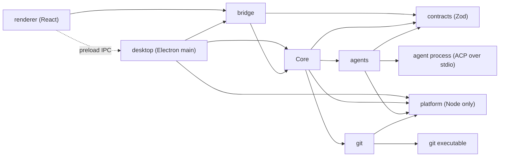

# Architecture

Status: implemented. Code60 is an Electron desktop application for macOS and Linux.
The background scheduler retains an internal headless executor; there is no public Code60 CLI.

## What it does

`code60` runs coding agents in parallel. Isolated runs get their own worktrees.
Desktop chats checkpoint human requests and automatically integrate isolated
working-file changes at safe turn boundaries, with message-level Undo. Scheduled runs retain review-only worktree behavior.

Project workers and Scheduled Jobs require a Git repository with an initial commit. Relay may explicitly execute in a direct folder (see [Runs without a worktree](#runs-without-a-worktree)).

That is the whole product. The tool talks to agents over the [Agent Client Protocol](https://agentclientprotocol.com) (ACP), runs them from the Electron and React desktop app or its independent scheduler, and keeps only the plain files it needs to show what happened.

## Relay and multi-project architecture

The Relay architecture replaces database-wide orchestration.
The rules in this section take precedence over the single-project descriptions
below. Desktop conversations are Relay or project-bound chats. Database-wide
legacy chat files are not loaded into interactive conversations, migrated,
assigned to projects or deleted. Explicit read-only RAG snapshots are the
exception for searching existing database-associated history.
See [Relay implementation status](docs/relay-implementation.md) for available
features, resource bounds and remaining native-platform validation.

- Relay is one application-owned logical conversation, available without a database.
  Project chats belong to individual open projects. Selecting or expanding a
  project changes presentation, never Relay's authority.
  Home is the first sidebar page-list destination, with a Phosphor house icon
  and a database-independent launchpad, followed by Search, Assistants, Projects and Providers.
  Assistants is a database-independent navigation home containing exactly two
  title-only cards: Relay and Custom Assistants. Its sidebar heading opens this
  page without toggling its children; the separate chevron retains saved expansion
  and the supplied speech-bubble icon. Cards reuse Home artwork, gating, focus,
  pending/error handling and existing navigation without connecting a provider or
  starting work. Relay and Custom Assistants breadcrumbs link back to Assistants.
  Closed contents are inert; closing recursively collapses nested disclosures,
  and explicit destination navigation reveals its ancestors without starting work.
  No new execution authority is introduced. Home
  uses the standard page title position and “Welcome to Code60” above exactly six title-only feature cards,
  ordered Relay, Custom Assistants, Search, Projects, Apps and Sessions. The Relay card selects Relay
  and clears worker selection; Search and Sessions require a database, while
  Custom Assistants, Projects and Apps do not. The Custom Assistants card opens management,
  not an agent conversation or provider connection. Cards adapt to narrow
  layouts and enlarged text, with shared keyboard focus and theme colors.
  Startup remains on Chat. Search is a regular labelled sidebar page tab with
  selected, disabled and arrow-key behavior; there is no utility row or sidebar wordmark.
  Relay uses the locally bundled pet animation. Projects uses the supplied project-initiation animation and contains the
  open project headings. Project chats
  indent one 24px step beneath their project; owned workers indent one more step
  beneath their conversation. Project labels navigate without toggling their disclosure. Project conversations expose separate Rename and Archive buttons and retain a context menu;
  project rows use a red circular × with the “Close Project” tooltip. That icon
  invokes the existing confirmed Stop Folder operation, keeping the project open
  while stopping its project-owned work and Relay workers in the same folder. Each project row puts a circular + before the red × and a circular disclosure
  chevron after it. The + starts the existing project-bound New Session flow
  without changing expansion. The project name opens its home without toggling;
  only the dedicated chevron controls project expansion, including on keyboard
  activation. Selection and ancestor hiding preserve the project disclosure state. Rows retain highlights across the navigation area inside a 12px right gutter. Conversation menus anchor to
  their trigger and remain within the viewport. The Projects heading has a circular “+” action immediately left of its circular
  disclosure chevron, opening the existing project modal when connected or database
  connection flow otherwise. It remains available when collapsed; the list contains
  only project entries. This placement change adds no capability and requires no
  self-knowledge catalog change.
- Desktop host, Relay service, project host, execution host and database services
  remain in `src/desktop`. Do not construct a DesktopController per project.
  Core stays Electron-independent and receives explicit workspaces/dependencies.
  ProjectHost owns retained runtime identities and database-instance epochs.
  Each runtime owns its workspace, batches, history, review/task state, file
  context and project conversations. Async work captures its runtime before
  yielding; callbacks bind that owner explicitly, never the selected directory.
  Selection changes presentation only. Closed or replaced runtime identities
  cannot acquire authority again, even when the same path is reopened.
  Project review/task/Git requests carry the runtime UUID and database epoch.
  Bind the owner unconditionally before asynchronous work, including requests
  for the currently selected project; a path alone cannot identify a live owner.
  Command, configuration and prompt-template writes carry the database epoch
  captured by the originating view. Validate it again inside the action queue;
  never obtain a fresh epoch to make a stale action succeed.
  Database selection and project-history actions use that same captured epoch.
  Native pickers run outside the queue and recheck it after every dialog, then
  again inside the queued operation. A delayed picker cannot replace or modify
  a newer database, including a reopened instance of the same SQLite path.
  Relay activity never blocks database selection or becomes database-owned work.
- An execution target is a canonical directory with an opaque identity, independent
  of Git, database membership and open-project history. Project chats may use only
  their bound target and must use isolated worktrees.
- Relay alone may accept a required, bounded absolute `cwd` through its
  authenticated MCP gateway, with explicit `direct` or `worktree` mode. Main
  canonicalizes and rechecks directory identity before launch. No renderer process,
  command, environment or arbitrary filesystem capability is added. The configured
  verified provider and the harness's permission decisions remain authoritative.
  Never fall back between modes or retry in a different directory.
  Keep filesystem device/inode comparisons at full integer precision, including
  identities above JavaScript's safe-number range. These internal
  identities are not renderer capabilities or persisted execution authority.
- Explicit direct mode runs in the exact directory, even inside Git. Host-owned
  bounded folder preimages cover files before execution; Undo also rewinds manual
  edits since that snapshot and must warn explicitly. This is not isolated
  application/discard. Worktree mode requires a valid Git base.
  Existing run-record formats remain readable.
- Relay lives in `$XDG_STATE_HOME/code60/relay` (default
  `~/.local/state/code60/relay`). `state.json` sits outside `workspace/`, its
  persistent ACP/process directory. Validate private permissions,
  same-handle bounded reads and atomic writes. Never initialize Git, associate it
  with a database, or remove it on shutdown. Missing workspace data, malformed
  metadata and unsafe storage require explicit recovery. An exclusive writer
  lock never displaces a live or unverifiable owner.
  A persisted history gap remains recorded but permits a fresh connection when
  the journal passes validation. Retry clears a transient write-failure latch
  after validation succeeds. Damaged frames or changed journal identity still
  block connection; a history gap alone never permanently disables Send.
- Relay journal writes coalesce adjacent fragments of the same message and flush
  after 50 ms, at 64 KiB, at turn completion, and before reconnect/shutdown.
  The serialized writer bounds queued plus in-flight text to 1,048,576 UTF-16
  code units and 1,024 records. Each batch shares a file sync.
  A journal failure stops that generation's journal writes, releases queued
  buffers and marks history incomplete where possible. The live conversation
  and worker delivery continue with a separate history-saving warning.
  Explicit reconnect validates storage before creating a new writer. Partial
  batches are never replayed. Diagnostic records retain the first failure's
  stage, allowlisted code, queue sizes and changed identity fields, with
  incomplete-marker failure recorded separately. No source or raw error is logged.
- After verified setup, startup creates a fresh ACP session automatically, without
  any prompt. It never restores native provider context, worker ownership, task
  authority, gateways, pending plans or feedback. Only a human Send creates live
  authority and attaches prepared history, once. Failed connection exposes Retry,
  not an unbounded reconnect loop.
- One history-window builder supplies retained historical evidence and first-Send context.
  The Relay screen shows the live conversation and composer. It has no separate
  historical transcript panel, history paging buttons or historical Copy controls.
  The live Relay transcript retains up to 1,000,000 serialized UTF-16 code units,
  evicting oldest events only when that character budget is exceeded. It has no
  event-count limit, so tiny streamed fragments do not prematurely evict text.
  Historical labels, summaries and partial-excerpt markers count toward 64,000
  Unicode characters. Prefer complete recent messages, preserve structured records,
  omit duplicate raw ACP/tool payloads and never split a Unicode character.
  Older source stays on disk, with explicit bounded paging and exact-source Copy.
  Copy may read only a pinned message through expiring opaque source cursors.
  Pin the journal's exact native identity and nanosecond change stamps for the
  lifetime of the reader. Serialize bounded journal I/O with its own appends,
  not conversation turns. Only verified local appends advance that stamp;
  replacement or outside modification invalidates Copy, even for valid UTF-8
  with unchanged size. Check the handle and directory entry after each read.
  Each source read is bounded and runs outside lifecycle/turn queues; it never
  grants filesystem paths or execution authority. Renderer clipboard access stays
  unchanged. An explicit full-message Copy is separate from bounded display pages.
  Tail reads/indexes, event buffers and UI pages must remain bounded; incomplete
  evidence is visibly incomplete. This is not transcript retention or a cap on
  the uninterrupted harness session's own context.
- Worker authority is conversation identity, live generation, human-authorized
  task, target and owned run. Scope tokens are ephemeral. Capacity is reserved
  before asynchronous preparation and includes idle workers across all targets.
  Deduplication includes target and mode; metadata failures after acceptance never
  permit redispatch. Manual batches and project chats retain independent limits.
- Serialize lifecycle changes briefly, controls per target and turns per
  conversation. Expensive reads run outside control queues. Git record writes
  coordinate by canonical common directory; apply/undo remains checkout-local.
  Worktree create/remove, internal task snapshots and initial-commit metadata
  operations share an in-process queue keyed by canonical Git common directory,
  across Git instances and linked checkouts. Independent repositories proceed
  independently. Revalidate directory identity after waiting. Queued cancellation
  performs no mutation; cancellation after starting awaits subprocess cleanup.
  Git's own filesystem locks remain authoritative across processes. Never remove
  a Git lock or hold this metadata queue over working-file integration/Undo writes.
  Interactive run shutdown cancels queued worktree creation without waiting for
  another owner's metadata operation. Started worktree commands use owned process
  trees and settle cleanup before shutdown returns. Scheduled execution keeps
  its existing subprocess behavior.
- Freeze instructions per human request. Baselines, worker assignments, plan rows,
  results and reviews are target-qualified. Human Accept authorizes the specific
  plan revision and target assignments. A target change requires new acceptance.
  Relay operating instructions never follow database prompt overrides.
  Relay review workers pin their accepted canonical worktree, native directory
  identity, branch and base. Capture and application reject record redirection
  or directory replacement, even within the same Git common directory. Older
  unpinned evidence remains readable but cannot be recaptured or applied.
  Review index rollover writes one new page before advancing its manifest. A
  validated single-entry next page after a full page completes that interrupted
  publication on reopen or append. Invalid or ambiguous pages fail visibly and
  remain untouched; recovery never reinstates execution authority.
- Open-project views survive navigation and dispose on actual close. Closing a
  project stops only project-owned work after confirmation, not Relay workers in
  that folder. Folder stop explicitly includes them and pauses replacement for
  that task/target; other targets continue. Stop all pauses automation and stops
  orchestrator turns and all workers.
- Desktop also persists the ordered open-project set per database in private,
  versioned `.code60_workspace/sessions/<database-path-sha256>.json` metadata.
  Validated bounded reads and serialized atomic writes retain at most 64 canonical
  paths, never runtime IDs or execution authority. Successful database connection
  reopens those projects with fresh runtime identities and stopped saved chats,
  leaving Relay selected. Transcript events load only on explicit chat/project
  selection. Successful opens and confirmed closes save the set; navigation and
  shutdown teardown do not. Missing folders warn without blocking other restores
  or recreating folders. Unavailable entries retain their order and capacity
  across unrelated opens/closes until that saved project is explicitly closed.
  Invalid session files remain untouched. Chat titles,
  archive state and provenance retain their existing storage; unsent drafts are
  not restored. No workers, gateways, pending plans or uncertain work resume.
- Database replacement disposes database-owned work only. Database tool requests
  carry an instance epoch and reject stale requests. Shutdown, renderer crash,
  signals and updates attempt cleanup for every owner, collect failures and retain
  forced escalation. Relay is not a detached daemon.
- App summaries and scoped detail subscriptions carry explicit identities,
  generations and monotonic revisions. Subscribe before reading, buffer updates
  and resynchronize on gaps. Inactive summaries stay small. Relay's file view
  explicitly selects its own workspace or a target, never the selected project.
  Poll by application/database/target keys, deduplicate shared stores and read
  previews/sizes only for visible requested views; agent results stay pushed.
  Relay worker transcript tools page the same bounded live target event window,
  not a lifetime `events.jsonl` read. Responses identify the window revision and
  incompleteness; cursor positions belong to that window. Original run evidence
  stays on disk. Project and headless record-reader contracts remain unchanged.
  The polling registry partitions application configuration, database-instance
  tables and target-runtime sources. It resolves the owner synchronously before
  installing a flight. Each scope retains its own single-flight, failure history
  and timers; navigating never invalidates another live target's reads.
  Closed scopes stop scheduling and discard late results. Visibility gates
  target previews and worktree-size scans without retargeting their callbacks.
  Detail subscriptions use a generated subscription UUID plus an explicit
  project-instance/database epoch, conversation/generation, or execution-target/
  Relay-generation address. Main captures that owner when subscribing, before
  any initial read. Detail frames carry their own predecessor revision; full
  reads use no predecessor. Closing/replacing an owner emits a terminal frame,
  never a frame for its replacement. The registry is bounded to 128 concurrent
  subscriptions, clears on renderer reload/shutdown and isolates listener errors.
  Subscribing and reading never select a project or grant execution authority.
  Detail publication checks owner-local change versions before constructing
  payloads. Unrelated project, Relay-target and file-root updates do not reread
  or rebroadcast an unchanged owner. Still check validity on every app publication
  so a closed owner emits its terminal frame. Listener and release failures cannot
  prevent publication or cleanup for other owners.
  App summaries include only each active detail subscription's last publication
  revision (at most 128 UUID/number pairs). A missing final detail frame therefore
  triggers that subscription's bounded full-read recovery, without copying an
  unchanged owner on unrelated updates. Hints received during an initial or
  recovery read are checked before installing its result.
  Explicit hidden worktree inventory reads omit recursive sizes. A visible size
  scan checks its captured owner and visibility throughout traversal, stopping
  on navigation, hide or close rather than finishing an unwanted filesystem scan.
  Default worktree listing behavior is unchanged.
  Renderer detail readers share the app stream's bounded subscribe-before-read
  recovery protocol, but merge on their own revisions. Retained caches are keyed
  by the complete owner address and pruned on close/generation replacement.
  Inactive conversation summaries carry constant-size reply counters and compact
  plan status/progress summaries, not transcripts or full plan documents.
  Each open-project entry also carries compact worker summaries, so inactive
  sidebar workers receive new IDs and status changes without transcript reads.
  Cached project detail frames may fill prompt/event data, but cannot rewind
  newer worker metadata from app summaries.
  Reply counters preserve unread badges without history reads. Plan status
  comes from the app summary, atomically with selection, never ahead of it
  through a detail frame that could reopen a background conversation's plan.
  The production app stream is summary-only, including the selected conversation.
  Its fixed summary read supports initial load and gap recovery; explicit legacy
  snapshot reads remain full for existing callers. Summaries omit transcripts,
  history windows, worker prompt bodies, files, worktree listings and review data.
  Selected project/conversation/Relay-target details supply those views. Worker
  reply counters are pushed with run summaries, without transcript reads. App
  revisions cannot advance detail-data fences or replace retained detail content.
  A selected Relay worker subscribes to its exact target/conversation/generation;
  navigation releases that subscription, while cached data has the same complete
  address and is pruned on generation replacement. Status and plan selection stay
  authoritative on the app stream, even if a detail frame arrives first.
  Relay worker windows are bounded separately per target (512 events and 256,000
  serialized UTF-16 code units each), with at most 256 targets. Activity in one
  folder cannot evict another folder's visible history. Compatibility full reads
  retain one bounded aggregate window. Truncated target evidence is labelled;
  original worker records remain on disk. Clear windows on generation replacement.
  Relay file views explicitly select its workspace or an owned execution target.
  A file context names an existing Relay conversation/target detail subscription,
  an increasing view sequence, expanded relative folders and one optional relative
  preview. It accepts no root path, project address or filesystem capability.
  Main resolves and rechecks the canonical root and generation before and after
  reads. Unsubscribe/reload invalidates the file context, including in-flight
  requests; late context changes cannot overwrite a newer sequence.
  Cache and schedule file reads per root through the existing Poller, with shared
  single flights, bounded listings/previews and independent failure history.
  Only active, visible requested file views schedule previews. App pause/settings
  apply to those pollers; project/database navigation does not retarget them.
  Files travel on the addressed detail stream, not inactive app summaries.
  File contexts are bounded to 16 concurrent views. Identical requests to the
  same canonical root share a read; different roots retain independent failures.
  Explicitly opening Files chooses Relay workspace initially and offers only
  currently owned targets. A root change replaces file tabs, never plan tabs.
- Relay reviews belong to its private application store, not a project database.
  Persist conversation/generation/task, opaque target, canonical cwd, exact native
  directory identity, workspace mode and the already captured default baseline.
  For Relay records the legacy `project` key is the logical Relay UUID, never a
  path capability. Keep worker-turn assignments with their originating task.
  Saved provenance permits evidence reads, not restored worker authority.
  Load individual bounded review records on demand through private same-handle
  readers. A paged compact creation index must not turn the complete lifetime
  review collection into startup work or an in-memory collection. Preserve old
  records on disk. Reuse immutable review contents and checkout-local TaskLoop
  journals, seeding its baseline from first-default-dispatch capture rather than
  recapturing at Accept or integration.
  Relay-only review requests carry current conversation/generation plus generated
  target/review/revision/file IDs, never a renderer-supplied cwd or project fallback.
  Historical reviews remain readable; feedback requires live originating task,
  generation and worker-turn ownership. Restart fails pending delivery and never
  reconnects saved workers or feedback automatically.
  Group Changes by target, splitting bounded worker groups rather than silently
  dropping assignments. Direct targets show their actual cwd, transcripts and
  snapshot warning. Automatic isolated integration remains checkout-local and
  revalidates native target identity, immutable sources and affected files.
  Navigation and database replacement do not retarget it.
  Push a constant-size review revision hint with Relay metadata, not review
  collections or file contents. An active conversation or Changes view reads its
  bounded index page; only requested controls/diffs load individual review content.
  Conversation timeline reads project at most 32 review records into compact
  metadata per page, without reading immutable file bodies or loading lifetime history.
  Renderer reload cancels human reads/operations
  without revoking Relay's worker assignments or replaying feedback.
  Worker summaries may retain an opaque review link even if creation-index
  persistence failed. It identifies saved evidence only, never a path capability.
  Settled isolated worker turns schedule bounded, coalesced automatic captures.
  Background capture yields to explicit worker actions and human review operations;
  eligible captures integrate through the active request's durable write journal,
  without replaying work or treating captured bytes as success. Captures revalidate
  source ownership before publication; shutdown cancels and settles them.
  Project chats and Relay render one quiet files-changed link per request.
  Ordinary-chat corrections share the existing composer. Older snapshots remain
  in Changes; zero-edit turns have no empty card. No feedback forms, line inputs,
  review checklists, Preview application or Apply controls remain in normal Chat.
  Side-panel revision/application tabs remain read-only and pinned. No revision
  arrival opens a panel, steals focus or changes the main composer draft.
  Freeze the actual completed turn outcome in each capture. An interactive
  session returning to idle is not evidence that its last turn succeeded.
  Application tab metadata is observable, but its contents are not agent-readable
  through desktop awareness. Existing native confirmation and ownership checks apply.

### Conversation checkpoints and message Undo

Persist a checkpoint before editable human work, with additional direct targets
covered before execution or follow-up. Direct preimages are content-addressed and
deduplicated across checkpoints, exclude Git and Code60 state, and reject links,
unsupported paths, more than 10,000 entries per folder, 64 directory levels or
32 MiB total source contents before editable launch. Charge quota before private
snapshot writes, including interrupted captures. Recorded rollback storage is
bounded to 256 MiB; retain at most 100 prior request checkpoints. Journal payloads
remain independent of bounded display diffs.

Checkout leases include overlapping parent/child roots. Covered direct children
share their parent's snapshot; enlarging coverage to a parent after execution
is refused until a new request. Both preimages and current Undo reads share the
32 MiB aggregate direct-content bound. A live older worker's integration belongs
to the checkpoint active when its serialized checkout write begins, even when
capture reads span a newer human request. Preserve immutable capture associations
on unchanged recaptures and retain one latest capture per review per request.

Undo belongs beside Copy on the latest human message, including zero-edit turns.
Confirm the request, targets, unsent-draft replacement and the direct-folder
manual-edit warning. Stop and drain only owned work, invalidate late results,
preflight every target, then execute guarded inverse journals. Isolated conflicts
block rather than overwrite newer edits. Preserve Git HEAD/staging. Rewind the
active transcript, tasks, plans, scoped memory and continuity; keep discarded
evidence privately. Return the original request and exact saved-code references
unsent. Retire provider context
and hand off only surviving history on the next Send.

Interrupted multi-target restoration and conversation rewind are approved durable
recovery exceptions, resumed only explicitly, including when no provider remains.
Restart never replays work.
Legacy unapplied reviews remain read-only and never integrate automatically;
preserve existing journals and explicit recovery. Checkpoints are not Git commits
or machine snapshots and cannot reverse external effects.

Deferred: workspace relocation, durable recovery, automatic task continuation,
RAG, semantic retrieval and automatic history retrieval outside the window.
SQLite remains schema 5. No bulk transcript moves/deletions or implicit legacy
imports are permitted.

## Non-goals

### Approved scheduled automations

An Electron-independent `automation` module owns local scheduled execution, private
metadata, restart reconciliation and authenticated local IPC. Durable schedule
metadata and persisted occurrence claims are approved exceptions to durable recovery
being deferred. There is no durable task queue, catch-up, retry or exactly-once
guarantee. Relay remains desktop-owned, not a daemon.

Intervals are anchored elapsed time; daily/weekly schedules use a saved IANA zone.
Skip nonexistent local times and use only the first repeated local time. Persist
claims and advance recurrence before launch. Never replay uncertain work. Dispatch
at most one automation globally and record busy/missed occurrences rather than queue
them. Pause affects future runs; editing never changes an active snapshot.

The service is the sole metadata writer under the private application state
directory. Bound reads, check revisions, write atomically and hold an exclusive
writer lock. Live or unverifiable ownership blocks recovery. Preserve history and
worktrees. Persistence failure and low space stop dispatch.

Use core headless single-turn execution with mandatory worktrees, the saved local
base branch resolved at launch, explicit deny-by-default permissions and no MCP or
implicit memory. Pin repository and provider identities; changes require review.
Worktrees are not sandboxes. Never automatically merge, apply, commit or push.

Installation requires consent. Use per-user launchd or systemd
without linger. No TCP or hosted service. Desktop controls use the automation public
API; the renderer uses narrow validated preload methods and opaque repository IDs.
Desktop shutdown and Stop all do not stop service-owned work.
The database-independent Scheduled Jobs page is nested under Apps, alphabetically
before Command Builder in both display and keyboard order. Its Apps home card opens
the same page and remains enabled without a database. The quit dialog explains that
background automations continue. Apps → System Manager owns the Scheduling Service
status, install/repair/start/stop/uninstall, resume and recovery controls,
separate from Scheduled Jobs's schedule accordions and history table. System Manager
has its own Apps card, sits alphabetically after Prompt Builder, and remains
available without a database. Both pages defer hidden reads, refresh from pushed
service notices and preserve native consent for service changes.
System Manager also checks status two seconds after each completed read while the
page and document are visible, respecting global Pause polling. Failed or
unavailable checks back off to at most sixty seconds and reset after recovery.
Background reads coalesce with the current flight, leave controls interactive and
retain action failures. Visibility changes discard stale replies; leaving the
page or pausing polling disposes its timer. Initial and explicit reads remain
available while automatic polling is paused. This adds no poll-source key.
The existing scheduler/status UI request returns typed installation, native runtime
state and optional live health without installing, starting or repairing anything.
Validate the registration's installed flag against its native definition; false
uninstall markers are not installed. Invalid/inconsistent metadata and failed native
inspection show Status unavailable. Bounded launchd/systemd reads distinguish an
inactive job from an unavailable supervisor. The live scheduler protocol is unchanged.
System Manager shows Not installed (dashed neutral badge, Install), Stopped (solid
neutral badge, Start), and verified Running (compact blue badge, Stop). A running
standalone scheduler is also labelled Not installed and offers Install instead of
native Stop. Jobs paused and active execution remain separate annotations. Checking
and unavailable states never guess a main lifecycle action; explicit Repair remains
under Service options for recovery, with Uninstall only for verified installation.
Keep pending action feedback beside the last verified state, suppress competing
actions and refresh afterward, including failures and declined confirmations.
Stop is the sole main action for an installed running service, pausing jobs and
cancelling active work before stopping the process. Do not show a separate
pause-and-cancel button. Resume jobs remains secondary for existing paused state,
including after Start; starting the process never resumes jobs automatically.
Preserve single-flight reads, hidden-view disposal,
stale-response rejection and native consent. Use the shared neo-brutalist tokens,
saved typography and forced-color system edges without bright dark-mode panels.
No new preload method, setting, persisted schema or migration is introduced.
Open execution transcripts subscribe before reading, coalesce saved-chunk notices,
assemble adjacent text chunks and show the saved execution outcome. Closing, hiding
or replacing the modal releases its subscription and rejects late reads. Evidence
reads share the core run writer queue to avoid partially appended JSONL records;
stream notices do not mutate schedule revisions.

### Approved agent memory

The shared right sidebar includes a human-opened, closable and reorderable Memory
Recall tab in Relay, project chats and all worker chats. Relay workers can use it
without a database. It follows the displayed chat's full runtime, conversation,
generation, worker/run and target identity, independently of file roots and project
selection. Existing turn-associated `Memory used` notes are the only recall index:
validate their UUIDs and resolve only those IDs through memory detail. Never
rerun retrieval, browse unrelated records, open the panel or steal focus on recall.
Render recorded turn groups newest first in five-turn pages, including the latest
dispatched zero-hit turn; a newer turn clears the earlier current-turn marker.
Only the selected visible tab in a visible document reads records or subscribes
to memory notices. Chat details remain pushed through their existing subscriptions.
Owner replacement, navigation, closing or hiding discards late results. A shared
four-read limit spans overlapping old/new requests; retain at most 160 record
summaries with evidence quotes, not source-message bodies or revision collections.
Saved IDs are not text snapshots. Label changed-since-recall saved records,
forgotten/missing placeholders and malformed notes. Omit introductory and
source-history gap copy from the tab;
never invent earlier turns or change transcript retention. Evidence is read-only
text; editing and forgetting stay in the Memories browser. Self-knowledge reports
only the tab's metadata and explicitly denies its contents, without new MCP tools.

Apps → Data Viewer → Memories is a database-independent, application-wide table
of persistent memory records. It uses the shared Glide table, saved filters and
presentation settings, with bounded cursor pages rather than loading the store.
Compact project/type/status selectors beside the title filter saved records;
table search, column filters and sorting apply to the current page. A compact
pager reports the page's record count. Pushed memory notices refresh the current
page without timers. Hidden pages retain filters and paging but defer reads;
stale replies cannot replace the current view. Selecting a row or pressing Enter
opens a compact Memory details dialog with readable attributes, editable text,
named project/conversation provenance, formatted dates and last recall, attributed
evidence quotes, expandable source messages with cited text highlighted, and
newest-first revision history. Raw IDs and offsets stay out of the presentation.
A sticky action row provides revision-checked edit, pin, resolve, promote and
forget actions; Save changes is enabled only for changed text or pin state.
Native confirmation still owns
global promotion and forgetting. Settings → Memory links to this shared browser,
without maintaining a second record list.

Desktop memory is an explicit exception to automatic semantic retrieval and
managed context handoff being deferred. Relay, project chats and workers may
receive scoped historical evidence and between-turn checkpoints. A separate,
private application `memory.sqlite` stores generated knowledge and learning checkpoints;
it never changes project schemas or grants persisted execution authority.
Automatic extraction uses the verified orchestration provider with tools denied.
Global promotion is human-only. Memory settings, source provenance, corrections,
suppression and bounded retrieval are owned by desktop; core receives optional
injected lifecycle hooks. Scheduler defaults and the manual RAG experiment stay unchanged.
Only completed, committed source ranges can advance extraction cursors. Provider
session replacement never replays a dispatched request or restores task authority.

Settings exposes one immediately saved application-wide Memory On/Off switch and
one retention policy: Never, 30 days, 90 days or one year for unpinned records.
Off stops learning capture, generation and recall, cancels pending learning,
discards unprocessed learning-only evidence and preserves saved records/citations.
On starts prospectively, without importing Off-mode transcripts or live context.
There is no daily generation limit or per-role/type/conversation override.
Private settings/schema version 2 migrates any restricted legacy configuration to
Off, preserves existing records and initializes deletion retention to Never.

Automatic context handoff is independent of saved memory. A bounded, session-local
continuity buffer and checkpoint remain available while Memory is Off; they are
never persisted as a learning backlog or used to create long-term memories.
Valid learning checkpoints may be reused only when their evidence matches the
uninterrupted learning-enabled live buffer. Handoff still runs only between turns,
with tools denied and no restored permissions or task authority.
Retention deletes expired unpinned records and derived revisions/vectors in bounded
sidecar batches, retaining shared evidence required by surviving records and
suppressing recreation. Shortening retention requires a main-owned count preview,
native confirmation and revalidation. Maintenance runs independently of Settings.
Search indexing retries automatically with bounded backoff; manual repair is shown
only after those retries fail. Scheduled automations and manual RAG are unchanged.

Exception for the desktop RAG experiment: Settings → Advanced → Experiments → RAG
manually snapshots all saved/live orchestration chats and workers across the
connected database's registered projects, including archived/stopped conversations
and legacy directory histories. It includes retained and closed project chats,
with project provenance, and reads live worker events from each captured owner.
The application-owned Relay conversation is not database-associated and is excluded.
It indexes only human prompts and assistant text.
Core reconstructs streamed messages, chunks exact source spans (512 total model
tokens, up to 64-token overlap), validates normalized vectors and ranks cosine
similarities with stable ties. The injected embedder separates document/query
operations. Desktop alone owns discovery, storage and CPU inference.

Jina Embeddings v2 Base Code INT8 (768 dimensions) and its tokenizer are bundled at
a pinned revision and SHA-256 hashes, prepared explicitly with `npm run prepare:models`.
Transformers.js is pinned. Model loading, embedding, index parsing and ranking run
in a lazy, bounded Node sidecar using the Electron executable in Node mode, not in
main or the renderer. Masked mean pooling and L2 normalization follow the model card.
Remote model loading, filesystem caches and runtime downloads are disabled.
Packages unpack the native ONNX/sharp runtime and include model provenance and
Apache-2.0 notices. Only the target ONNX CPU binaries are shipped.

Private, versioned JSON generations beneath
`.code60_workspace/rag/<database-path-sha256>` store conversation provenance,
message ordinal, original offsets/text and little-endian float32 vectors encoded
as base64. Model, chunker, database, source and vector identities are checked.
The database schema, Search and MCP tools are unchanged. Future repository
sources must add a distinct versioned source kind, not misuse conversation fields.
An atomic manifest replacement publishes a completed generation. Failed/cancelled
builds keep the old manifest; native-confirmed Clear deletes only derived RAG files.
There is no auto-indexing, generation, agent access or repository indexing.

Rebuild/retrieve/clear are single-flight outside the controller action queue;
strict bridge requests carry only opaque database/request identities and bounded
query text. Status and progress are pushed. Queries are limited to 8,192 characters
and 512 total tokens and return at most ten text-only chunks. Reads are bounded
(1 MiB records, 32 MiB transcripts, 128 MiB snapshot, 1 MiB per message);
an index supports 2,000 conversations, 10,000 chunks and 96 MiB persisted data.
Limit or unreadable-source failures are explicit, never partial successes.
Read-only orchestration history and strict project listing avoid reconciliation
writes and silent corrupt-record skipping during indexing. Chat metadata snapshots
reserve a read between the existing ChatStore's pending and subsequent atomic
writes, without entering the controller action queue. Cancellation targets
the current request UUID and runs on database replacement, renderer reload/loss,
Stop all and shutdown. Sidecars are stopped before unfinished generations are
removed. Page changes retain query/results; database changes reset them.

Exception for Tactics and stopped orchestration chats: a browser-safe versioned
catalog supplies eight bundled prompt workflows. Only the composer opens the
searchable native Tactics modal. Preview is distinct from Apply; Apply and Remove
persist selection without sending, dispatching, or modifying the draft. The bridge
accepts only chat/project identity and a trusted catalog ID or explicit null.
Unavailable saved IDs require replacement or clearing.

Desktop ChatStore persists versioned private metadata in
`.code60_workspace/chats/<generated-directory-id>.json`, bounded to 500 records,
16 MiB each and 1,000 task contexts per chat, with a 64 MiB metadata read budget.
Run records are read at most 1 MiB and transcripts at most 32 MiB per read.
Only the selected stopped chat loads transcript events and plans; other histories
load on explicit selection. Oversized history remains on disk with an actionable
error, never an empty or silently truncated successful recovery.
Atomic private writes and bounded same-handle reads reject symlinks and malformed
records. Each human Send freezes the effective tactic ID/version/full prompt.
Legacy absent selection leaves ordinary delivery unchanged; an explicit removal
sends a no-tactic context. Worker-turn assignments, saved plans and review feedback
retain their originating task context, with automatic updates batched per task,
not by the currently selected tactic. The operating contract remains authoritative;
typed text and dollar-command expansion retain their existing separation.

Full restart restores titles, archive/selection, existing transcript references,
and task provenance as stopped history. It restores no gateway, worker ownership,
deduplication, automatic inbox or plan authority. Continue task explicitly uses the
frozen task instructions; Send is a new request with the current selection. ACP
restore/fresh handoff keeps existing process/provider checks and re-establishes a
new scoped gateway only on explicit continuation. Saved plans remain paused until
human continuation and revised plans still need Accept. New authorized desktop
work integrates automatically through request checkpoints. Roles, review stability and correction limits are prompt instructions,
not a hard workflow engine or additional worker permissions. Failed/incomplete
evidence must not be represented as verified completion.

Exception for orchestrator plans: a conversation may save Markdown task lists in
`<chat working directory>/plans`, with versioned private records in `.code60/plans`.
Only a human Accept action authorizes the displayed revision. The orchestrator reports
completion with evidence notes; this does not approve or merge worker changes. Drafts
block new worker work in that conversation. Plans use existing between-turn delivery,
not a durable job queue; restart never restores execution authority. Failed or paused
execution requires explicit continuation. Plan tabs share the Chat side panel and show
an equally weighted completed/total progress bar and “X out of Y” outside the document.
Each task row shows a read-only completion checkbox centred on its first line of text, a
written status (Pending, In progress, Blocked, Completed) and its evidence note aligned
with the task text.
The right sidebar offers View Plan for the displayed orchestration session's
latest existing plan, including after its tab is closed. It selects or reopens
that plan's tab without generating a plan or granting execution authority.
Plan records persist an immutable, conversation-local creation sequence, including
rewound records when allocating the next sequence. Summaries sort by this sequence,
so restart, atomic file replacement and edits to older plans never change which
plan is latest. This prerelease schema requires that sequence on saved records.
While Relay or a custom assistant browses project files, View Plan returns to
that conversation's own panel without putting its plan into the project file scope.
The action wraps within the 120px panel minimum with enlarged Button Text.
Other conversations' plans do not supply this action, including in worker views.


Exception for Chat review: desktop-only review records, immutable bounded file snapshots,
legacy human review decisions and pending feedback are persisted beneath the private
`.code60_workspace/reviews` directory beside the project database. This is not a general
job queue. Restart never automatically delivers saved feedback or grants worker authority.
Historical reviews remain read-only; they cannot silently become new work. New
requests use ordinary-chat corrections, automatic integration and message Undo.
run records and the database schema are unchanged.

Chat review groups workers by the human request that dispatched them. A Changes tab shares
the Chat side panel with project and revision-specific file tabs. Overlapping paths in
different workers remain distinct. Git snapshots use a temporary index and immutable blob
content, with limits and explicit unavailable/partial states. Revision selection remains
stable as new captures arrive. Add to chat carries an exact revision, worker, path,
side and line range into the existing composer without sending or replacing its
draft. Legacy feedback anchors, decisions and receipts remain private compatibility
evidence, not normal review controls. Saved provenance never authorizes a worker
mutation. Existing ownership, scope and recovery checks still apply.

New Chat tasks at the repository root share a frozen baseline of current saved files unless a
worker uses an explicit Git base. A temporary index captures tracked changes and eligible
untracked files while respecting Git ignores and excluding Code60 storage, common generated
files and known untracked credential filenames. Internal snapshot commits use
`refs/code60/tasks/` and leave HEAD, branches and staging alone. Each review revision can
reference immutable worker captures independently of bounded display text. Older reviews
remain readable without historical automatic integration.

Automatic integration combines isolated worker changes with the current project
at settled turn boundaries. Conflicts leave the project untouched and require
ordinary-chat corrections, never forced overwrites. Integration and message Undo
recheck affected files, serialize writes per checkout and record before and after contents in
private review storage. Interrupted writes require explicit recovery, which preserves newer
edits and reports unresolved paths. Worktrees and internal snapshots are retained. The
application supports regular files up to 32 MiB and bounds journal content at 128 MiB. Changed
links and submodules are refused.

These are deliberately out of scope. Add one back only when a real user needs it.

- Merging, committing worker changes to a project branch, pushing, or deciding whether a task succeeded. Exceptions for explicit initial commits and internal desktop task snapshots are described here.
- Retries, durable task queues, and exactly-once execution. A failed run is reported, and the user starts a new one.
- Automatic crash recovery. After a crash, the tool lists what was left behind; recovery starts only when the user sends a new message to an ended session in the desktop app.
- Storing credentials. Agents log in through their own CLIs. The scheduler passes the environment through unchanged; desktop startup enriches only PATH to discover installed tools.
- Settings profiles, workspace trust, imported project settings, and settings export. The desktop app's saved run configurations (see [Desktop app](#desktop-app)) are the one exception: named batch settings stored in the project database, never applied to the CLI or the config file.
- CLI orchestration services, external ACP servers, and arbitrary agent-to-agent communication. Only the desktop Orchestration Chat may dispatch and control its own workers in the open project through the scoped MCP tools described below.
- Agent-controlled session save and fork; steering (prompting an agent in the middle of a turn); and model changes during a turn. Between-turn model changes and follow-up prompts are supported in the desktop app only. Explicit ACP restoration of ended desktop runs is described in [Ended-run recovery](#ended-run-recovery).
- Budgets, cost tracking, and usage totals. The desktop shows only the current context occupancy reported by the harness.
- Workspace capacity limits, transcript retention, and Worktrunk hooks. The read-only Worktrees tab measures logical file sizes when it is opened and in the background while it is visible, but does not enforce limits. Private desktop diagnostics are the focused retention exception described below.
- File watching. The desktop app polls external state on a schedule (see [Polling](#polling)) instead.
- Shared or remote Code60 servers, and coordination across machines. User-configured remote MCP tool servers are supported as described below.
- Sandboxing. A worktree is not a security boundary, and the agent runs with the user's permissions.
- Windows desktop execution and distribution.

## Desktop diagnostic logging

Desktop startup alone enables an optional typed log sink in core and agents. The
scheduler does not construct a desktop diagnostic store or enable capture. Browser-safe record/query schemas live
in contracts and cross the bridge through its existing entry point. Desktop owns
the focused JSONL store, not SQLite or the transcript store.

Diagnostic records use version 1, generated record/launch/operation UUIDs, UTC time,
fixed component/event/message values, severity, outcome, optional duration and
allowlisted provider/run/project identifiers and error categories/codes. Project
identifiers hash the project directory; paths are never recorded. Each turn has its
own correlation ID even when turns overlap. Streaming chunks and successful polls
are not diagnostic events. Persistence failures are coalesced per run.

Storage is `$XDG_STATE_HOME/code60/logs` (default `~/.local/state/code60/logs`),
separate from transcripts, preferences and databases. Diagnostics alone retain up
to seven days and 20 MiB total, including active segments. Startup writes, reads
and writes prune storage; queries also check record expiry. Private segments rotate
at 256 KiB or one minute. A shared exclusive directory lock serializes every app's
pruning, append, clear and query, with a 300 ms acquisition deadline. Live or
unverifiable owners are never displaced; dead-owner locks become reclaimable after
30 seconds. Unique owner filenames prevent stale reclaimers deleting a new owner's
file. POSIX ownership and private modes reject unsafe storage.

Capture validates an allowlist before serialization. It accepts no arbitrary text,
exceptions, prompts, transcript fragments, raw ACP/tool payloads, environments,
commands, arguments or absolute paths. No approved free-form diagnostic text is
currently stored; any future approved text must use existing credential redaction
before UTF-8-safe truncation. This is not encryption or an anonymization guarantee.
Records are capped at 2 KiB; pending capture is bounded by 512 records and 512 KiB.
Logging failures never throw into lifecycle operations or recursively log themselves.
Shutdown flushing waits at most 500 ms. Dropped records, persistence failures in
this launch, and malformed/truncated retained records appear explicitly in the viewer.

Apps → Data Viewer → Logs sits alphabetically between Events and Messages and has a palette
entry. It remains usable without a database. Compact selectors beside the title choose
current-project scope (including app events) or all projects and the current launch; all-project, launch, severity, component, provider, run, outcome and time
filters apply to retained history, not just the page. Shared DataTable column
settings and saved filters are reused. Search/filter changes discard stale responses.
Pages contain at most 200 records and use bounded, five-minute opaque cursors.
Cursor snapshots pin file byte boundaries, including same-millisecond writes.
Main retains at most 128 cursor tokens and 2 MiB of estimated snapshot metadata;
the viewer retains a 128-page back stack but can keep paging into older history.
Refresh always returns to the latest page. Evicted,
expired/cleared/restarted cursors require an explicit latest-page refresh. Column
sorting is page-local. Clicking a row or Enter opens structured details and Copy
record. Main-process notices are batched at 40 ms; there is no renderer fetch timer.
Paused, selected, scrolled and older-page readers are not moved by live notices.
Viewing pause never pauses capture. Clear logs requires a native confirmation and
touches diagnostic segments only, never Events/transcripts, databases or run records.

For diagnostics, preload exposes only `queryLogs`, `logDetail`, `clearLogs` and a payload-free
`onLogsChanged` subscription. Main checks the sender and bridge validates strict
bounded requests. No request accepts a path; no agent or MCP tool can access logs.
The seven-day/20 MiB policy does **not** expire or limit existing transcripts.

## Modules

Desktop stdout/stderr are optional terminal output: the GUI may outlive the
launcher that consumed them. Install stream-local EPIPE guards before desktop
dependencies can log, so a closed pipe cannot produce an Uncaught Exception
dialog or interrupt work. Other stream errors still propagate; do not install
process-wide exception suppression or apply this policy to MCP protocol stdout,
agent transports, scheduler output or persisted diagnostics. This reliability
fix introduces no capability, setting or stored schema; no catalog change is needed.

| Module | Source | Responsibility |
| --- | --- | --- |
| Desktop | `src/desktop` | Electron main process: the window, native dialogs, the IPC handlers, one workspace with multiple independent run batches, and shutdown. |
| Bridge | `src/bridge` | The typed IPC contract between `desktop` and `renderer`, and validation of every request from the renderer. |
| Renderer | `src/renderer` | The React interface, built with Vite. It runs sandboxed, with no Node.js or Electron access. |
| Contracts | `src/contracts` | Browser-safe Zod schemas, shared value definitions, and the prompt templates sent to agents; no application or platform dependencies. |
| Core | `src/core` | Runs, the parallel scheduler, permission policy, run records, and leftover detection. |
| Automation | `src/automation` | Electron-independent scheduled execution service, private metadata, execution integration and local client. |
| Agents | `src/agents` | Starting an agent process, the ACP client, translating ACP updates into run events, cancelling, and killing the process. |
| Git | `src/git` | Creating, listing, and removing worktrees, measuring their logical file sizes, diffs, and status, using the `git` executable. |
| Platform | `src/platform` | Node-only leaf module for executable/environment resolution, owned process trees, native identity, path identity, and private storage. |



- `automation` depends only on `core`, `contracts` and `platform`. Pure recurrence lives in core; OS service primitives live in platform.
- `desktop` depends on `core`, `bridge`, `automation` and `platform`. `bridge` and `renderer` may import only types from `core`; neither may import `platform`. The renderer reaches the main process only through the preload bridge. Only `desktop` imports Electron, and only `renderer` imports React.
- `agents` and `git` never import each other or `core`. `core` receives them as injected interfaces, so tests can use fakes.
- `core`, `bridge`, and `agents` may import `contracts` through its index. `contracts` imports only Zod, never application modules or Node.js. It owns shared IDs, tool kinds, stop reasons, duration rules, and the [prompt templates](#prompt-templates). Record schemas live in `core`, IPC schemas in `bridge`, and config schemas in `core`. Zod code generation is disabled before schema construction to preserve the renderer CSP. Colocated contracts unit tests may import Vitest; production imports remain restricted to Zod, and all other boundaries still apply to tests.
- Domain logic lives in `core` and runs without the desktop app.
- `core`, `agents`, `git`, and `desktop` may import `platform` only through its index. `platform` imports no application modules, Electron, React, or provider SDKs. Bridge, renderer, and contracts remain browser-safe.

## A run

A run is one agent session in one new worktree (or, [without a worktree](#runs-without-a-worktree), directly in the current directory). It starts with one prompt (in the desktop app, the prompt is optional; see [Desktop app](#desktop-app)). In the desktop app, you can send follow-up prompts after each turn, and the agent keeps its context. A headless run is exactly one turn.

1. **Create the worktree.** Core creates a run ID, then, when the run has a worktree, `git` runs `git worktree add -b code60/<run-id> <path> <base>`. `<base>` defaults to `HEAD`. Worktrees go in `<repo-parent>/<repo-name>.worktrees/<run-id>` unless the config says otherwise.
2. **Start the agent.** `agents` spawns the configured command with the worktree as its working directory, in its own process group. It initializes ACP, creates a session rooted at the worktree, and sends the prompt.
3. **Stream events.** ACP session updates become run events (see [Run events](#run-events)). Core appends each event to the run's event log and forwards it to the owning caller.
4. **Answer permission requests.** Core applies the [permission policy](#permissions). The desktop app may ask the user. Headless mode never waits.
5. **End the turn.** In headless mode, the turn's stop reason decides the run's final status, and `agents` stops the agent process. In the desktop app, the run becomes `idle` instead (see [Follow-up turns](#follow-up-turns)).
6. **Review.** Desktop review shows worktree changes against `<base>`. Scheduled changes remain review-only; desktop conversations use guarded automatic integration and message Undo.

The tool advertises no ACP file-system or terminal client capabilities. Agents use their own tools inside the worktree, and permission requests are the only point where the tool approves anything.

If an agent requires ACP authentication, the run fails with a message telling the user to log in through that agent's own CLI.

### Runs without a worktree

Project workers and scheduled automations require a Git repository with an initial commit.
Relay alone can explicitly select direct-folder execution without Git. Direct mode
never silently falls back to or from worktree mode. Existing direct-run history stays readable.

### Run statuses

| Status | Meaning |
| --- | --- |
| `queued` | Waiting for a free slot under the parallel limit. |
| `running` | The agent is working. |
| `waiting` | A permission request is waiting for the user (desktop app only). |
| `idle` | A turn ended, and the agent is waiting for a follow-up prompt or for you to finish the run (desktop app only). The agent process stays alive. |
| `finished` | The last turn ended normally (`end_turn`). This is not a check that the task succeeded. |
| `failed` | The worktree or agent failed to start, the agent exited, ACP failed, or the last turn stopped for any reason other than `end_turn` or `cancelled`. The reason is recorded. |
| `cancelled` | The last turn was cancelled by the user, or the process received SIGINT or SIGTERM. |
| `timed_out` | The last turn exceeded the turn timeout. |
| `interrupted` | Found after a crash: the run was active, but the process that owned it is gone. |

### Parallelism

`run` accepts several agents. Each `--agent` flag creates one run, and the same agent may be named more than once. When only one agent is named (or none, meaning the default agent), `--parallel <n>` starts `n` runs of it, all at once, up to 32. With several `--agent` flags, `--parallel` instead overrides `maxParallel` for that invocation. Core keeps an in-memory queue and starts runs up to `maxParallel` (default 4). An `idle` run keeps its slot, because its agent process is still alive; finish it to free the slot. A failed run does not affect the others. Nothing is queued across process restarts.

Two `code60` processes can work on the same repository at the same time. Run IDs, branches, worktree paths, and record directories are all unique per run, so the processes never write to the same files.

The desktop app can also run multiple independent batches in the current project. Each batch has its own orchestrator and selected parallel limit, not a project-wide limit. New sessions do not inherit earlier sessions' ACP context or worktree changes; each isolated worktree starts from its selected base revision. Without worktrees, sessions necessarily share the folder's changes.

### Follow-up turns

In the desktop app, a turn that ends for any reason other than an agent exit or ACP failure moves the run to `idle`. From `idle` you can:

- **Reply.** Type a prompt and send it. Core sends it as a new `session/prompt` on the same session, and the run returns to `running`. A new prompt is sent only after the previous turn has ended.
- **Finish.** End the run. `agents` stops the agent process, and the last turn's stop reason sets the final status, using the same rules as headless mode.

Core never reads an agent's message to decide whether it asked a question. You read it and decide whether to reply. An `idle` run has no timeout. Quitting the desktop app finishes every `idle` run.

### Ended-run recovery

Recovery is explicit and desktop-only. It never starts automatically after a crash. Sending a new message from the chat composer continues any ended run (`finished`, `failed`, `cancelled`, `timed_out`, or `interrupted`) in the open workspace. Resume in the actions menu or command palette only opens the chat and focuses its composer; it starts no agent. Queued, running, and waiting runs are already active; an `idle` run already has a live session that accepts replies. Continuation is disabled while the ended run's recorded agent process group is alive, or after its worktree was deleted. The user must stop a leftover process before trying again; core checks the process group again before starting a writer.

When the record has an ACP session ID, sending the message launches the configured agent in the existing worktree and initializes ACP. It calls `session/resume` when advertised, otherwise `session/load` when advertised. Transcript updates replayed by `session/load` are suppressed because the append-only event log already contains them. A successful restore keeps the run ID, branch, worktree, and history, records a reconnection note, and sends only the new message, without resending any prior prompt.

If the record has no ACP session ID, the agent does not advertise restore, or ACP restoration fails, the same send action starts a fresh ACP session in the same worktree without a confirmation modal. Code60 builds a deterministic handoff summary of at most 12,000 characters from the `handoffSummary` [prompt template](#prompt-templates) from saved prompts, agent messages, tool-call summaries, and run state. It tells the new agent to inspect the worktree and verify completed work instead of blindly repeating prior requests. The first ACP prompt combines that summary and the user's new message. The transcript records only the new message as a prompt, and records the reason for the handoff as a note with an expandable Handoff summary. A failed agent start leaves the previous status unchanged. Handoff reuses the existing run record, branch, worktree, and event log; it creates no replacement run or worktree.

### Cancellation and timeouts

The turn timeout (`turnTimeout`, default 30 minutes) applies to each turn, not to the time a run spends `idle`.

Cancelling a turn, whether by the Cancel turn command (context menu or command palette) or timeout, sends ACP `session/cancel` and waits up to 10 seconds for the turn to end. In the desktop app, a turn that ends within that time leaves the run `idle`, so you can reply or finish. In headless mode, or when the turn does not end in time, the run ends: the agent's process group gets SIGTERM, followed by SIGKILL after 5 seconds. Killing the whole group also stops the tool processes the agent started. The worktree is always kept.

On SIGINT or SIGTERM, the desktop cancels active turns, stops its owned processes, then quits. A second signal skips the grace periods. The independent scheduler handles its own signals and work.

## Permissions

ACP permission requests carry a tool-call kind: `read`, `edit`, `delete`, `move`, `search`, `execute`, `think`, `fetch`, `switch_mode`, or `other`. A request with a missing or unknown kind is treated as `other`. The policy maps each kind to `allow`, `deny`, or `ask`:

```json
{ "read": "allow", "search": "allow", "think": "allow", "edit": "allow", "default": "ask" }
```

- `ask` prompts in the desktop app. In headless mode, `ask` means deny.
- `--allow <kind>` (repeatable) and `--allow-all` override the policy for one invocation.
- Core picks the agent's "once" option when allowing (`allow_once`) and when denying (`reject_once`). It never picks the "always" options, so the agent keeps no lasting grant. If the agent offers no matching "once" option, the request is answered as cancelled.
- Every decision is recorded as a `permission` event, with who decided it (`policy` or `user`) and the options offered by the agent.

## Run events

```ts
type RunEvent = { runId: string; at: string } & (
  | { type: "status"; status: RunStatus; reason?: string; turn?: number; completedAt?: string }
  | { type: "prompt"; turn: number; text: string; origin?: "automatic" }
  | { type: "note"; text: string; detail?: string }     // Reconnection or handoff explanation
  | { type: "message"; text: string }
  | { type: "thought"; text: string }
  | { type: "toolCall"; toolCallId: string; title: string; kind: string; status: string }
  | { type: "permission"; toolCallId: string; title: string; kind: string;
      decision: "allowed" | "denied"; by: "policy" | "user";
      options?: { optionId: string; name: string; kind: string }[] }
  | { type: "turnEnd"; turn: number; stopReason: StopReason;
      completedAt?: string; outcome?: "finished" | "cancelled" | "timed_out" | "failed" | "interrupted" }
  | { type: "sessionState"; state: SessionState } // Model, context occupancy and harness modes
  | { type: "acp"; update: string; payload: string; size: number; truncated?: true }
  | { type: "stderr"; text: string }   // Written once when the run ends: up to 64 KiB of scrubbed stderr
);
```

Every ACP session update is recorded as a raw `acp` event, including updates that also produce typed events and updates the tool does not understand (plans, non-text content, tool inputs/outputs, and other provider fields). `update` is the ACP update name, `payload` is its JSON text, and `size` is its original UTF-8 byte count. Payload text is capped at 256 KiB per update, clipped at a complete UTF-8 code point with `truncated: true`; clipped payloads are not necessarily valid JSON. Unrecognized updates are never treated as errors or approvals. Raw and typed transcript updates replayed by `session/load` are suppressed to avoid duplicating history. Session metadata is collected during setup/replay and published once as current state after the setup response. Each completed ACP prompt response records its turn number and stop reason as `turnEnd`; transport failures instead retain the run's failure status/reason.

### Session information and harness modes

Orchestrator and worker composers share a compact footer: the current mode on the left; context donut, Model picker, 20px harness logo and Send/Stop on the right. Metadata formerly below the composer is inside it. Missing reports use **N/A**; zero capacity has no percentage. The donut uses dark charcoal for used capacity against a light track, clamps its visual fraction to 0–100%, and exposes reported token counts and percentage in a mouse/keyboard tooltip. Long model names truncate with full-name tooltips; unknown harnesses use a Carbon terminal icon. The footer wraps on narrow composers. Context usage may decrease after compaction and is never inferred from transcript length. Ended sessions retain read-only values identified as **Last reported** in their tooltips.

To change a mode, wait until the session is idle and use the custom popover menu above its trigger. It preserves advertised controls and option groups, uses radio semantics and checkmarks, supports arrow/Home/End/Enter/Space navigation and Escape/outside dismissal, and restores trigger focus. Busy, inactive, ended, session replacement and new mode reports dismiss an open menu. The visible Harness Mode label is omitted, with an accessible label retained. Names, ordering and groups come from that harness; Code60 does not impose universal approval levels. The harness menu uses the Neobrutalism Dropdown Menu presentation. Beside it, the **Code60 auto-approval** toggle controls one application-wide policy for orchestration chats and their workers, independently of harness mode. It defaults on and persists across restarts. With it off, each new ACP request waits for Allow once or Deny in the requesting conversation. Live sessions read the preference at request time. Changing it leaves pending decisions with the user. The footer counts pending decisions and opens their owning conversation, including an archived project chat while it has a pending request. Permission answers can settle while session options or a handoff are in progress. The harness determines the effects of its modes, including any sandbox behavior; Code60 forwards the selected value.

The stable ACP v1 adapter retains every valid non-mode select `configOptions` control (including uncategorized and reasoning options) in optional `SessionState.settings`. Model and mode fields remain compatible with older records. It uses legacy `modes` only when config options are absent. It does not advertise boolean-config support or interpret provider metadata. New/load/resume responses and pushed config, mode and usage notifications feed a bounded, validated session snapshot. Setter responses and notifications replace the complete configuration, including dependent reasoning options. Updates before a new session's ID arrives are limited to 128 metadata notifications / 256 KiB and matched to the returned ID. Usage has safe nonnegative integer counts; malformed/unsupported controls cannot grant capabilities.

Optional `sessionState` in `run.json` and `RunView` retains model, usage, mode/setting controls and report timestamps. Deduplicated `sessionState` events use existing ordered writes and snapshot revisions, without polling, SQLite changes or a record-format bump. Older records remain readable. Fresh handoffs clear old reports; restored connections use newly reported state without reapplying saved settings. State events do not become conversation text, unread replies, timing activity or worker summaries.

The Model picker shares the mode popover's grouped choices, keyboard navigation and dismissal. It forwards ACP `session/set_config_option` between turns only, using the existing `set-mode` action and idle/single-flight checks. Busy sessions explain **Available after this turn**; missing controls explain **Not advertised by this connector**; timeouts show **Model unconfirmed** without claiming rollback. There are no hard-coded provider models or legacy `session/set_model` calls.

The picker can save confirmed `model`, `thought_level` and `model_config` values as defaults for new orchestrator or worker sessions. Main derives selections from the owned run; the `save-model-default` action accepts only its ID. Orchestrator defaults cover Relay, project chats and Custom Assistants. Workers use their own role default and never follow parent changes. Settings → Agents → Default models lists saved connector/role entries; the fixed `modelDefault` preload method clears one entry. Strict, bounded `modelDefaults` version 1 preferences live in `desktop.json`, using its existing serialized atomic writer; compact snapshots contain selections, not option catalogs.

Precedence is explicit in-session choice, then saved role default, then connector default. Interactive core receives optional `initialSettings`, applies the advertised model first after installing a new session, then rechecks dependent controls before applying reasoning. Unavailable, refused or unconfirmed values produce visible notes without preventing startup or choosing substitutes. Explicit choices are retained in memory across session replacement for context handoff; an explicit model change discards prior dependent choices. ACP load/resume does not reapply defaults. Helpers and scheduled automations keep connector defaults.

The existing worker/chat IPC action unions accept a narrow `set-mode` action with a run ID and `{source, configId, value}`. Main-process ownership and core idle-state checks apply, and values must match current advertised choices. Core exposes a pending mode-change flag, rejects overlapping prompts/changes, and automatic worker delivery waits until it clears. The controller releases its action queue while awaiting the RPC so shutdown and other sessions remain responsive. Requests time out after 15 seconds; local waits abort on shutdown. A rejected change retains reported state; a timeout labels mode unconfirmed until a subsequent report or successful retry. No failure claims to roll back the harness.

## Files

Project run records live inside the repository's Git directory, so they travel with the repository. The desktop orchestration conversation instead keeps its records in `.code60_workspace/<chat-folder>/.code60/runs` beside the connected database. Outside a Git repository, they live in `$XDG_STATE_HOME/code60/dirs/<key>/runs/` (default `~/.local/state`), where `<key>` is the first 16 hex digits of the SHA-256 of the directory's absolute path. `list` and the other commands look in the same place for the directory they run in.

```text
<git-common-dir>/code60/runs/<run-id>/
  run.json       Run record: status, agent, first prompt, turn count, base, branch, worktree, PIDs,
                 the agent's command line, times, last stop reason, and when it was discarded
  events.jsonl   Append-only run events, for display and review
```

- `run.json` is replaced atomically (written to a temporary file, then renamed). `events.jsonl` is append-only.
- Records and events are validated when read, including agreement with the requested run ID. Malformed records are omitted from listings; directly reading a malformed record or event log reports an error without including its contents. Unknown metadata fields are ignored, and older records without optional recovery fields remain readable. Event readers skip unknown string event types after checking their run ID; known types still require valid fields. Older releases reject logs containing `acp` or `turnEnd`, so this run-record change requires a major release.
- Both files are created with mode `0600`. The event log can contain anything the agent printed, so it is treated as sensitive. It never leaves the machine.
- Raw ACP updates preserve provider content as well as the typed display events, so logs grow faster and may contain sensitive tool inputs and outputs. The 256 KiB raw-payload cap applies per update, not per log; no total-size limit or retention policy is enforced. Stderr retains up to 64 KiB of scrubbed text, written when the run ends; oversized lines are omitted.
- The platform diagnostic utility redacts common credentials before clipping operational errors and stderr. ACP provider errors become generic failures instead of echoing provider text. This is best-effort protection, not PII anonymization: prompts, messages, tool payloads and raw ACP transcripts remain intact, and existing records are not rewritten. See [the security policy](SECURITY.md#local-data-and-sensitive-records) before sharing records.
- The first prompt is stored in `run.json` so `list` can show it. `run.json` also stores the optional ACP session ID for desktop recovery; older records without it remain readable. Every prompt, including follow-ups, is a `prompt` event in `events.jsonl`. Logs on standard error never include prompts.
- These files are records, not a recovery mechanism. If they are lost, only history is lost.

Configuration is one JSON file at `$XDG_CONFIG_HOME/code60/config.json` (default `~/.config/code60/config.json`). It is read-only to the tool; the user edits it.

```json
{
  "defaultAgent": "claude",
  "maxParallel": 4,
  "turnTimeout": "30m",
  "worktreeDir": null,
  "mcpServers": {},
  "permissions": { "read": "allow", "search": "allow", "think": "allow", "edit": "allow", "default": "ask" },
  "agents": {
    "claude":   { "command": ["npx", "-y", "@agentclientprotocol/claude-agent-acp"] },
    "codex":    { "command": ["npx", "-y", "@agentclientprotocol/codex-acp"] },
    "opencode": { "command": ["opencode", "acp"] },
    "droid":    { "command": ["droid", "exec", "--output-format", "acp"] }
  },
  "prompts": {
    "handoffTurn": "{{summary}}\n\nThe user's new message follows. Check the worktree first, then respond to it.\n\n{{message}}"
  }
}
```

Every key is optional. `permissions`, `agents`, and `prompts` are merged over the defaults shown above, one kind, agent, or template at a time. Unknown keys (including inside agent definitions) and invalid values are a configuration error (a configuration error). Durations use the same grammar in shared configuration and saved desktop configurations, and must total a positive safe integer number of milliseconds.

The model is part of an agent's command or of the agent's own configuration. The tool does not pick models; the desktop displays the model reported through ACP configuration.

### User MCP servers

The optional top-level `mcpServers` map defaults to empty. See [MCP configuration](MCP.md)
for stdio, HTTP and SSE examples. Each definition has an explicit `type`: stdio
accepts only `command`, `args` and `env`; HTTP/SSE accept only `url` and `headers`.
Names and commands must be nonempty, arguments and environment/header values must
be strings, and URLs must use HTTP(S). Omitted `args`, `env` and `headers` become
empty collections. Unknown fields and the reserved server name `code60` are usage
errors (a configuration error). MCP validation and malformed-JSON errors never echo values.

The distributed `mcp.default.json` is an opt-in starter containing pinned stdio
Playwright MCP (isolated/headless) and Context7 definitions without credentials.
It ships in desktop resources, but is never loaded
automatically or copied over user configuration. Users explicitly merge selected
entries into `config.json`; runtime defaults remain empty.

The default orchestration contract permits explicitly requested tasks through
user-configured MCP tools, while project edits still go to workers. It follows
the provider's tool catalog, including OpenCode's Code Mode `execute` wrapper;
inner MCP tool names are not assumed to be direct top-level tools. This guidance
grants no new main-process authority and does not authorize shell commands.

Tool-call events may include optional `mcp: { server?: string }` attribution.
The agents adapter recognizes documented structured programmatic MCP tool names
and Claude ACP metadata, never free-text titles, arguments or configured-server
presence. Partial updates retain attribution; corrected names may replace it.
Only the marker and bounded server label enter typed history and snapshots.
Legacy history remains readable without attribution. Both chat renderers show a
shared MCP badge and server label; Events adds a category-filterable Server column.
Unknown explicit MCP calls say Unknown; ordinary tools remain unlabelled.
Attribution is presentation metadata, never authority or evidence of success.
The built-in worker transcript projection flattens attribution to `mcp` and
`server` fields, keeping its scalar-only contract.

Core resolves a detached server list when preparing scheduled runs, desktop
manual runs, dispatched workers, orchestration chats and explicit ended-run
recovery. Only chats also receive their own built-in Code60 stdio gateway.
Workers and manual sessions receive configured servers without that gateway.
Setup/connection probes, episodic-memory extraction and search-summary helpers
receive neither user servers nor the gateway.

The ACP adapter sends definitions on `session/new`, `session/load` and
`session/resume`, translating maps to ACP environment/header entries and omitting
the stdio `type` on the wire. After initialization it requires the provider's
`agentCapabilities.mcpCapabilities.http` or `.sse` to be `true` for every configured
remote transport. Missing support fails session startup explicitly and follows
normal connection/process cleanup; servers are never silently dropped.
Stdio requires no optional capability.

Config reloads do not restart or alter active sessions, including idle sessions.
Later runs/workers, new/retried chats and explicit recovery use the newly resolved
configuration. Restoration and fresh handoffs do not use saved server definitions.
Definitions stay in main-process memory and ACP setup requests, not run records,
transcripts, renderer snapshots or execution results. The agent owns MCP connections and
stdio children; Code60 retains its existing agent process-tree cleanup and
once-only permission policies. This is not a new sandbox or a permission grant.

Configuration stays user-managed and read-only, without a Settings editor,
credential writes, OAuth implementation or environment-variable interpolation.
Users must trust their providers and servers: configured environment/header values
are sent to the selected provider, and agent/tool output can still contain sensitive
content in ordinary transcripts. Keep the config private and out of source control.

### Conversational browser automation

The built-in orchestration gateway exposes `code60_browser` to Relay, Custom
Assistants and project chats. A user states a preference in chat, without a
Settings selector or persisted mode. Each live conversation defaults to Headless;
`set-mode` chooses `headless`, `visible` or `existing-browser`. `status` and mode
selection do not start a process. `list-tools` and `call` lazily launch the fixed
`npx -y @playwright/mcp@0.0.84` command in a generated private npm context outside
repositories and conversation directories. A fixed package manifest, empty
user/global npm configuration, fixed public registry, script shell and private
application cache prevent repository package/config substitution. npm/Node
override variables are removed and package installation scripts are disabled.
Headless adds `--isolated --headless`; Visible adds `--isolated`; Existing Browser
adds `--extension`. Chrome and Node.js/npm are user-installed prerequisites.
The first requested use may download the pinned MCP package. Existing Browser
requires Microsoft's Playwright extension and its connection approval; ambient
`PLAYWRIGHT_MCP_*` overrides, including approval-bypass tokens, are not inherited.
User-configured MCP servers remain separate and unchanged.

`browser-automation.ts` owns one connection and rejects overlapping calls. It
validates strict action/mode inputs, discovers the upstream tool catalog and
accepts only the intersection of that catalog and the product-owned browser tool
allowlist. Unsafe host-code, installation, upload and page-registered WebMCP tools
are excluded from both discovery and dispatch. `browser-client.ts` implements bounded
stdio MCP initialization, tool discovery/paging and calls, with no host sampling,
elicitation or arbitrary executable capability. Its sole fixed workspace root is
the host-owned conversation directory, independently of npm's private cwd, so
requested outputs retain their scope without repository-controlled resolution.
Main owns the subprocess
group through `platform`; stdout is protocol-only and stderr is drained without
capture. One action has a 100-second deadline, responses are bounded to 8 MiB and
catalogs to 128 tools. The gateway preserves browser images and upstream tool
errors. Failure never retries an uncertain action or silently selects a new mode.
Automatically named artifacts use a separate temporary directory with a 32 MiB
eviction budget and are removed after verified cleanup. Explicit output filenames
are restricted to regular files directly in the owning conversation workspace.
Only Chrome is currently selected for Existing Browser; no Edge support is implied.

Browser authority starts at the dispatched prompt event, never process startup.
Cancel revokes it before asynchronous ACP cancellation; turn failure/timeout and
agent exit revoke and release browser work. MCP cancellation aborts its gateway
fetch, whose disconnect signal cancels the owned browser action. Isolated Chromium
uses a separate group, so cleanup awaits its browser-close acknowledgement before
terminating the MCP watchdog group. Unverified shutdown retains ownership and
reports a retryable cleanup failure; verification retries never re-signal a stale
process group. Existing Browser only detaches its connection, preserving Chrome.

Changing modes closes the old connection before publishing the new mode and loses
isolated state. Cancel aborts pending work and releases the connection; Stop,
message Undo, replacement, close and shutdown retire owned processes. Navigation
does not transfer ownership or stop another chat's browser. Restart restores
history only, with a new Headless selection. External website effects are not
reversed by message Undo. Workers, setup probes, isolated helpers and the scheduler
never receive this gateway tool. It automates browser content, not native desktop
applications. Self-knowledge reports unverified runtime prerequisites as unknown.

### Prompt templates

Orchestration and recovery prompts that Code60 writes itself are templates in `src/contracts/prompts.ts`. Dedicated memory extraction and search overview helpers use fixed prompt-rendering functions in `contracts`; these are not orchestration template overrides. A template marks merge fields as `{{name}}` (spaces inside the braces are allowed). `prompts` in `config.json` may replace any template by its ID. The `operatingContract` is injected before each user message in the orchestration chat; its text is not recorded as if the user wrote it. ACP v1 has no stable system-prompt field, so this context is included in the prompt sent to the selected provider.

The orchestration chat uses the connected database's saved Operating Contract edit first, then `config.json`, then the built-in template, on each new turn. Desktop handoffs resolve each template the same way; edits apply only to later handoffs, never a turn already in progress. Edits are shared by every project in that database. Scheduled execution uses its saved prompt rather than database chat templates.

`operatingContract` is a fixed clause map rather than a string. Its required keys, in assembly order, are
`role`, `requests`, `delegation`, `planning`, `workers`, `activity`, `updates`, `reviews`,
`permissions`, `discovery`, `browser`, `untrustedData`, and `responses`. Each value must be nonempty
text with no merge fields. Assembly joins the text with one newline, without adding clause labels,
and the complete body must fit the existing 8,000-character limit. The renderer preview and main-process
agent delivery share the same assembly function. Configuration overrides must supply the complete map;
legacy string overrides reset to built-in clauses instead of being migrated.

| Template | Sent | Merge fields |
| --- | --- | --- |
| `handoffSummary` | The summary of an ended run for a fresh handoff session, truncated to 12,000 characters after merging. | `status`, `turns`, `agent`, `branch` and `base` (`none` without a worktree), `worktree`, `reason` (`none` when not recorded), `prompts` (one `- ` line each), `messages` (one line each), `toolCalls` (`- title (kind, status)` for the latest state of each call); lists are `(none)` when empty |
| `handoffTurn` | The first prompt of a handoff session. | `summary` (the merged `handoffSummary`), `message` (the user's new message, required) |
| `operatingContract` | Prepended to each user turn in the app-wide orchestration chat. | none |
| `workerUpdates` | Automatic worker turn-end and failure updates, delivered between orchestration chat turns. | `updates` (required; worker states and bounded reply excerpts) |

- A template is at most 8,000 characters and not empty. An unknown or malformed merge field, an unknown template ID, or a missing required field is a configuration error (a configuration error).
- Merging is one pass: values are inserted as they are, never escaped and never scanned for further merge fields. Saved prompts and agent output are untrusted text inside the prompt.
- Automatic orchestration turns also receive the Operating Contract, with an explicit automatic-update heading. Their prompt events carry `origin: "automatic"`; older/user prompt events omit it. The saved clause set is assembled immediately before delivery; edits never affect a turn already in progress.
- Scheduled execution uses exactly the saved prompt text without a chat template.

### Commands

Commands are reusable user-authored prompts, separate from system prompt templates.
The Command Builder page precedes Prompt Builder under Apps. It lists `$name` and title beside an editor
for Name, Title, Description and Prompt, with Save, Discard and natively confirmed
Delete. The name follows the title until manually edited. Drafts stay in memory
across page, project and command switches within the connected database.
The Command Builder page uses the page-title header style; its title and New command
action remain outside the scrolling list/editor body, including narrow layouts.

Schema 5 adds `code60_commands`: UUID `id`, case-insensitive unique `name`, `title`,
`description`, `prompt`, `created_at` and `updated_at`. Upgrades from schemas 1–4
create the table in the same transaction as earlier upgrade steps; upgrading from
4 does not reset Operating Contract clauses again. Commands are shared across
projects in that database and never stored in project files.
Contracts bound names to 1–64 lowercase letters, digits and hyphens (starting with
a letter or digit), single-line titles to 120 characters, optional descriptions to
500 characters, prompts to 100,000 characters, and saved commands to 200.

The orchestrator-only `code60_create_command` MCP tool accepts the same fields
without an ID and saves immediately only when the user requests a reusable command.
It uses the authenticated current-chat gateway and serialized main-process writes,
returns the saved command, and publishes updated snapshots. Duplicate names and
the command limit fail without overwriting anything. It cannot update or delete
commands, execute prompts, or grant workers access to commands.

The bundled `$create-command` prompt is available in the orchestrator $ command picker
without a saved row. Append a description of the command to create; the prompt asks
the orchestrator to infer its fields, clarify missing instructions, call
`code60_create_command`, and report the saved invocation without running its prompt.
The bundled `$plan` command asks the orchestrator to create or revise a Code60 plan
for the supplied request, then end its turn and wait for the human Accept action.
The bundled `$business-evaluation` command preserves the supplied entrepreneurial
evaluation prompt verbatim. Its mandatory plan gate forbids research, substantive
analysis, delegation and deliverables before Code60 delivers acceptance. After
acceptance, it requests evidence-based evaluation, a bounded challenger review
when useful, and five documents or labelled sections: decision brief, supporting
feasibility analysis, market/economics model, risks/assumptions, and validation plan.
These are prompt instructions, not new execution authority or automated jobs;
existing plan, Git-readiness, worker ownership and permission checks still apply.
Four bundled conversation commands use the current conversation and optional
additional instructions: `$catch-me-up` explains broader context and missed
background; `$big-picture` pauses the current line of work and reassesses its
value and approach; `$pushback` rechecks disputed claims against evidence,
correcting errors without agreeing merely to appease; `$simplify` explains the
current topic in plain language without requesting code refactoring. These
commands request explanation or reassessment, not expanded execution authority.
Built-ins are supplied by contracts and resolved by main at send time. They do not
count toward the 200 saved-command limit or appear as editable database rows.
An existing saved command with the same name takes precedence in both the picker
and main, preserving user-authored commands.

The narrow `saveCommand` and `deleteCommand` preload methods are strictly validated
in bridge and checked again by main. Snapshots include commands sorted by name,
or an empty list without a database. Main resolves the current database command
with bundled commands as a fallback
when an orchestrator `send` request includes its name, rejecting missing commands
instead of silently sending plain text. After the Operating Contract and
`--- User request ---`, the agent receives:

```text
Command $name: <title>
<prompt>

Additional instructions:
<text after $name>
```

The Additional instructions block is omitted when the suffix is empty. Only one
command is expanded, at the very start of a message. There are no placeholders or
argument substitutions. Core keeps delivered text separate from the exact typed
text recorded in prompt events; the user bubble marks the recognized leading
command, and Copy still copies the original message.

The orchestrator composer exposes a filtered ARIA combobox while the caret is in
the initial dollar word. Up/Down selects; Enter or Tab inserts `$name ` rather than
sending; Escape dismisses. Unknown dollar words show a plain-text notice and are
sent unchanged. Slash-prefixed text, including `/plan` and paths such as `/tmp`, is always plain text. Worker chats do not
expand commands.

## Leftovers after a crash

`run.json` records the PID of the owning `code60` process and of the agent's process group. When the tool starts, and whenever you run `list`:

- A run that was `queued`, `running`, `waiting`, or `idle` when its owning process disappeared is marked `interrupted`.
- If the agent process for an ended run still exists, `list` says so and shows its command line.
- `stop <run-id>` kills that process group, but only after confirming that the live process's command line still matches the recorded one, which guards against reused PIDs. The recorded command line is what `ps` reported right after the agent started, because launchers such as `npx` change how their command line looks. If it does not match, the tool refuses and prints the PID so the user can decide.
- Worktrees are never removed automatically.
- In the desktop app, an ended run with its worktree intact may be continued by sending a message after its leftover agent is stopped. It attempts ACP restoration first, then starts a handoff if needed as described above. This is not automatic crash recovery.

## Desktop app

Shared desktop tooltips ignore delayed scroll notifications whose ancestor positions
already match those captured at hover/focus. Actual movement still dismisses them;
Escape and pending-reveal cleanup remain independent. This reliability correction
adds no capability, bridge method, setting, persisted schema or self-knowledge entry.

### Renderer ownership and composition

`main.tsx` only loads assets, runs existing preference migrations and mounts the
API-injected `App`. The shell composes snapshot, preference, window appearance,
visibility and splash lifecycles with focused pages, dialogs, menus and footer
components. `desktop-snapshot.ts` subscribes before the initial read and publishes
buffered updates atomically through the revision-aware snapshot reducer.

Ownership does not imply visibility:

| Lifetime | Owners |
| --- | --- |
| Application | Preferences, updates, notifications, navigation, splash, snapshot subscription and file-panel layout/visibility |
| Database | Orchestrator identities/events, conversation views and Command Builder/Prompt Builder drafts |
| Project instance | Worker views/selection, retained session panels, transcript cache, table selections, menus and project dialogs |
| Conversation or dialog | Right-panel tabs/order/selection and Explorer/file preview state per chat or worker, form/draft text, action progress/errors, scroll and disclosure state |

Hiding a page, closing the file panel or returning to splash does not dispose its
owner. Replacing the single open project disposes its temporary state and read
callbacks, but does not key or reset the database's conversations or editor
drafts. Database replacement also disposes those database-owned views. Existing
storage keys and persisted history remain intact. `ScopeLifetime` captures a
generation, not just a path: completions from the first A in A → B → A cannot
publish into the new A. Snapshot replacement epochs preserve that boundary even
when React batches away the intermediate B render. Captured run/project identities go to existing bridge
methods; disposal never stops workers, deletes history, or replays actions.
Transcript reads stay bounded and file-context changes remain serialized.

`navigation.ts` is the static source for page and Settings IDs, labels, ordering,
groups, availability and palette destinations. `app-pages.tsx` renders an
exhaustive page map. Dynamic conversations stay separate. Focused modules replace
the former mixed `state.ts`: snapshot state, transcript formatting, session
presentation, appearance, typography and table preferences.

Every sidebar parent opens a database-independent `NavigationHomePage`, sharing
`NavigationCards`, title placement, empty/error states and metadata with its rows.
Cards list direct children: Projects lists only open projects; each project lists
its direct conversations, leaving owned workers nested under their conversation;
Apps lists apps; Data Viewer lists its tables; Settings lists its sections plus
Advanced; Advanced lists Contributor Tools and Experiments; Experiments lists
Episodic Memory and RAG. Only database-dependent leaves are disabled.
The curated Home cards and guarded Relay selection retain their existing content.

Parent labels navigate home and expand when clicked from another page. On that
home, a label toggles its disclosure without navigating. Left/Right only change
disclosure or focus, not the active page. Closing a navigation accordion also
closes descendant worker/page disclosures; project lists retain their individual
chevron state while their ancestor is hidden. Reopening does not restore other
descendant expansions.
External navigation reveals only the destination's ancestors. Selecting Relay
never reveals project chats. Selection retains the single-flight action guard
without temporarily disabling or dimming unrelated navigation rows. Project and
chat labels keep their text color through pointer presses and selection.
Existing disclosure storage keys and independent project plus/conversation actions
are preserved. Project rows replace the former More menu with the circular red ×
Stop Folder action described above.
Settings also opens home from the palette and Cmd+, / Ctrl+,. Its section panels
remain mounted so controls and drafts survive. Direct Updates and Polling links
still open their requested sections.

`navigation-tree.ts` derives static children and dynamic project/conversation
descriptors from existing metadata and summaries. `navigation-actions.ts` shares
selection, single-flight guards and errors between cards and rows. Async replies
cannot navigate after database-instance replacement, project closure or later
navigation. Closing the viewed project returns to Projects.
Project homes are separate from Chat: cards neither create/select conversations
implicitly nor mark replies read, activate composers/files or fetch transcripts.
Retained drafts, scroll, work, unread state and Relay ownership stay independent.
No IPC, dependency or polling capability is added.

`ChatMessage` shares safe presentation, exact-source Copy/age controls and slots
for command highlighting or handoff details. `ChatDraft` shares storage and
revision-aware, success-only clearing without erasing in-flight edits.
`OrchestratorActions` and `WorkerActions` remain distinct controllers; recovery,
permissions, tactics, semantic activity and timing retain their feature owners.

`style.css` declares `vendor`, `tokens`, `base`, `layout`, `components`,
`utilities`, then `accessibility`. Feature sheets in `styles/` own navigation,
editors, settings, tables, chats, files/plans, overlays and splash. Glide CSS is
imported into `vendor`; necessary Monaco runtime adapters target only its editor
internals. Cards use `--card-radius: 5px`, with navigation cards overriding it to
10px. Shared Settings cards and fieldset groups use `--settings-card-radius: 10px`
across every Settings page. Editable text/number/date fields and textareas
use `--input-radius: 5px`. Buttons use `--button-radius: 5px` and chat surfaces
use `--chat-radius: 5px`. Composers use `--composer-radius: 10px`, and human prompt
bubbles use `--user-bubble-radius: 5px`. Modal dialogs use
`--dialog-radius: 5px`; the full-window splash keeps its native geometry.
Unrelated controls and surfaces remain square through
`--ui-radius: 0`; radio buttons and status dots remain circular. Keep radius
rules in their owning feature sheets, without a universal important reset. The preference
lifecycle retains selected `data-theme` and publishes resolved
`data-color-scheme`; explicit Dark and live System-dark use the same palette,
signal tokens, artwork and canvas/editor colors.

The workspace reserves its measured preceding height as a header row above its
content, including a wrapped database notice. The sidebar has no extra top padding;
its first card starts at the workspace top with its normal 6px outer margin.
The sidebar spans the full workspace height and starts directly below the preceding
strip and notice. Breadcrumb icon sizes and wrapping affect only
the content column, never the sidebar position. Its scrollport disables automatic
scroll anchoring during disclosure changes; selecting an already focused row
does not refocus or scroll it.
A ResizeObserver keeps this inset synchronized with strip/notice/window changes, avoids redundant
style writes and disconnects on disposal. All PageTitle breadcrumb containers share
this top origin; Search, Scheduled Jobs and System Manager do not add their
own top padding. Header controls align to the top at every title size, and Git
readiness notices render below chat headers. Navigation cards stay 224px wide,
with 36px artwork and 32px gaps, wrapping without stretching. Their title size is
9/11 of the independent Card Titles role (18px by default, minimum 8px); other
card titles and persisted typography choices are unchanged.

These are preparation boundaries, not concurrent-project support. There is no
project cache or multi-project host. Concurrent snapshots, polling, background
execution and execution authority still require backend/bridge design; view
activation alone grants none of those capabilities.

The Code60 desktop app is the interactive interface. It is a standalone Electron app with a React interface. `npm run dev` builds and starts it, rebuilding on changes; `npm start` starts the built app. It is not packaged or signed in this version.

- **Orchestration Chat.** Chat is the default page after the splash and renderer reload, and the first alphabetical sidebar entry. Once setup is complete and a database and enabled orchestration provider are available, the main process loads saved conversations as stopped history. With no saved conversations, it creates an initial idle ACP session in a generated UUID subfolder of `.code60_workspace` beside the database. **New chat** creates and selects another independent session; the expandable Chat group in the primary sidebar switches conversations without stopping background turns. An accessible Carbon plus action sits beside Chat, outside the tab button and available even while the Chat group is collapsed. It creates a conversation and reveals the group. Only labelled conversation buttons are nested beneath Chat, with selection, unread/approval counts and accessible activity/failure descriptions. Creation and selection share an in-flight guard and visible failure feedback. Expansion is remembered, external navigation reveals the selected conversation, and collapse never changes it. Each live chat has its own working directory, transcript, draft, scroll position, worker ownership, authenticated gateway and automatic-update inbox. New directories use mode `0700`; existing folders and legacy workspace contents are retained, with no Git initialization or branch creation. Sessions start idle without a prompt and use the current orchestration approval setting. They stay alive across page and project switches; changing databases, provider, or its configured command ends live chats while preserving their saved files. Renderer reloads reuse all main-process sessions and the selected conversation, never creating another. Conversations are independent of project batches, tables and search. Run and event records live privately in `.code60_workspace/<chat-folder>/.code60/runs`, outside SQLite. Restart restores only stopped history and metadata, not gateways, worker ownership, update inboxes or plan authority. The empty conversation shows “Give Code60 a task.” The header retains connection controls. The page presents user messages on the right and streamed replies on the left; thoughts, tools, permissions and session notes appear in inline activity dropdowns toggled by the live activity icon/status or completed turn timing. Errors stay visible. A persistent composer has square corners, no border and no outer shadow. It uses light gray (#f3f3f3) in Light and dark gray (#303030) in Dark/System dark. The sidebar background shares the diagonal blue workspace gradient; foreground cards use white in Light and charcoal (#252525) in Dark/System dark. Composer focus subtly changes the background to #e9e9e9 or #383838, without a layout shift; worker composers share these rules. Forced colors use system-colored outlines. The right file panel and previews retain the main app surface. The current provider logo appears inside the composer footer; connection, cancel and new-session controls remain in the header. It shows explicit semantic activity below the latest transcript message. Neither chat composers nor sidebar entries show striped loading lines. Current-project worker counts remain in the activity tooltip, supplied by main-process ownership snapshots even when automatic updates are paused. These counts never change orchestrator sendability or Stop semantics. Enter sends a new human request, Shift+Enter inserts a newline, and Stop cancels that chat's turn. Stopped chats wait for Send, which starts a new request with the current tactic selection; Chat omits New session, Continue task and the saved-chat-stopped warning. Database connection, Cancel, Relay Retry connection, connection errors and current history-saving warnings remain available. The main process validates every action against an existing chat run ID; stale requests cannot target replacement sessions. Paths are generated only in the main process, never supplied by the renderer or agents. Existing core startup and turn timeouts, permission handling, cancellation and process-group cleanup apply. Stop all and every shutdown path stop every chat; quitting warns when any chat is starting or working, and idle orchestrators alone do not trigger a confirmation. Each chat's draft survives switching conversations, pages and renderer reloads for the current run. Initial database connection is available from Chat when needed.

- **Agent setup.** Every installation, including existing users with a legacy provider preference, must complete the desktop wizard once. The desktop-owned catalog presents Antigravity, Claude, Codex, Copilot, Droid, Kiro and OpenCode alphabetically with bundled logos in button cards that start detection and connection immediately on click or keyboard activation, without radio inputs or a Continue step. Wizard headings are 16px and text/controls 13px, independent of larger page-title preferences. Choose a Primary / Orchestrator, detect its executable and prerequisites, then initialize ACP and create a session without a prompt. Successful verification automatically commits through the existing main-process finish action, without add-another questions, review pages or confirmation dialogs. The result stays open with Close and an optional Add another agent action; failures offer Close and Retry. Save failures retain verification for an explicit save retry and never claim Connected. Each optional addition starts a new add transaction, preserving the saved primary and earlier successes even when a later attempt fails or is dismissed. Only Detected and Connected label agent status; progress and failures are separate. Settings offers Add agents and Change primary. Changing primary requires all active orchestration work to finish or stop; adding agents preserves live chats. Existing settings remain active until the verified connection is saved automatically.

- **Setup transaction and probes.** The main process owns the candidate, role, phase, errors and verified set, recovered through snapshots after renderer reload. A single attempt runs at a time. Detection refreshes desktop PATH and checks provider-specific prerequisites; npx alone does not establish Claude/Codex detection. Configured command overrides remain authoritative. Existing npx adapters may download when connecting; Code60 never installs provider CLIs or stores login credentials. A probe initializes ACP and creates a session in a generated private `code60-agent-probe-*` temporary directory independent of the database. It sends no prompts and creates no runs, transcripts or worktrees. The existing 15-second timeout and process cleanup apply; stop the process before removing the directory. Cancellation, dismissal, config changes, renderer loss/reload and shutdown cancel attempts and discard stale completions. Completed verification stays in memory until committed or abandoned.

- **Enabled agents.** The automatically invoked finish action atomically writes `agentSetup` version 1 to desktop preferences: primary provider, enabled IDs and SHA-256 identities of verified command argument arrays. Legacy preferences never satisfy this gate and available agents are never imported automatically. Persisted membership means configured, not a live connection. Automatic chat startup, manual and MCP worker dispatch, continuation, and saved run configuration validation require completed setup and an enabled provider with an unchanged command identity. Snapshots and MCP provider lists contain only enabled agents. Changing a verified command requires verification again. Core accepts resolved desktop configuration; scheduled execution uses its saved configuration and lifecycle. Native desktop defaults add `agy acp`, `copilot --acp --stdio`, and `kiro-cli acp`, retaining Claude/Codex npx adapters and the existing Droid/OpenCode commands.

- **Visual system.** Light uses white surfaces except for gray composers and colored user bubbles, including resting controls, table headers and rows, code blocks, disabled controls, and the footer. Hairline borders separate fields, buttons, groups and sections; only overlays keep one tight shadow. Hover uses pale blue fills without adding borders; selection uses neutral gray. Primary actions use blue (`#5b9fe6`). Dark and System dark use charcoal (`#252525`) resting surfaces, including every table row, with dark gray (`#303030`) composers. Button groups use raised gray (`#303030`); table headers and dialog headings retain muted dark blue (`#253347`), and hover highlights retain `#1b2d4a`. Main text is white, muted text is `#b1b1b1`, subtle borders are `#484848`, control borders are `#8c8c8c`, and selection uses neutral gray (`#3c3c3c`). The native title-bar overlay and window background use `#252525`. Fine borders separate controls and fields; disabled controls are dimmed with solid borders, without hatching or dashed outlines, and unavailable sidebar destinations are dimmed labels without outlines. The database notice is a single compact status row with its Connect to database action. Primary actions use a lighter blue (`#77b7f5`), with related shades for focus and hover; human message bubbles use dark blue (`#1b3a5c`) with white text, or pale blue (`#d8e8fa`) with black text in Light. Status signals remain opt-in. The sidebar is square and has no outer border; main page surfaces have no outer border, with square corners on Chat. Passive containers other than cards and modal dialogs are square; modal dialogs have square corners. The shared Code60 wordmark uses locally bundled D-DIN Regular, independently of text-role preferences, and has a small 45-degree chamfer at the upper-right of its colored 60 block. The subtitle retains its D-DIN font. Settings cards and groups have square corners; agent choices, approvals and result cards have square corners. Buttons outside the left sidebar use square corners; toggle switches use pill-shaped tracks and circular thumbs; new-message composer frames use square corners; left-sidebar buttons and selected rows use square corners with square outer corners on each card’s first/last visible rows; checkboxes and modal/popup windows remain square; radio inputs and their selected dots stay circular, without altering Carbon checkbox marks. The selected sidebar row carries a 2px inset accent bar on its left edge. Digits use tabular numerals, and timestamps, counts, versions and fact labels use a compact monospace metadata face, while card titles use their independent text role. The full-window splash and native window frame retain their existing geometry. Human message bubbles use square corners; agent messages, non-Chat page panels and vendor editor/table internals remain square. Editable text/number/date fields, textareas and composite prompt fields have square corners. Selects, scrollbar thumbs and other passive containers stay square. Standard controls and composite prompt editors show a subtle shadow on keyboard focus. The Focus highlight border switch adds an outline and stronger halo. Both chat composers use a focus border, and independent icon actions highlight the glyph. The switch defaults off, applies immediately, and persists locally as `code60.focusHighlight`. When enabled, outlines follow control geometry; explicit selection, validation, approval and failure cues remain. Standalone buttons have no trailing-edge border effect. Related controls, including segmented radio choices, form seamless square groups with straight internal separators, with no overlapping hit areas. A fine outer border distinguishes control groups; their fill is white in Light and raised charcoal in Dark. Standard groups use 28px controls (30px including the frame); compact groups use 24px controls. Menus, dialogs, chat windows, the palette and toasts use one tight overlay shadow. Sidebar pages and navigation groups use locally bundled Phosphor duotone icons sized to match their navigation label text. Carbon glyphs in navigation scale with the same setting. Resting left footer glyphs match the footer text. Original paths and 20% secondary-layer opacity are retained from @phosphor-icons/core 2.1.1 (MIT), without a dependency or runtime fetch. Decorative glyphs inherit their label color through hover, selection and forced colors. Icons are decorative, without extra names, focus targets or actions, and retain an 8px label gap and at least 12px of leading space. The gutter and shared 40px rows grow together with larger saved text to avoid clipping and preserve hierarchy alignment; clicking never resizes a row. Other icons use locally bundled IBM Carbon glyphs in the DOM and canvas, with 16px as the standard size. Seven configurable text roles retain their independent choices. Status labels and symbols carry meaning with optional signal colors; nothing blinks. Reduced motion disables functional animation; forced colors retain visible control edges and selection. Scrollbars use subtle theme-relative thumbs and a stronger hover tone app-wide; forced colors retain native contrast. Dialogs, menus, editors and canvas-table scrollers reserve a stable gutter before overflow so wrapping and scrollbar appearance do not shift content sideways. Horizontal tab strips, workflow diagrams and code/table blocks reserve scrollbar height as well. Non-scrolling clipped frames keep automatic gutters, and Monaco retains its own overlay-scrollbar layout. No decorative dots or middle-dot delimiters are added outside the explicitly requested dotted preview frame.
- **Overlays.** Buttons with an accessible label or a `data-tooltip` show an inverted tooltip after a 500ms hover, or at once on keyboard focus or a quick move from another tooltip; Escape hides it. Tooltips prefer to sit above their control with a 2px stem pointing at it, flip below near the top edge, appear beside menus for menu items, and show shortcuts (from `data-tooltip-keys`) at the right. Unavailable menu items and buttons explain why in their tooltip. Cmd+K (Ctrl+K) opens a command palette, unless a dialog is open. An empty query lists every command in groups: Pages (Chat, File Explorer, and the remaining page tabs, including Prompt Builder and Settings), Project (New agent session, Open project, Connect to database, Poll project data, Stop all runs), Appearance (each theme, Signal colors, and Inline charts, with checkmarks on the current choices), and Session (commands for the selected session). Typing switches to one ranked list: label prefixes first, then word starts, then substrings, then matches in the group or run context, with matched letters bold and underlined. Arrow keys move, Enter runs, Escape closes and restores focus, and the footer counts the results. Unavailable commands are listed but disabled, following the same rules as the buttons they mirror. Right-clicking a session row, pressing the Context Menu key or Shift+F10 on the grid, or activating its Actions cell opens the same actions menu: Open chat and Review changes; Cancel turn, Finish run, Resume, and Stop leftover agent; and Delete worktree last under a 2px rule. Actions menus never have title strips. Items have Carbon icons; unavailable items keep their place, hatched, and say why in a tooltip. Arrow keys, Home, End, and typing a letter move between items; Escape or Tab closes the menu and restores focus, while an outside click, resizing, or window blur closes it without moving focus. Resume is unavailable while the recorded process group is alive or the worktree was deleted; it only opens the chat and focuses the composer. Toasts appear 16px from the window's bottom-left corner, newest at the bottom, at most three (a fourth displaces the oldest). Each has a Carbon icon, a written tone, and a 3px left rule: Note (4 seconds), Done (6 seconds), Warning (8 seconds), and Error (stays until dismissed or displaced). A bottom bar shows the time remaining; hover or focus pauses it, and the dismiss button or Escape closes a focused toast. Notes, Done, and Warning are announced politely; errors use `role="alert"`. Approvals stay in place until handled.
- **Splash.** Require verified main-process agent setup before entry. The full-window splash uses solid white or midnight slate for the saved Light, Dark or System appearance, with upper-right Light/Dark controls and a separate draggable top strip. Center the bundled D-DIN wordmark and exact subtitle "v0.2 Paddock (Beta)" with one Start button below them. Lift the group up to 48px within its available space, reducing the lift on short windows. Project selection is available through the Projects → Add Project action after entry, not on the splash. Start and Escape enter without opening or switching a project; Start receives focus when configured and connected to a database. Retain the database notice and connection action when disconnected, the setup wizard when unverified, and actionable errors. Active runs do not block entry. Returning from the footer preserves projects, chats, drafts and active work; an explicit return remains visible across reloads until Start or Escape. Use system colors and visible focus in forced colors. Dark and System dark use a solid midnight-slate surface; Light and forced colors also stay solid. There is no background selector or legacy splash-background preference.
- **Database.** Edit > Database Connection… in the native application menu, or Connect to database on the start screen, opens a Select database dialog to open an existing SQLite file or create a new one with the native file pickers. The database stores the history of opened project folders (canonical path and last-opened time), saved run configurations, prompt template edits and reusable commands; run records stay where they are. New databases use schema 5. Older Code60 databases upgrade in one transaction: schemas 1 and 2 gain the prompt-template table, schema 1 also gains the run-configuration table, single-block Operating Contract edits are reset once when upgrading from before schema 4, and schemas 1–4 gain the commands table. Other saved prompts, configurations and project history are preserved. Schema 4 introduced Operating Contract clause maps as JSON in its prompt-template row. Opening projects requires a connection. The app remembers the selected database in `$XDG_STATE_HOME/code60/desktop.json` and reconnects on launch; a saved database that is missing or unusable is reported, never recreated. Only empty files and Code60 databases are accepted, and other databases are never modified. Switching databases requires every run to have ended and closes the open project.
- **Workspace.** File > Open Project… in the native application menu (Cmd+O or Ctrl+O) is enabled while a database is connected and no batch is active. Open Project shows a dialog with a borderless header and the connected database's project history, newest first. Choosing an entry first asks for confirmation; Open Folder is a centered plus-labelled button link below the list. Its native folder picker supports explicitly creating a directory as well as selecting an existing one, then confirms the full selected path before opening. Cancel leaves the current project and history unchanged. Opening never initializes Git or automatically creates project files; a directory explicitly created in the native picker can remain after cancellation. Each opened folder is recorded once. A labelled x icon in the upper-right of each project row removes only that history entry, without touching its folder or runs; the row has one shared hover fill rather than a separate Remove region. The selectors no longer expose a bulk Clear history button. A folder that no longer exists is reported and stays in the history. Run records are found in their existing storage locations, so the app shows the folder's earlier runs as history. Switching projects requires every run to have ended.
- **Run batches.** The sessions table's New agent session add row (see [Tables](#tables)), or New agent session in the command palette, starts one batch with an optional first prompt, one or more agents (the same agent may repeat), a parallel count with the same meaning as `--parallel`, and advanced options for the base revision, turn timeout, and per-kind permission overrides. Validation and defaults are the same as for `run`. Additional independent batches can start while earlier sessions are running, waiting for approval, or idle. Parallel limits apply per batch. The controller tracks each batch and its subscriptions, routes actions and approvals to its owner, and combines snapshots and sequenced events without clearing earlier transcripts. Completion history reads are serialized with starts and refreshes so overlapping batches cannot overwrite newer history or a switched workspace. Project and database switches stay blocked until all batches have ended; Stop all and every shutdown path stop all batches, including forced shutdown. Without a first prompt, each run goes straight to `idle` ("no prompt yet"), and the first prompt you send becomes turn 1 and the run's first prompt. Finishing a run that never got a prompt gives `finished` with the reason "no prompt was sent".
- **Database workspace directory.** Whenever the desktop app successfully opens or reconnects to a Code60 SQLite database, it creates `.code60_workspace` in the database file’s parent directory if missing, using private directory permissions. Existing contents are preserved. This includes startup reconnection and databases selected after launch. A file conflict or filesystem error follows the existing database connection error path.
- **Episodic Memory experiment.** Settings → Advanced → Experiments → Episodic Memory extracts important details from the open project's recorded events with the configured orchestration provider. A **Maximum events** field beside the centered extraction button accepts a whole number from 1 to 10,000, defaults to 10,000, and remembers the last valid value locally. The cap follows the existing session order and takes each session’s earliest recorded events until reached; a larger limit processes all available events. The button count reflects the capped selection. Invalid limits disable extraction, and the limit cannot change during a run. Clear retains both the prompt and the limit. The **Extract from N events** button captures the displayed per-session event counts, waits for complete transcript reads, and displays each returned natural-language statement as a separate cloud, with softly rounded edges, two subtle lobes, and a continuous contrasting outline around the filled shape. Clouds flow side by side and wrap onto new rows with a 35ch maximum width, 28px vertical/32px horizontal padding, and text at least 16px. Light mode uses a diagonal white-to-light-blue fill and dark text. Dark mode uses the gradient only in a thick 4px outline, with a transparent interior and the normal foreground text color. The silhouette keeps fixed-size lobes as text grows; forced-colors mode uses system colors and a plain outline. Completion reports the end-to-end elapsed time measured with a monotonic clock, including startup and cleanup; Clear and a new extraction reset the timing status. **Edit prompt** opens an inline editor; edits persist locally, **Reset prompt** restores the default instructions, and **Clear** removes results and status while retaining the prompt. Results remain in memory across page switches and reset on project/database changes or renderer reload. Extraction may be rerun with a revised prompt. Empty input, unavailable providers, incomplete reads, invalid responses, and errors are explicit; failed or cancelled runs do not publish partial results.
  - The main process validates the request ID, project directory, session membership, prompt size (8,000 characters), and event counts. It reads the selected event prefixes itself, including live events not yet written to disk; later events are left for the next extraction. A request supports up to 10,000 events and 1,000,000 serialized characters, with explicit errors rather than silent truncation. Core divides input into excerpts of at most 32,000 characters and uses one fresh ACP session per excerpt, validates JSON statements, and deduplicates identical text ignoring case and repeated whitespace. Responses are bounded to 64,000 characters and 500 statements per excerpt, 2,000 characters per statement, and 2,000 combined statements.
  - Extraction is single-flight, has a five-minute deadline, and runs in a temporary directory with no Code60 MCP server. Its fixed prompt treats event text as data and prohibits tool use; permission requests are denied. This uses the existing agent process model, not a sandbox. It does not add project runs, feed the orchestration Chat, or save extracted statements. The process group is stopped and the temporary directory removed on completion or failure. **Cancel extraction**, Stop all, project/database/provider changes, and shutdown cancel outstanding work; stale cancellation IDs cannot stop another extraction. The two fixed preload methods use the ordinary sender checks and strict bridge validation.

- **Prompt Builder.** A permanent sidebar page lists the handoff templates, worker-update template and Operating Contract, with each effective source (Saved edit, config.json, or Built-in). The Operating Contract has 13 labelled clause editors in a fixed order, without add/remove/reorder controls. Its single Preview replaces all boxes with the assembled read-only body, including unsaved changes. Save commits all clauses together; Discard changes and confirmed Reset to default affect the whole contract. Other templates keep one monospace editor, a merge-field dropdown when fields exist, and inline validation; their Preview uses fixed sample values, never real run data. Edit template returns to the unsaved draft. The page does not list MCP tool descriptions or input contracts. Invalid templates cannot be saved. Unsaved drafts are kept per template through page switches; Discard changes restores the effective text. Save stores an edit in the connected database. Reset to default confirms before removing the saved edit and restores the config.json template, or the built-in template when no config override exists; its tooltip names that source. The page offers Connect to database when disconnected. Saved edits load on connection and with the run-configurations poll; invalid or unknown saved templates are skipped with a warning.
- **Run configurations.** A permanent Configurations tab shows a table like the sessions table with Name, Preset Provider (every distinct agent in the configuration), # Agents (sessions the configuration creates), Uses, and Last Used (local time, or Never). Its New run configuration add row opens the run configuration editor; it is unavailable while another action is in progress. An Actions column after Name works like the sessions table's: clicking its cell, or pressing Enter on it, opens a menu with Edit and Delete for that configuration; deleting asks for confirmation and never affects sessions. A configuration holds the batch settings from the run form (agents, parallel count, base revision, turn timeout, and permission overrides), never a task prompt or project path. Names are unique within the database, ignoring case, and configurations are shared by every project in it. When saved, a missing parallel count or turn timeout is filled in from the current defaults; an empty base revision stays empty, so the configuration also works without Git. New agent session first lists the configurations and a Do not use a run configuration option. Choosing a configuration opens the run form prefilled with its settings and an empty prompt; changes apply only to that batch. Back returns to the list and keeps the draft. A batch counts as one use of its configuration once it has started; declined and invalid starts do not count. After a batch starts, a confirmation reports how many sessions started and has an unchecked Save Run Configuration checkbox. Checking it shows a name field, and saving stores the batch's settings as a new configuration with one use, without starting agents again. Each batch can be saved once; a failed save can be retried.
- **Git readiness.** Desktop dispatch, manual launch and continuation require Git and an initial HEAD commit. Core preparation revalidates required isolation before creating records or workers. Existing non-isolated runs remain readable and stoppable, but cannot receive prompts or resume, even after Git setup. Their review says “No baseline was captured for this run” and offers project browsing and setup where needed; Refresh cannot reconstruct it.

<a id="tables"></a>

- **Tables.** All Settings pages use 10px card corners. Table defaults uses a 5px density selector with inner end corners following its border. Toggle switches app-wide use pill-shaped tracks and circular thumbs, preserving their size, ON/OFF text, focus and forced-color behavior. These are presentation changes only. Fresh global defaults use Low density (44px rows), with row, column and heading lines off. Explicit global choices and per-table overrides remain saved; Reset to defaults inherits the global choices. The Sessions, Messages, Events, Configurations, Worktrees, and Polling tables share one Glide Data Grid component and its built-in interactions. Each grid has a page title on the left, followed by any store-wide selectors, and one right-aligned toolbar of borderless Carbon icon actions: Search, Filters, Columns, Settings, and any table-wide actions after a thin divider. Each action keeps its accessible name, which the shared tooltip shows. An applied saved filter appears as a removable chip (Unapply filter) beside Filters. When the controls exceed the available width, a separate container scrolls horizontally and places the scrollbar below the toolbar. The area behind the toolbar is transparent; there is no separate toolbar above it. Pages do not add explanatory sentences about how their filters or controls work. Search, or Cmd+F (Ctrl+F) while that table's page is visible and no dialog is open, opens Glide's search overlay for that table only; Escape closes it and returns focus to the grid. Each column heading except Actions has a Glide header menu (also reachable from the Column picker by keyboard) with Sort ascending, Sort descending, and a filter. Text columns offer Contains, Is, Is not, Is empty, and Is present; category columns such as Agent and Status choose Is or Is not from the column's values; number and date columns add At least and At most (on or after and on or before for dates). Filters on several columns combine with AND. While column filters apply, a row below the header shows one removable chip per filtered column (Clear <column> filter), a Clear all filters link and an N of M rows status. Ad hoc column filters are kept in memory for the open database and project only, and reset when either changes; Polling result rows always stay under their source. The Settings button opens a labelled native modal dialog for that table: Row density, Row lines, Column lines, Heading lines, Fit columns to width, Visible columns (at least one stays visible), Inline charts on the sessions table, and Reset to defaults. The modal uses an 880px maximum width, 32px viewport margins, fixed header/footer, and a scrollable body. Its four-row Glide preview uses fictional sample data with the current table's headings, order and widths, shared typography and theme, and sample Sessions charts. Draft edits update only the preview until Apply; Cancel, Escape and the close button discard them and return focus to the trigger. Reset changes the draft to inherited defaults; Apply then removes the saved override unless the user edits the reset draft. Turning off charts preserves at least one ordinary visible column. Workspace/table replacement discards an open draft. The preview has an orange dotted outer frame and a plain Preview heading. Visible columns lives in a closed-by-default dropdown above it; Escape closes the dropdown before the modal, and outside clicks or moving focus outside the dropdown dismiss it. Display settings use two columns of On/Off toggles with no row dividers, stacking only on very small windows. Column visibility also uses toggles. The preview has no editing, sorting, resizing, or row actions. Column widths from resizing and the column order from dragging headings are saved with these choices by stable column ID, per table, in local storage under `code60.tableView.v1:<table>`; a table without saved choices follows the Settings page's Table defaults. Legacy session-filter storage is preserved; the new named-filter workflow uses its own versioned schema. The sessions and run configuration tables end with Glide's sticky, tinted add row (New agent session and New run configuration); activating it opens the existing creation form and never creates a row inline. A labelled button with the same name, visible on keyboard focus, does the same, and both are disabled under the same conditions. Selection stays with the row's ID through sorting, filtering, and data updates.
- **Named filters.** Every existing table has a Named filters dialog for creating, inspecting, editing, deleting, applying and unapplying a definition. Conditions use stable column IDs and typed comparisons with Match all/any, including relative minutes for date columns. A preview counts matching parent rows after ad hoc column filters. Only one named filter is active per table and it intersects with existing column filters; edits apply immediately, unapply removes only its effect, and deletion clears its selection. Versioned local storage scopes definitions and selection to table plus database/project (Polling uses the database). Unknown columns/types/operators/versions are explained and never silently rewritten. Malformed libraries are retained until the user explicitly resets them.
- **Consolidated Search.** Search includes every project registered in the connected database, open or closed, without a selected project or scope picker. The complete registry is independent of the recent-project list's 200-entry limit. Other databases, Relay, Custom Assistant and database-wide legacy conversations are excluded. A 560px entry form retains the Type and Sort controls, explicit Enter/Search submission, unapplied-changes tooltip, responsive layout and existing loading artwork. Clearing the query keeps filter choices. Reduced motion and forced colors retain static loading alternatives.

  Main captures the database epoch, request UUID and project membership on submission. Four concurrent project readers gather project identity, saved project conversations and worker transcripts, plus existing bounded file evidence for All/File queries. Reads never call `listRuns`, reconcile interrupted records, initialize folders, open runtimes, resume agents or repair saved history. Per-project history uses the existing bounded, symlink-rejecting storage readers; missing, corrupt or oversized records produce concise partial-results feedback while healthy sources continue. Documentation/source retrieval retains its 32-directory, four-level, 24-text-file and ten-excerpt bounds per project and existing exclusion/encoding checks.

  Matching excerpts live in a private, disposable SQLite results file. Global relevance (exact identifiers/title matches first) or newest ordering, all-term case-insensitive matching and Type filtering are captured immutably. Pages contain 100 results; opaque cursors provide Load more. Every result has a project-qualified identity and provenance; duplicate project names display their paths. Identical filenames and session IDs from different projects remain separate. Search stays mounted across page and project switches, preserving drafts, results and overview. New registrations join the next submitted search; removal of a captured member invalidates its search. Database replacement, replacement queries, clearing, renderer reload, Stop all and shutdown cancel owned reads/helpers and remove temporary results after cleanup.

  One dedicated ACP overview helper uses up to twenty globally ranked captured excerpts of 4,000 characters each. Natural-language questions without literal matches use relevant context, which is displayed with the overview. The strict bridge accepts only a captured search UUID/database epoch and a separate overview request UUID, never renderer-supplied excerpts, filesystem roots or commands. Replies return the exact project-attributed numbered evidence. The helper retains a private temporary working directory, denied permissions, no gateway, 2,048-character queries, 16,000-character replies and a five-minute deadline. It creates no run records, worktrees or conversations. Every exit stops the process before removing its directory. Provider/command changes cancel only the overview; literal results remain usable on missing providers or failures, with Retry overview available. Plain text and validated local numeric citations never execute generated markup.

  Source opening resolves an opaque captured source against the current database epoch, retained membership and directory identity. It reuses an open runtime, or asks the existing native Open Project confirmation before opening a closed project. Declining leaves navigation unchanged; confirmation is revalidated before selecting the captured owner and navigating to its file, session or original transcript-event address. Archived conversations remain read-only excerpts and are never restored merely by opening a result. Ordinary project selection does not invalidate requests. No setting or persistent schema migration is added; the capability catalog documents the expanded scope.

- **Shared transcripts.** Messages, Events and project worker views share a renderer-owned cache for each database/project. Reads use the existing validated `events` action, run at most four concurrently and deduplicate in-flight/cached requests. Late responses cannot publish into replacement scopes. Search uses its independent main-owned database request and never depends on this selected-project cache.

- **Sessions table and chat.** A Glide Data Grid table fills the window. There is no app header. Stop leftover agent and Stop all runs (while a batch is active) join the shared table toolbar as stop icons; refresh is in the application footer polling widget. Rows are numbered on the left, with white backgrounds in Light and black backgrounds in Dark; clicking a row number opens that session's chat like any other cell. Sortable, resizable columns show Agent, Actions, Status (including discarded runs), Turns, Approvals (blank at zero), ID (last six characters), PID (the agent's process group, blank before the agent starts), Branch (`none` without a worktree), and Started (local time). Clicking a session's Actions cell, or pressing Enter on it, opens the actions menu described under Overlays instead of the chat. Sorted columns show a Carbon arrow in the heading. Newest sessions appear first by default. Status is text, not only color: the Status column draws each state's 16px Carbon icon and 12px label in a 128px slot, following the emphasis rules under Visual system. With Inline charts on (the default), three more columns draw on the canvas from the run's recorded events: Turn time (a line of the last six completed turns, prompt to turn end, with the latest duration), Events, 5 min (bars for ten 30-second buckets of non-status events, with the total), and Last 2 min (a strip of state spans, solid while working and hatched while awaiting approval). Each column shares one scale across rows (at least 0 to 20 seconds and 0 to 8 events); a run without samples shows Unavailable rather than zero, and the cells' text gives the same values in words. The charts redraw on the chart ticker, every five seconds by default (see [Polling](#polling)), and only while the Sessions tab and window are visible. Context usage, ratings, tags, and owners are not shown, since Code60 does not record them. The application footer polling widget shows an eye icon and scoped agent-message age above its Pause/Start and Refresh buttons. Search, column filters, and table settings work as described under Tables. Click a row, or press Enter on the focused cell, to select the session and open its chat.

Current-project sessions, including history, appear beneath Chat in the primary sidebar. Orchestrator-owned workers nest beneath their controlling chat, using the current snapshot's ownership IDs; manual sessions and history without a known owner appear directly under Chat, except that finished sessions are hidden unless a current (unarchived) orchestrator owns them. They stay available in the Sessions table. Ownership is not inferred or persisted across app restarts. Workers are named by the `label` the orchestrator gave `code60_dispatch_agent` (held in memory with ownership and published as `workerLabels`), in both the sidebar row and the worker chat heading; without one they show the provider and short run ID. Conversation rows use leading chat artwork for project orchestrators and decorative worker artwork for workers, with role and status in accessible descriptions and tooltips, plus approval counts. Unread reply counts appear only for orchestrators; worker rows omit them, including in tooltips and accessible descriptions. Conversation rows do not display activity, completion or error labels. Project orchestrators with owned workers use their leading chat artwork as a separately labelled disclosure; other orchestrators retain their separate trailing worker disclosure. The conversation label selects independently. New children expand their parent without selecting a conversation or stealing focus; otherwise manual collapse is retained. External worker navigation reveals Chat and its parent. Up/Down traverse visible controls, Right expands or enters workers, and Left collapses or returns to the parent. Collapse never changes selection.

One selected conversation fills the normal Chat workspace beside the shared file panel. Sessions, Events, Search, Open chat and Resume all navigate there, never into a popup. Worker selection does not change backend orchestrator selection, ownership, automatic updates, sendability or Stop semantics. The footer retains polling, updates and an actionable approval count, but no chat dock. Opening a session preserves other conversations' drafts and scroll positions. New or discovered sessions never replace the selected conversation. Worker drafts survive renderer reload for the same run; reload otherwise starts on the selected orchestrator. Workspace changes clear worker selection and view state. Historical transcripts are loaded on demand through the existing bounded, project-scoped cache, with retryable failures. Agent output remains plain text; thoughts, tools, permissions and recovery notes are in expandable Activity. Copy and turn timing use the shared components.
- **Controls.** Worker composers send follow-ups to idle runs or explicitly continue ended runs using existing ACP restoration/handoff safeguards. Enter sends and Shift+Enter adds a line. Stop cancels the selected worker's active turn; Finish run, leftover stop and worktree deletion remain in session actions. Deleted worktrees show an inactive message; other blockers explain why sending is unavailable. Approvals retain Allow once and Deny, with other runs continuing independently. Chat no longer has window, minimize, close, fullscreen or dock-reordering controls.

- **Review.** Quiet files-changed links open pinned read-only diffs. Changes retains captured worker revisions and branch/worktree provenance, including untracked files. Corrections use ordinary chat and exact Add to chat references; message Undo restores code and conversation. Delete Worktree is enabled once the session has ended and its agent is gone. Delete Worktree and Stop leftover agent use the same core commands and safeguards as `discard` and `stop`; discard lists the files that will be lost in a native confirmation dialog.
- **Worktrees.** A permanent Worktrees tab lists every existing Git worktree registered with the currently open repository, including worktrees created outside Code60. Each row shows its path, an Actions menu with Browse project files, branch (or detached), filesystem creation time, repository name, and logical size. Creation time uses the directory's birth time when available. Size is the sum of regular-file byte sizes, excluding symlinks and the top-level `.git` entry so shared Git objects are not attributed to one worktree; inaccessible or missing values show as unknown. The shared table header names the page; refresh uses the application footer. The tab scans when selected and then polls in the background while it and the window stay visible; the listing arrives in the revisioned snapshot. A failed scan keeps the last listing and shows the error. It never changes, removes, or prunes worktrees. A non-Git project shows an explanatory empty state.
- **Events.** A permanent Events table consolidates all recorded events from every run in the open project, newest first. Every log entry stays separate, including streamed chunks, intermediate tool states, raw ACP updates and turn-end outcomes. Columns show time, agent, full session ID, event type, status or outcome (including permission decision and stop reason), ACP update name, tool kind, tool-call ID, and payload details as plain text. Raw ACP details show their JSON text directly, with an explicit marker and original byte size when clipped at 256 KiB; other details are JSON fields. Selecting a row opens its session chat at that event; raw ACP and turn-end events do not create duplicate chat blocks. It uses the shared table search, typed column filters, named filters and saved presentation settings, and shares the project transcript cache with Messages, including loading, partial errors and retry. The orchestration chat can read and search these same source rows through `code60_read_events` and `code60_search_events`; no new IPC is added. Raw ACP and turn-end events are excluded from activity chart counts to avoid double-counting typed events.
- **Messages.** A permanent Messages tab lists every prompt, agent message, and thought from every run in the open project. Adjacent streamed message and thought updates are combined into one row. The table shows time, agent, session ID, type, and message text; tool calls, status events, permissions, and stderr are not message rows.
- **Page tabs.** After the splash, the left navigation defaults to a 220px track,
  resizable from 180px to 480px. One opaque, outlined Card groups Home/Search,
  Assistants (Relay and Custom Assistants), Projects, Providers, Apps and Settings.
  Keep five thin section separators, a 6px combined horizontal inset, 4px section
  vertical padding, 2.5px between rows and an extra 3px above the second row. Row height is fixed at 40px for default text and grows together
  with larger saved navigation text to fit 2.5em artwork. Use 2px vertical row
  padding, 15px extra internal left inset, 24px hierarchy steps and a 12px gutter
  beside the divider. Selection changes fill without adding a left border,
  changing weight, resizing rows or shifting the navigation. Only each card's
  first row uses Medium (500); other rows use the saved Button Text style.
  Dedicated top-right chevrons own card expansion; heading clicks navigate.
  Arrow keys retain disclosure and visible-order navigation, with Home/End and
  Up/Down wraparound. Add Project is a circular heading action left of the
  Projects chevron, reachable with Tab even when collapsed; each project row has
  + (New Session), red × (Stop Folder) and its own chevron, in that order. Keep open/closed state, drafts and ownership
  across navigation and resizing. The navigation toggle stays in the 28px drag
  strip, clear of native controls; collapsing hides and inerts the entire sidebar.
  Breadcrumbs occupy a normal-flow 10px card above the primary content card,
  excluding an open side-by-side inspector's width. Chat frames the conversation
  and inspector separately with a 12px gap. Card surfaces stay opaque while the
  entire left background supports independent opacity and macOS native blur.
  Preserve keyboard focus, forced-color outlines, state retention and existing
  owner-scoped file/review behavior.

- **Window frame and app menu.** There is no native title bar. The window controls sit over the dedicated top drag strip (the macOS traffic lights at its left; on Linux, window buttons drawn at its right), above the sidebar tabs so the tabs stay clear. Dragging the top strip, the sessions toolbar, the start screen, or the Settings page heading moves the window. The window title stays `Code60 - <version>` for the Window menu and window switchers. The first native menu is the Code60 app menu, with About Code60 showing the version from `package.json`; on Linux it also holds Quit. On macOS the bold menu title is the running bundle's name, which stays Electron while the app is unpackaged.
- **Settings.** There is no native Settings menu or app-wide settings gear. The File Explorer gear opens only its own settings dialog. The permanent Settings tab, Settings in the command palette, or Cmd+, (Ctrl+,) selects Settings, unless a dialog is open. Escape does not leave Settings; choose another tab instead. Each Settings page uses its specific name as its only main title, aligned at the standard upper-left page inset, without an additional Settings heading. Cards stay centered in a readable 640px maximum-width column; only the header drags the window so the page can scroll. The Settings overview retains its Settings title. Settings pages show no explanatory paragraphs; an information button beside a setting or section heading shows the explanation in a tooltip, and the setting's control keeps it as its accessible description. Each Settings page starts with a header holding its title and page-wide actions (Change primary and Add agents; Reset text; Reset polling defaults and Open polling monitor; Check for updates and the download and install actions; Copy version info), followed by bordered cards: titled groups of rows (Appearance: Window and Accessibility; Table defaults: Lines and Layout, with Row density as a joined segmented control; Agents: Connected agents and Permissions), field groups with a Reset button at the top right (each Text role, with a live preview and a Reset shown once customized; each polling source and Charts), the Updates status and automatic-check rows, and the About version list. The Appearance section has Theme (Light, Dark, or System, the default), live Window background opacity/blur sliders, and a Signal colors switch (off by default) that adds red failure and green success colors without removing icons or labels. There is no separate Transparent background switch. The native window always supports alpha; the full-window backdrop uses the saved percentages while foreground cards remain opaque. All areas remain interactive on macOS and Linux, and the splash remains opaque. The Text section has independent settings for Table Headings, Button Text, Agent Chat Messages, Human Chat Messages, Page Titles, Card Titles, and Normal Text: font size (8 to 64px), weight (Light, Regular, Medium, Semibold, Bold), a Case choice (As written, Uppercase, or Lowercase), and Typeface (System, Computer Modern, D-DIN, Georgia, IBM Plex Sans, IBM Plex Serif, Lexend, Shantell Sans, Scientifica, Roboto, Space Grotesk, Tahoma, or Verdana). Page Titles defaults to Space Grotesk Bold (700) at 16 CSS px; Card Titles uses Space Grotesk Bold (700). Body and chat default to IBM Plex Sans Regular (400); Button Text and Table Headings use IBM Plex Sans Semibold (600). Role sizes remain: Table Headings 12px, Button Text 13px, Agent Chat Messages 14px, Human Chat Messages 14px, Card Titles 22px, and Normal Text 13px. All roles default to sentence case. Home/Apps card names and settings card/field-group titles use Card Titles, independently of every Page Titles choice. Left navigation labels default to 15px while other buttons stay at 13px; an explicit Button Text size overrides both, even when explicitly set to 13px. Resetting Button Text restores the separate defaults. Saved typefaces, sizes, weights and case choices remain intact when adopting the new defaults, without advancing the existing migration markers or repeating their resets. The legacy one-time typography migration still clears old typeface and weight overrides while preserving sizes, case, theme, table layouts and later choices. The shared wordmark uses D-DIN Regular; the regular 18px D-DIN splash subtitle remains unchanged. Both IBM Plex families include bundled Light (300) normal and italic faces; IBM Plex Sans also includes bold and regular/bold italic faces for existing weight settings and semantic Markdown emphasis. Page/card titles default to Bold; sidebar rows honor Button Text weight independently of selection. Other navigation, labels, status text and the wordmark retain their configured weights. The Table defaults section sets the defaults for tables without their own Table settings: Row lines, Column lines, and Heading lines (the lines directly above and below the column headings) switches, all off by default; an Inline charts switch (on by default) for the sessions table's chart columns; a Fit columns to width switch (off by default) that scales the columns, keeping their proportions, to exactly fill the window's width as it is resized, with column resizing disabled while it is on; and Row density radio buttons: High (24px rows), Medium (32px), or Low (44px, the default). Legacy Paper selections resolve to Light and are saved as Light on load. All other appearance and table choices are stored in the renderer's local storage. Explicit role choices override these defaults; size, weight, and case remain independent. Page Titles includes table page headings, Settings, and dialog titles. Normal Text sets table-cell size, weight, and case, while data cells use Normal Text’s typeface; Table Headings styles the canvas headers. Reset text restores only text settings to their built-in defaults. The Code60 theme resets every appearance setting once (text styles, the legacy typeface, theme, table lines, row density, fit columns, signal colors, and inline charts), marked by `code60.appearanceVersion = theme-4`; per-table presentation settings are reset in this same migration; later choices, named filters, drafts, saved configurations, and project and database data are preserved. Case changes affect display only, never stored messages or prompts; code and diffs stay monospace and case-preserving. Computer Modern uses CMU Serif. D-DIN, CMU Serif, IBM Plex, Lexend, Shantell Sans, Scientifica, Roboto, and Space Grotesk are bundled for offline use (Scientifica includes regular, bold and italic faces; bold is never synthesized for buttons and titles); Georgia, Tahoma, and Verdana use installed system fonts with fallbacks. The agent configuration file stays read-only.
- **Polling.** See [Polling](#polling). Settings has a Polling section after Text for intervals and reset controls, and a button that opens the Polling page.
- **Quitting.** Closing the window or quitting while runs are active asks for confirmation, then cancels active turns, finishes every run, and waits for the agents to stop. SIGINT and SIGTERM do the same without asking; a second signal skips the grace periods. A crashed renderer also triggers this shutdown. Worktrees are never removed.

Sidebar disclosure groups (Projects, Apps, Data Viewer, Settings, Advanced, Experiments and owned
workers) expand and collapse their actual height and opacity over the shared
175ms UI transition, after a short 20ms delay. Keep children mounted, with closed
groups immediately inert and hidden from assistive technology while the visual
collapse finishes. Native CSS transitions reverse from their current position on
rapid toggles, without renderer timers or delayed navigation actions. Reduced
motion and forced colors skip both the delay and animation. Reveal focused
destinations immediately to avoid clipping keyboard or external navigation.
Preserve saved expansion, external reveals, keyboard navigation and selected-row fills.
Pressing regular or primary buttons does not change their border color; retain
their pressed fills and visible keyboard focus. Conversation rows retain their
hover fill and text color on mouse down.

Left-sidebar navigation fills use a 20ms hover delay and 175ms background-color
fade on both entry and exit. Reduced motion and forced colors make these changes
instant; keyboard-focus indicators remain immediate. Right-panel views use the
shared combobox with separate transparent New and Close actions and keyboard-only
reordering.

Conversation navigation rows paint one shared background with square outer corners beneath the
chat label, Rename and Archive actions and worker disclosure, with straight internal seams. Keep these buttons independent, transparent when
enabled, keyboard reachable and visibly focused; retain disabled cues.
New or revised draft plans still open their existing side-panel tabs, without
adding duplicate Plan buttons above the conversation.

Human prompt bubbles use the local Neobrutalism Bubble content with 5px corners,
2px theme-aware outlines, pale-blue Light and dark-plum Dark/System-dark fills
and contrasting text.
Automatic worker prompts and agent code blocks remain square. Agent responses
use 2px bottom margins after their unchanged 16px outer bottom padding, giving
18px of trailing space below Copy (75% of the previous 24px). Human and agent bubbles share 12px vertical and 18px
horizontal padding. Timing notices leave visually equal 8px gaps above and below their separator;
the following agent bubble starts 8px below the line. Its content starts 22px
below the line after border and padding, matching human bubble insets.
Markdown boundary margin resets follow general block spacing to enforce that gap
for paragraphs, code and tables. Completed-turn timing notices have
a theme-aware 1px horizontal separator below the timing text or disclosure button,
not inside that button; active timers have no separator. Both message composers
use the local Card with a 2px control outline and no outer shadow. Focus adds an
independent outline and subtle theme fill without changing the box geometry. Forced colors
retain the existing system-colored borders and Canvas/CanvasText message fills.

Page selection fades the incoming content from 40% to full opacity over the shared
175ms motion duration, including Settings sub-pages, project homes and conversation
changes. It changes neither layout nor selection timing and never remounts views
or resets drafts, scroll or focus. Initial render, splash, hidden/inert views,
reduced motion and forced colors skip it. Rapid navigation, document hiding,
preference changes and disposal cancel effects and listeners.
Chat hides only the synthetic exited-owner PID interruption diagnostic; recorded
reasons and events remain unchanged, as do recovery safety and actionable errors.

### Chat file panel and read-only tabs

Standard controls show a subtle shadow on keyboard focus. Focus highlight border adds an outline and stronger halo and is off by default. Forced colors uses a system outline. Independent icon actions throughout the app use borderless, transparent hit targets. Hover, pressed and focus states highlight the glyph without filling its background or adding an outline, including when Focus highlight border is enabled; disabled controls retain their muted glyph. Decorative icons inherit the state of their labeled button, navigation item or row. Close, add and drag controls inside larger areas remain independent buttons with their own hover state.

Chat has one right-side file panel, toggled by an accessible Carbon side-panel drawer icon at the right of its tab header. It starts fully closed at zero width with no divider or reserved rail. The same accessible toggle appears at the top-right of the chat area when closed, and inside the panel toolbar when open. Expanding/closing animates over 175ms and respects reduced motion. On narrow windows the closed panel also has zero height. Hidden panel contents are inert; toggling preserves focus, tabs, preview state and the last expanded width. It is an opaque card with a full 3px theme-aware border, square corners and a 12px gap from the chat/breadcrumb column. Above 1200px, the right card extends upward into the reserved space beside the breadcrumb row, aligning both card tops while keeping its bottom at the footer inset. The existing layout observer measures this extension on header/body resizing and clears it on hide/disposal; the chat itself stays below the header and clips its transcript. The gap moves above the card in stacked layouts, with no upward extension, and closes to zero with the panel. CSS and pointer/keyboard resize bounds include this gap to preserve the conversation minimum. Its tab-header row uses the same solid `--card-header-fill` as sidebar cards, with Canvas in forced colors and a transparent resize grip. Content shares the main app surface through the independent `--chat-neutral` token, including Monaco, with no container padding. It is hidden outside Chat. A single borderless keyboard/pointer divider resizes the panel, initially 20% of the Chat workspace (40% of its former half-width), with a 120px panel minimum and a 300px conversation minimum. At window widths of 1200px or below it stacks beneath Chat and the width divider is hidden.

The empty panel shows a centered Open Files link button. The + New Tab dropdown item creates a closable New tab with the same empty view. Open Files replaces its blank tab with File Explorer, or creates an Explorer tab from an empty panel. Multiple Explorer tabs are allowed. Selecting a file opens and selects a read-only file tab, reusing an existing tab for that project-relative path. Only the selected tab's content is shown. Duplicate basenames use relative paths as tab labels. The Files view dropdown replaces the tab strip. The main pages and + New Tab remain in the dropdown; file/document views offer Close current tab below the header. Arrow keys and Home/End highlight dropdown options for explicit selection, Delete closes the current view, and Alt+Left/Right reorders from the closed selector. Closing the selected tab focuses its right neighbor, then its left neighbor, or the empty selector when none remain. Closing the final tab keeps the panel open in its empty state.

Each individual chat or worker session owns its right-panel tabs, order, selection, Explorer state and Monaco scroll/selection state. Switching sessions within one project restores the selected session’s panel without changing another session’s tabs. Relay and its workers also have independent panels. Panel visibility remains shared layout; each mounted panel retains its resized width. Session panels remain in renderer memory across panel toggles, page switches and open-project navigation; closing the owning project, replacing the database or reloading the renderer clears project panels. Paths and contents are not persisted. Inactive Relay panels release their main-process file subscriptions while retaining renderer state. Awareness preview reads bind to the active panel’s exact subscription and current context, including its owned root. Read-only archived review evidence opens in the reachable selected panel without selecting or unarchiving the owner. Headless Tree retains keyboard navigation and lazy reads; Explorer tabs within a session share expansions, last selected file and the hidden-files preference. Show hidden files lives only in the native modal opened by the settings icon beside the Explorer title. Its checkbox applies immediately; Done, close and Escape dismiss the modal and restore trigger focus. Workspace/page/tab changes or hiding the panel dismiss it.

Explorer always browses the current project root (including non-Git projects), never a worktree or private orchestration directory. Without a project it offers Open project. Legacy Files navigation, the palette and Browse project files actions select an existing Explorer tab or create one, revealing Chat and the panel. Search file sources open their file tab directly. File context and polling visibility follow only the active Explorer or file tab; blank/empty panels, hidden panels and pages outside Chat clear context and suspend file reads. Project/context changes discard late reads. No preview has a Reveal in Files action.

The fixed `setFileContext` preload method accepts only the current project, an allowed root, expanded relative directory paths and one preview path. Bridge validation rejects traversal, unknown fields, duplicates and requests above 64 directories. Main-process authorization allows only the open project or a worktree from its inventory. Reads reject symlinks and paths outside the canonical root, and never execute file content. A listing is capped at 2,000 entries per directory and 10,000 entries overall, with visible truncation notices. Previews accept regular UTF-8 text files up to 1 MiB; binary, larger, missing and unreadable files report an explicit error. Filesystem I/O is asynchronous, outside the controller's action queue, with results discarded after context/project changes or shutdown.

The Files poll source refreshes the requested directories and preview every five seconds while a Chat Explorer or file tab is visible, respecting global pause, manual refresh and interval settings. Initial selections/expansions trigger a read even when automatic polling is paused. There are no renderer fetch timers or filesystem watchers.

Monaco and its worker/language assets are bundled locally and loaded on the first preview. The Vite build gives Monaco-generated style elements a build-specific nonce authorized by the HTML CSP; inline scripts and unapproved style elements remain forbidden. A separate `style-src-attr` allowance supports Monaco's generated per-token positioning styles. Workers are allowed only from the app. Code previews have no links, editing, remote services or language servers. Headless Tree and Monaco are renderer-only dependencies.

### Polling

The desktop main process owns one scheduler (`src/desktop/poller.ts`) for every external read the app repeats. Live agent events are pushed by the orchestrator and are never polled. There is no file watching.

| Source | Reads | Default | Range |
| --- | --- | --- | --- |
| Run history | `listRuns` for the open folder (also marks interrupted runs and checks leftover agents) | 5s while a batch is active, 30s otherwise | 2 to 300s; cannot be turned off |
| Agent config | `config.json` | 15s while a batch is active, off otherwise | 5 to 600s, or off |
| Run configurations | Saved run configurations and prompt template edits in the connected database | Off (read on connect and after each write) | 30 to 3600s, or off |
| Worktrees | `git worktree list` and logical sizes | 30s while Worktrees is visible | 5 to 600s, or off |
| Files | Expanded directories and the selected preview | 5s while a Chat Explorer or file tab is visible | 2 to 600s, or off |

- Each source runs at most one read at a time. Overlapping requests share the read in flight, and a change during a read (such as a batch ending) queues exactly one more. History, config, and configuration reads are serialized with user actions; worktree scans are not, so size scans never block session controls.
- Automatic polls run only while the window is visible, and worktree polls only while Worktrees is selected, and file polls only while an Explorer or file tab is visible in the Chat panel. A failed poll keeps the last good data, records the error, and backs off exponentially up to 60 seconds, never faster than the configured interval. A project or database switch discards results from reads still in flight. Shutdown stops every timer.
- Pausing stops automatic polls for the rest of the session; Poll now still works. Interval overrides are saved under `polling` in desktop.json, holding only the sources the user changed, and Reset restores the built-in defaults. Config changes apply to later batches, not running sessions.
- The Polling page uses the shared table header with its title on the left and controls on the right. A vertically centered last-seen button at the left of the application footer shows the age of the newest received agent-text message. The footer has no top border, uses a 20px default content height plus 4px bottom padding with compact vertically centered controls, and shows the full runtime Code60 version at its bottom right. Clicking it opens a native modal containing Pause/Start polling and manual Refresh of all available sources; these actions are absent from the resting footer. The modal retains busy/error handling and restores focus on Escape or close. Chat scopes that age to the selected conversation, including a worker; other pages use current-project sessions, including saved history. Original event timestamps are used, never replay/poll time. No messages yet and Message time unavailable distinguish absent and incomplete data. Pausing polling does not pause streaming; actual poll times remain in Polling. Manual refresh works while automatic polling is paused; unavailable sources are excluded. Refresh and pause controls are centralized here, including for Worktrees and Sessions. A sources table like the other tables lists each source with an Actions column (Poll now and Polling settings), its status (Unavailable, Disabled, Paused, Hidden, Idle, Polling, Healthy, or Failed, drawn as an icon and text; Failed adds a warning triangle and a 3px left rule), effective interval, active and idle settings, last attempt, last success, next poll, failures in a row, last result (outcome, trigger, and duration), and a bar sparkline of recent durations. Clicking a source row, or pressing Enter on it, shows or hides its latest 50 results as nested rows below it, newest first, under a chevron in the Source cell. Each result row gives its trigger, Success or Failed, the time, its duration and any error, and a bar on its source's duration scale. Result rows have no actions, and sorting reorders only the sources. Results are diagnostics only, never source data, and stay in memory.
- The renderer's chart ticker only advances the clock for the inline charts and relative times; it reads no data. It runs every 5 seconds by default (1 to 60s), is stored in local storage as `code60.chartTickMs`, and stops while the window is hidden.

### Orchestrated workers

Orchestration Chat uses MCP for its control plane; Code60 uses ACP for each worker's session, prompts, cancellation and restoration. This is desktop-only, not an external ACP service.

Workers default to the selected desktop orchestration provider, as reported by `code60_get_context.defaultProvider`, not `config.json` `defaultAgent`. An explicit dispatch provider overrides this default. An unavailable provider is an error, never a silent fallback.

- `code60_get_context` returns the open project, current scope token, enabled providers, defaults and capacity. `code60_dispatch_agent` accepts a provider, self-contained prompt, request ID and optional base revision/turn timeout. It returns a run ID when accepted, not when the task finishes.
- Dispatch creates one ordinary interactive run in the open project, with its own worktree and the current orchestration approval setting. Git readiness is mandatory, including a second check during core preparation. Workers appear in Sessions and their chats display the current approval setting.
- `code60_list_agents` lists only this chat's workers in the open project. `code60_read_agent` pages their transcripts, combining streamed text and showing tool calls at their latest state. Worker replies and tool output remain untrusted data.
- `code60_send_agent` sends a follow-up only to an idle worker. `code60_cancel_agent` cancels an active turn. `code60_finish_agent` ends an idle worker and frees its slot. `code60_stop_agent` stops a live worker or a checked leftover process, keeping its worktree. `code60_resume_agent` explicitly continues an ended worker with a new prompt using ACP restoration or a fresh handoff, using the current orchestration approval setting and existing recovery safeguards.
- Live workers, including idle ones, count against the configured `maxParallel` for this chat. Capacity exhaustion rejects dispatch/resume instead of queuing. Manual batches retain their independent limits. Dispatch request IDs deduplicate identical retries in memory and reject reuse with different arguments; neither deduplication nor worker ownership survives an app restart.
- Only the creating chat generation may control a worker. Project changes rotate the scope token, and replacement of a chat revokes only its gateway and ownership. Creating or selecting another chat does not revoke existing chats. Existing workers stay visible and user-controlled through normal session controls. Tools never target manual sessions, the orchestrator itself, or another project.
- Worker turn-end and failure events queue bounded state/reply excerpts, coalesced into automatic prompts only while the orchestrator is idle. Startup failures also wake it. Streaming chunks do not wake it, and finishing an already-reported idle turn does not duplicate its update. Automatic prompts appear as labelled Activity, not user messages.
- Stop in Chat pauses automatic updates without stopping workers. Stop all also pauses updates and stops every run. Chat shows no paused-updates notice; sending a user message unpauses delivery, and the bridge's resume-updates action remains available. Chat replacement clears its inbox; shutdown clears update timers.

### Diff read lifetime and presentation

Desktop diff requests use `readDiff({ requestId, id })` and `cancelDiff({ requestId })` through the validated preload bridge. The legacy diff action remains a compatibility adapter. Core prepares the run's worktree/base and reconciles interrupted status inside the controller's serialized action queue; Git execution runs outside that queue. The desktop read manager admits at most two requests, including preparation, and reports excess requests as busy with a retry instruction. Request IDs are UUIDs and run IDs retain their existing validation. No request accepts a filesystem path.

Cancellation targets only the matching request. Workspace/database replacement, renderer reload, and shutdown cancel outstanding reads; discard settles reads for its run before removing the worktree. Cancelled queued preparations cannot later start Git, and results from an obsolete workspace/database are rejected. Git receives an optional abort signal through temporary-index preparation and diff execution. Cancellation waits for the subprocess completion callback before removing the temporary index; the worktree's real index remains unchanged. Default Git patch output and timeouts are unchanged.

In retained-project mode every diff, review capture and review-file read captures
its runtime before yielding, including the selected runtime. Navigation does not
invalidate that read. Project close, folder stop, workspace reset and discard
settle only that owner's reads. Database replacement stops all database owners;
renderer reload and shutdown cancel every read. The shared two-read admission
limit remains bounded across projects.

Chat review uses the same bounded read manager through `captureReview` and `readReviewFile`.
The controller serializes capture preparation, then captures immutable Git trees outside the
control queue. Turn-end and terminal worker events request captures; overlapping events coalesce.
Refresh is explicit, local and cancellable. A capture never changes the selected revision.
`readReview` returns metadata on demand and accepts an optional revision ID to derive bounded
per-file line counts from that revision's immutable text; these counts are not persisted. Live
snapshots carry only review summaries and versions.
`reviewAction` validates human edits, anchors, submissions, review decisions and reconnection.

`ReviewStore` persists versioned JSON metadata and immutable file content below
`.code60_workspace/reviews/<database-hash>/<project-hash>`. Writes use private files and atomic
replacement. New immutable content uses `<revision-id>.rev` beside review metadata to stay
within the same bounded storage paths; reads retain compatibility with the older
`<review-id>/<revision-id>.json` layout. Existing data is not migrated or rewritten.
Limits are 200 reviews per project, 100 revisions per review, 1 MiB per text blob,
8 MiB text per worker snapshot and combined review capture, 2,000 files per capture, and
16 MiB per saved record. Saved JSON reads validate and read the same file handle,
reject links and nonregular files, and bound actual bytes read even if the file grows.
Binary, oversized, symlink and
submodule content is explicitly unavailable. Missing/discarded worktrees produce per-worker
errors; saved revisions remain readable. No persistence failure is treated as an empty diff.
Feedback delivery records its intent before sending and its receipt afterward. An uncertain
receipt requires checking the conversation and explicit retry, never automatic replay.

The Changes tab lists revisions nested under each review (task), without a review dropdown.
Clicking a revision opens a separate tab, deduplicated by review and revision identity.
`ReviewPanel` is a read-only file diff view pinned to that tab's revision.
It shows all files, including previously reviewed files, and exposes no capture, application,
undo, review-decision or feedback actions. MonacoDiff provides a read-only highlighted
inline view without a toolbar. File tabs use either a project path
or a saved review/revision/file identity, never a worktree path supplied by the renderer.
`useReviewFile` cancels on close, target changes and unmount and rejects late responses. Errors
and read Retry appear in the panel; empty revisions leave the diff area blank. PanelShell keeps
shared resizing, tab keyboard navigation and focus restoration; content remains in FilePanel.
One Changes tab contains all current and saved task groups; incoming captures never change an open revision tab.

The orchestrator receives `code60_read_review` and `code60_address_feedback`. Both require the
current conversation attachment, and address reports also require the current scope token.
Agent reads exclude unsent drafts and bound metadata to 200 latest files and 100 submitted
comments, with explicit truncation.
Reports never resolve human comments. Dispatch accepts optional reviewId and worker label;
otherwise workers join the current human request. Explicit reconnection updates review delivery
only and never restores worker ownership.

The renderer's `PanelShell` owns panel geometry, view selection, keyboard controls and reordering, and focus restoration. FilePanel owns file tab identities, browser content, and Monaco view-state retention. Project file reads retain their scope and behavior; Changes and saved revision files reuse the same shell.

The desktop `ConversationCoordinator` owns in-memory chat generations/scopes, worker ownership, dispatch deduplication, and coalesced worker-update delivery. It receives current workspace/run views, prompt delivery, template formatting, and change notification through narrow callbacks. DesktopController retains IPC, workspace selection, batch creation, and agent lifecycle. Human messages retain core readiness checks; automatic updates retain their existing paused, between-turn inbox. The coordinator persists no ownership or automatic-update inbox. ReviewStore owns the separate human feedback records; saved feedback never grants authority or triggers automatic recovery.

### Desktop security

- The renderer runs with context isolation, the Chromium sandbox, no Node.js integration, and a restrictive Content Security Policy. Navigation, new windows, and `<webview>` are blocked.
- The preload script exposes a fixed set of methods (`windowAppearance`, `setWindowTheme`, `setTransparent`, `setBackgroundHitTest`, `snapshot`, `connectDatabase`, `chooseFolder`, `openProject`, `removeProject`, `clearProjects`, `poll`, `setPollSettings`, `setPollingPaused`, `setVisibility`, `setFileContext`, `readDiff`, `cancelDiff`, `readReview`, `readReviewFile`, `captureReview`, `reviewAction`, `checkGit`, `beginGitSetup`, `previewGitSetupFile`, `initializeGit`, `commitGitSetup`, `cancelGitSetup`, `beginAgentSetup`, `attemptAgentSetup`, `cancelAgentSetup`, `finishAgentSetup`, `abandonAgentSetup`, `setOrchestrationProvider`, `testOrchestrationProvider`, `cancelOrchestrationTest`, `extractMemory`, `cancelMemoryExtraction`, `orchestrationChatAction`, `knowledgeRenderer`, `reportKnowledge`, `start`, `saveConfiguration`, `deleteConfiguration`, `savePromptTemplate`, `resetPromptTemplate`, `action`, `stopAll`, `subscribe`, `onMenu`, `update`, `onUpdate`), never `ipcRenderer` or raw channels.
- The main process accepts IPC only from the app's own page, validates every request in `bridge` (known fields, sizes, run-ID and permission-ID formats, once-only answers), and acts only on runs recorded in the open workspace or the app-wide orchestration chats. Orchestration chat actions accept only an existing chat's run ID, never arbitrary agent commands or directories. There are no generic file reads or command execution; `setFileContext` is limited to the current project and its listed worktrees as described above. Database and new-project paths come only from native pickers in the main process; `openProject` and `removeProject` accept only a path already in the connected database's history. `poll` accepts only the known source names, and the worktrees source reads only worktrees reported by Git for the open repository. `setPollSettings` accepts only the known sources and whole-second intervals within each source's range.
- The orchestration chat receives one built-in Code60 MCP stdio server, in addition to user-configured MCP servers. It exposes read/search tools for Sessions, Messages, Events, Configurations, Worktrees and Polling, plus the worker tools below. Its sidecar calls only a token-authenticated endpoint bound to `127.0.0.1`. Requests are size- and time-bounded, tool arguments are strictly validated, and worker mutations require the current project/chat scope token. The gateway is revoked when the chat is replaced and closes on shutdown. Workers receive configured servers but no Code60 MCP server. User servers cannot replace the reserved `code60` entry or inherit its gateway credentials. The Operating Contract is behavioral guidance, not a security boundary; the main-process allowlist, scope checks and in-memory ownership checks enforce the boundary. No built-in tool accepts SQL, arbitrary commands, environment settings or target directories.
- **Desktop self-knowledge.** Relay and project chats (never workers) receive five read-only tools: `code60_get_capabilities`, `code60_get_app_state`, `code60_list_customizations`, `code60_read_customization` and `code60_read_view`. A browser-safe catalog in `src/contracts/knowledge.ts` classifies every shipped capability, page, settings section and agent-visible tool; `docs/capabilities.md` is generated from it and `test/capabilities.test.ts` fails `npm run check` on drift. The desktop `DesktopKnowledge` read model derives availability (available/blocked/unsupported/unknown) and open-state metadata from existing owners on demand, with separate runtime, customization and UI revisions, revision-bound cursors, 8,000-character content pages and a 64 KiB response cap. The renderer reports presentation-only navigation and Files-panel tab metadata through the fixed `knowledgeRenderer`/`reportKnowledge` preload methods; main validates the renderer generation, per-view sequence and project/epoch or Relay conversation/generation owner, and discards reports on reload or owner close/replacement. Content reads return only the caller's own plans/reviews or an already loaded preview. Each delivered turn appends a separately labelled envelope of at most 8 KiB with counts, revisions and blockers, never inventories, transcripts, drafts, credentials, environments, MCP headers, diagnostic logs or memory records. `code60_get_context` keeps its fields and adds a compact `knowledge` hint. Awareness never selects projects, opens views, scans files, starts providers or grants authority; UI selection is never an execution target.
- Updates are batched about every 40 ms. Each carries a revision number and the
  previous broadcast revision. The renderer subscribes before reading its initial
  snapshot and buffers at most 32 update frames during each read. A buffer
  overflow or missing broadcast triggers a fresh full snapshot, not a silently
  incomplete event merge. Recovery keeps the subscription and permits only one
  snapshot read at a time, with three attempts per recovery before an actionable
  reload error. Disposal ignores late reads. This protects the current app stream;
  selected-view detail compatibility remains until the app stream is summary-only.


## Runtime

### Versioning

- Code60 uses semantic versioning. `package.json` is the single source for the product version, shown by `code60 --version` (exit 0), the desktop window title, bottom-right application footer, native About panel, and Settings About section. ACP client information and MCP server information report this same product version.
- Compatibility versions are independent of the product version: the SQLite database uses an integer schema version (currently 5), and `run.json` writes `format: 1`. Missing run-record formats mean 1. Records from a newer format are omitted from listings; a direct read reports that a newer version of Code60 created them.
- ACP uses the protocol version exported by its SDK. MCP negotiates its supported dated protocol versions, preferring `2025-03-26`. Neither protocol version is a Code60 release number.
- Settings About shows the product, database schema, run-record format, ACP and MCP protocol versions, plus the running Electron, Chromium and Node.js versions from `process.versions`. It also shows the configured embedding model identity, pinned revision, dimensions and precision shared with the offline sidecar, and the resolved `onnxruntime-node` package name/version and CPU execution information. Main reads package JSON once beside Transformers, without importing native inference, loading/downloading a model or claiming configured assets are loaded. Missing package metadata is nonfatal and displays Unavailable. Copy version info includes all these values and the copyright/license line. These read-only values arrive in `snapshot.versions`; they add no IPC capability.

- TypeScript, ESM, Node.js 22.12 or later, on macOS and Linux.
- Runtime validation uses Zod as a direct dependency for configuration, IPC requests (including polling), and persisted run records/events. Types for IPC requests and records/events are inferred from schemas.
- Dependencies: `@agentclientprotocol/sdk` (only `agents` imports it), Electron for the desktop app (only `desktop` imports it), and React with React DOM plus `@glideapps/glide-data-grid` (pinned to its React 19 beta) for its interface (only `renderer` imports them). The grid draws on a canvas with the app's theme colors and bundles its CSS file, so it needs no runtime style injection; Monaco's generated styles use the nonce described above. Vite builds the renderer; TypeScript builds everything else. The project database uses the built-in `node:sqlite` (only `desktop` uses it). Processes use `node:child_process`, with argument arrays and explicit working directories. Add libraries only when Node.js cannot reasonably do the job.
- Renderer fonts: `@fontsource/ibm-plex-sans`, `@fontsource/ibm-plex-serif`, and `@fontsource/roboto`; vendored D-DIN from [datto-d-din](https://github.com/amcchord/datto-d-din) and CMU Serif from `computer-modern@0.1.3`, with their OFL licenses in `src/renderer/fonts`; Shantell Sans from [Google Fonts](https://github.com/google/fonts/tree/main/ofl/shantellsans) with its OFL license; unmodified variable Lexend and Space Grotesk from their upstream projects, with pinned source references, SHA-256 hashes and OFL licenses in their font directories; and Scientifica from the upstream [v2.3 release](https://github.com/oppiliappan/scientifica/releases/tag/v2.3), with SHA-256 hashes and its OFL license in `src/renderer/fonts/scientifica`. Vite emits font files rather than inline data URLs to preserve `font-src 'self'`.
- Every subprocess, whether `git` or an agent, runs with a timeout or under a run's cancellation.

## Open questions

- Whether `diff` should also offer a summary view (`--stat`) or open the user's configured Git difftool.

### Shared chat timing and Copy

Agent replies in main and worker chats have a 2px outer bottom margin and retain
16px outer bottom padding. The rendered trailing gap below Copy is 18px, 75% of
the previous 24px (16px padding plus 8px margin). Bubble content padding and
typography are unchanged; completed-turn separator gaps remain 8px.

Orchestrator and worker chats use 5px composer and message-bubble corners. Human fills are pale blue in Light and plum in Dark; agent fills are warm neutral in Light and olive-charcoal in Dark, with contrasting text. Activity and tool disclosures stay distinct. Sidebar orchestrator rows show numeric badges for unread replies, separate from their decorative role icons. Worker rows omit unread reply counts across transcript and compact summary updates; notification delivery and reply tracking remain unchanged. A separate indicators column reserves space for unread/approval counts, with status only in accessible descriptions and tooltips; names ellipsize without overlapping badges when the sidebar narrows. Each turn counts once at its first nonempty agent text; chunks, thoughts, tools and status events add nothing. Opening a conversation clears unread immediately regardless of scroll, and replies while open stay read. Database/run-scoped session-storage read markers retain read state across renderer reloads, storing identifiers and turn/count markers only. Compact conversations push constant-space reply counts on the existing summary stream; legacy event-only snapshots and workers retain turn markers. No transcript is loaded or polled merely for an unread badge.

Both chat interfaces group response/activity by prompt turns. The orchestrator uses its live animation, status and activity timer instead of a separate Working for line. Worker chats retain the local Working for timer after the prompt, above the agent turn. Completed turns freeze as Worked for with their recorded outcome, not a success claim. Prompt dispatch and completion timestamps exclude queue, startup and idle time but include permission waits. Optional turnEnd outcome/completedAt metadata distinguishes cancellation from timeout; terminal status events may carry turn/completedAt for transport failures before process cleanup. Older records remain readable. Missing crash/history boundaries and clock anomalies show timing unavailable/incomplete, never invented duration. Small display components use the existing visibility-aware local ticker, with no backend polling, per-tick live announcements, focus changes or transcript scroll resets.

Nonempty user and agent text messages, including historical and streamed source, have one shared icon-only Carbon Copy control with an accessible label, a 16px icon, a 24px hit target and no separate fill or border. For both human and agent messages it sits outside the colored bubble. A compact relative age immediately before Copy uses the original prompt or first response-chunk timestamp, not replay time; missing/invalid timestamps remain explicitly unavailable. Agent ages align at the message text's left edge with natural content width. Both message types share the same 8px timestamp-to-button gap and 4px glyph padding, giving 12px of visible text-to-Copy spacing. Human-message ages keep their reserved width and right alignment. The row retains its layout space while hidden and fades in/out on message or controls hover, with keyboard focus also revealing it. Clock-only updates stay inside the small time display and stop in hidden chats/documents, without per-tick announcements. Every Copy activation briefly depresses only the glyph; always-overlaid failure feedback keeps the button position stable through pending, success, failure and toast dismissal/expiry. Reduced motion disables the fade and depression. Copy retains only the exact source captured at invocation, including whitespace and code, never adjacent activity, timers or attachments. After clipboard completion, the existing application toast stack shows “Copied.” as a success notification, with its shared six-second lifetime, pause/dismiss controls and polite announcement, never a local success tooltip. Failure keeps actionable inline feedback and Retry Copy without changing drafts, selection, scroll or agent state.

Agent replies in orchestrator and worker chats render Markdown through the shared,
memoized renderer-only `ChatMarkdown` component using `react-markdown` and
`remark-gfm`. This applies to saved history and incomplete streamed replies.
Paragraphs, headings, emphasis, lists, blockquotes, code, tables, strikethrough and
read-only task lists become React elements. Raw HTML remains literal text, images
become alt text, and no scripts, embeds, diagrams or remote assets are loaded.
The CSP is unchanged; `dangerouslySetInnerHTML` and raw-HTML plugins remain forbidden.
User messages, command labels, thoughts, tool output, errors, logs, diffs and plan
tabs retain their literal-text or existing structured rendering. Source records,
exact-source Copy and scroll-follow behavior are unchanged. Markdown inherits agent
typography, with semantic bold/italic and case-preserving monospace code; wide code
blocks and tables scroll within the message area.

Explicit link activation calls the narrow `openWebLink({ url })` preload method.
Bridge and main validate bounded absolute HTTP(S) URLs, rejecting credentials,
controls, whitespace, backslashes and other schemes. Main serializes native
confirmations showing the normalized destination; only approval calls Electron's
`shell.openExternal` to open the default browser. Cancellation is a no-op, failures
are shown inline, and no URLs or raw errors enter diagnostics. Electron navigation
and new windows remain blocked. Relative paths and unsupported links are inert.

The bottom-right application footer persistently shows full runtime snapshot.versions.code60, retaining prerelease/build suffixes and Settings About/Copy version info. No product version is bumped for this change.

### Sidebar table navigation

Project chats with owned workers use their leading chat artwork as the independent
worker disclosure. They have no trailing legacy agent icon or reserved slot for
it. The label still selects the chat, More retains its menu, and Enter/Space and
Left/Right keyboard disclosure remain available. Narrow rows reserve readable text
and complete indicators before shrinking the leading artwork gutter. The disclosure
keeps a visible focus edge in Light, Dark and forced colors.

All sidebar items live in one opaque, scrollable Neobrutalism Card with a 1px
outline, 5px corners and the main content Card shadow. Its six plain accordion sections are
Home/Search, Assistants, Projects, Providers, Apps and Settings. Five 1px theme
border lines separate adjacent sections without individual card outlines or gaps.
The Light shell and headers use white #ffffff, separately from the #f4f8fe app
background; Dark keeps a charcoal shell and the breadcrumb’s purple #2f1d37 section headers
with light text. Main navigation
artwork retains its independent theme header fill. Forced colors uses system fills
and edges. The shell keeps 4px horizontal padding plus its border, preserving the
5px row inset, and starts 6px below the native-control strip. Each section has 4px
vertical padding, trims its final row spacing and retains the 5.5px gap below its
header and 2.5px subsequent row gaps. The shell alone scrolls, so its outline stays
visible while every section retains its local header actions and independent
saved disclosure state. Window opacity/blur affects the full-window backdrop behind the opaque shell.
Each section has a dedicated top-right chevron button
with aria-expanded, aria-controls and Expand/Collapse labels. Clicking it changes
only disclosure, without navigating or dispatching work. Home/Search can collapse
Search and saves its expansion. Other header buttons navigate without toggling;
Assistants opens its navigation home. Keyboard Left/Right disclosure and
explicit descendant navigation still reveal the correct ancestors. Collapsed children
stay mounted but inert/hidden, and nested disclosures close recursively. The chevron
rotates over the shared motion duration and shows a solid primary-color glyph
backplate on hover, keyboard focus or press, with contrasting text color and the
shared icon press effect. Its accessible labels remain, while native and shared
tooltips are suppressed. Forced colors use Highlight/HighlightText; reduced motion
and forced colors disable animation.

The whole sidebar starts 24px from the window's left edge, twice the shared 12px
workspace inset. This replaces the earlier flush-to-window positioning; full-width
rows and their internal label indents stay unchanged within the sidebar. The
workspace width clamp accounts for the gap, and the footer database/return controls
remain aligned with the borderless sidebar's right edge when resized.

Apps sidebar descendants use 2.5em icons, a 25% increase from 2em, including nested
Data Viewer tables. Label insets reserve the larger artwork while row heights,
navigation-card artwork and breadcrumb icon sizes stay unchanged.

Scheduled Jobs, Command Builder and Data Viewer use transparent `time-management.gif`
(64 frames, 2.37 seconds), `marketing-automation.gif` (181 frames, 3.62 seconds) and
`database-table.gif` (85 frames, 2.22 seconds). Individual tables use `table.gif`
(109 frames, 2.9 seconds). Each has a first-frame PNG and preserves enclosed white
details, frame timing and the 640px canvas. Their original SVGs remain geometry
references. Prompt Builder uses transparent `spell-book.gif` (46 frames, 2 seconds)
and System Manager uses `gear-wheel.gif` (63 frames, 2.52 seconds), each with a
first-frame PNG and preserved enclosed white details and timing. `ai.svg` and the
generic wrench remain original geometry references. Projects uses the transparent `project-initiation.gif` (97 frames,
2.22 seconds) and its first-frame PNG, preserving the rocket's white window.
Its original `backlog.svg` remains a geometry reference. Apps uses `menu.gif`
(55 frames, 2 seconds), Home uses `home.gif` (59 frames, 2 seconds), and Custom
Assistants uses `robot.gif` (59 frames, 3 seconds), with matching first-frame PNGs.
The robot retains its white head and chest details while its exterior is transparent.
Their white backgrounds are transparent.
Settings uses the
supplied `options.gif`, with a transparent background, retaining all
57 frames and the original 2-second duration. Its transparent first-frame PNG is
shown at rest. The GIF plays once on hover or keyboard focus in navigation cards. Clicking a card does
not restart that playback. In the left sidebar and breadcrumb links, the GIF
plays once per click, including keyboard activation; hover and focus alone never
start playback there. Noninteractive page headings stay still. Reduced motion and forced
colors retain the still frame; hiding the document resets playback. Listeners are
cleaned up on disposal. Assistants, Apps, Custom Assistants, Home, Search, Relay and Projects share this same playback
behavior. Custom Assistants has its own artwork identity; Settings → Agents retains
the static helmet. The original SVG sources remain geometry references.
Animated artwork uses 2em navigation/breadcrumb boxes and 72px navigation-card
boxes, twice the ordinary icon size. Relay, Search, Projects and Custom Assistants are a further
20% larger: 2.4em in navigation/breadcrumbs and 86.4px on cards. All left-sidebar items share a fixed 40px row height at the default text size,
growing together only for enlarged text preferences. Selection, press, disclosure
and animation never resize an item; row actions stay on one line and long labels
ellipsize. The workspace header grows to fit its artwork without clipping content.
Settings Appearance, Text, Polling, Updates, Advanced and About use
`color-palette.svg`, `text-size.svg`, `heart-rate.svg`, `cloud-computing.svg`,
`analyze.svg` and `info.svg`. Individual projects, orchestrator chats and subagents
use transparent `folder.gif` (79 frames, 2.12 seconds), `labour-day.gif`
(100 frames, 4 seconds) and `drone.gif` (109 frames, 2.4 seconds), respectively,
with first-frame PNGs at rest and the shared navigation playback behavior. Preserve
the folder star; remove the gear opening with its background. Original folder,
communication and down-right SVGs remain geometry references. Keep project artwork
out of the label/activity flow so fixed rows and label indents remain stable. Relay uses the transparent `pet.gif` (120 frames, 2.4 seconds)
and its first-frame PNG. Its original steering-wheel SVG remains a geometry reference.
Search uses the transparent `search.gif` (162 frames, 3.56 seconds, supplied as
`search (1).gif`) and its first-frame PNG in its sidebar row, Home card and page
title. The separate Search loading artwork remains unchanged.
Individual Data Viewer tables and Settings Table defaults share `table.svg`.
Contributor Tools uses `under-construction.svg`. These replace their earlier
Carbon/Phosphor icons, including the grid-nine table icons.
Settings Memory uses `bookshelf.svg`, Agents uses `helmet.svg`, and the Advanced
Experiments disclosure uses `chemical.svg`. Episodic Memory and RAG retain their
own icons.
These supplied icons are
exceptions to the Phosphor and Carbon navigation artwork: their
original colors and geometry are retained in locally bundled SVG images,
shared by the sidebar, Apps cards and applicable Home cards. They remain decorative
and scale with the existing icon layout, without remote requests or CSP changes.
All navigation and page-title SVG viewports are trimmed to their artwork bounds,
including the remaining Phosphor icons. `navigation-icon-viewboxes.json` records
the measured bounds. Visible artwork fits its longest dimension to the same 1em
box, preserving aspect ratio, paths and colors. Integrity tests restore only the
original viewport before checking the original SVG checksum, and a sandboxed
desktop fixture independently compares all 52 viewports with Chromium's actual
geometry bounds. Toolbar icons and provider logos are outside this normalization.
The Text artwork uses the supplied colored font-size.gif with a matching still
poster; the original SVG remains a geometry reference.
Page headings reuse their navigation icons through `PageTitle`, at 1em of their
title text, including Settings sub-pages and dynamic Relay, orchestrator and worker
names. Breadcrumb chat labels are “Agent” for agent conversations and “Subagent”
for workers, including an “Agent” parent breadcrumb for a worker. Relay keeps its
name. Stored titles, sidebar names, rename dialogs and identity-bound navigation
remain unchanged. Decorative icons do not change rename actions.
Page titles use the local Neobrutalism Combobox in the workspace header. Its
closed trigger shows the current page's icon and label; the popup
contains only Home, its parent pages and the current page, in path order. The
current page stays selected with a checkmark. Selecting it closes the popup
without navigating; choosing a parent uses the existing captured navigation
actions and destination guards. There are no visible breadcrumb chevrons or
parent links, and Home is named rather than icon-only. The current page remains
the sole heading. Chat labels stay Agent/Subagent/Relay; an independent sibling
Rename button preserves the rendered chat's existing handler and identity.
No new execution authority or persisted navigation state is introduced.
The native top-layer popover and select-only ARIA listbox support arrows,
Home/End, Enter, Escape, Tab, pointer selection and outside dismissal. Restore
trigger focus on explicit dismissal, preserve outside-click focus, and close on
hidden/inert owners, navigation, resize/anchor movement, window blur and document
hiding. Keep bounds within the viewport, including enlarged text, and retain
forced colors/reduced motion. The local adapter follows upstream Popover and
Command presentation without Base UI, cmdk or new dependencies.
The first breadcrumb row uses the sidebar's shared row height and 12px first-row
inset so its icon centers align with the sidebar Home icon. An opaque theme-surface
card with a 1px outline, 5px corners and a hard shadow spans the content column
around the trail. Its background matches the sidebar cards' surface through
`--card-header-fill`, without a tinted header band. Header outer spacing is 6px
vertically; the card has 6px inner vertical padding, preserving alignment and
responsive wrapping. Forced
colors use Canvas/CanvasText, and focus outlines remain unclipped. During Chat,
ResizeObserver tracks the actual conversation column and reserves the open right
panel's measured width and separating gap beside the breadcrumb card, including live resizing and
close transitions. Stacked panels and non-Chat pages restore full card width.
Observation is scoped to active Chat and releases the inset/listeners on hide or
disposal; no polling or transcript-triggered layout reads are added. The header
reserves space above the content in normal flow on every page, including Chat.
Content never scrolls beneath the card. Wrapped trails and oversized artwork never
move the sidebar.
Breadcrumbs preserve title typography and wrap rather than overflow. With the
sidebar closed, center the trail inside its card. The header and main content
stay in the same grid column throughout the shared sidebar reveal animation,
keeping their card edges and widths aligned without a column or margin jump.
An open inspector retains its measured breadcrumb right inset. Reopening preserves
mounted content and navigation. This geometry fix adds no capability, setting or
persisted schema and needs no self-knowledge catalog change.
Breadcrumb additions and removals use the existing motion duration. Stable item
identities slide between their measured positions; incoming items fade in and
outgoing items fade out as inert, aria-hidden, ID-free snapshots without duplicate
headings. Only the destination trail is interactive and current immediately.
Snapshot raster artwork into canvases instead of cloning image elements: detached
file-image clones can initiate requests blocked by the renderer's unchanged CSP.
Live artwork playback remains unchanged. This presentation fix adds no capability
and needs no self-knowledge catalog change.
Publish React portal ownership in the layout phase and initialize breadcrumb
motion during mutation delivery, before paint. Do not defer setup to the next
animation frame and flash the new trail at its final opacity or height before
rewinding it. Preserve geometry across an empty portal handoff and carry current
opacity through interrupted entrances. Wrapped card height changes animate in
normal flow. Match unchanged visible text, artwork and current-page role across
different destination identities, so switching between Agent chats does not fade
an identical trail out and back in. Keep the destination's real controls and
captured navigation targets; visual continuity must never reuse an old handler.
Reserve retained identities before matching equivalent items and match each old
item at most once. Rapid replacement cancels
owned effects, and resize/visibility changes and disposal settle them and remove
snapshots. Initial hydration, reduced motion and forced colors remain immediate.
This adds no setting, stored schema or capability; no catalog change is needed.
During asynchronous chat/project selection, keep the currently displayed chat and
its portalled breadcrumb visible until the selected snapshot arrives. Make that
outgoing chat and breadcrumb inert while selection is pending, and keep detail
reads inactive; never hide every conversation and collapse the header between
owners. Only the explicit navigation-pending inert owner may continue publishing
its title; other inert or hidden retained views must not publish.
Page switching keeps the primary card background, outline and shadow fully
opaque. A short translation of the active content uses the shared motion timing;
never fade the entire card and expose the workspace between destinations. Target
only the visible settings section or conversation transcript, keeping Chat's
composer, cards and inspector stationary and retaining hidden views, drafts and
scroll state. Background updates and late initial chat/project identities do
not restart entrance motion. Replacement, motion/visibility changes and disposal
cancel owned effects; reduced motion, forced colors and initial hydration remain
immediate. This presentation change adds no capability or catalog requirement.
Only visible
views publish a trail into the header. Each original page title marker remains
inert and ID-free with display:none, reserving no space inside the page. Title-only
table and Settings headers collapse; headers containing actions or information
buttons remain compact and usable. Breadcrumbs still wrap in the workspace header.
Retained hidden projects, chats, workers and Settings pages cannot overwrite the
active trail. Original heading IDs and rename controls exist only once.
The sidebar toggle stays outside inert navigation, fixed in the native-control
row and vertically centered with the OS window controls. It clears the native
left inset, remains non-draggable, and keeps the footer return/database actions'
resting glyph color and opacity. Sidebar and flexible content occupy two columns; there is no
separate toggle-width content track. Header placement preserves shared title
alignment, sidebar clearance, collapse animation and saved drafts/navigation.
Dynamic project/chat/worker trails use each view's captured identity and registered
ownership, never the globally selected project. Relay remains application-owned.
Secondary section headings, file-panel headings and embedded table history are not
separate page breadcrumbs. Keep rename controls independent and never nest buttons.

Scheduled Jobs lists schedules as local MIT Neobrutalism accordions. Its shared
content header is titled Scheduled Jobs; its adjacent chevron menu offers New
scheduled job and Refresh, preserving inline creation/editing and trigger focus.
The schedules section remains separately labelled Schedules. Execution history
retains its icon-free Card Titles heading and its table tools.

Each collapsed job header has independent run/cancel, delete and disclosure
buttons in DOM and visual order. Use 24px transparent circles in 28px targets,
black outlines, 2px hard shadows, 1px press offsets and contrasting glyphs over
the blue fill. Paint hover on the full stationary header, without generic press
scaling. Its 4px inner corners fit the outer 5px radius and 1px border; square
lower corners while expanded. The noninteractive job heading labels the details
panel; only the final chevron toggles it. Omit agent/runtime/next-run subtitles;
append `(Paused)` beside disabled schedules, independently of manual execution.
Preserve visible keyboard focus, narrow wrapping, reduced motion and system
fills/outlines without shadows in forced colors.

Run starts one turn. The live pause glyph retains the Stop label and cancels
that run; its pulse is static for reduced motion/forced colors. The service list
adds optional ephemeral live ownership, independently of recurrence and history
paging. Older services without that field require a restart before run controls
are available. Never persist it or infer it from unfinished history. Expanded
jobs load their saved prompt, schedule, next run, repository, agent, branch,
timeout and permissions. Enable/pause remains a separate recurrence action.
Native delete confirmation, active-run refusal, revision checks and retained
evidence remain authoritative. Update the capability catalog for this workflow;
its presentation refinements introduce no additional capability, setting,
bridge method or stored format.

Navigation cards keep their 224px width and 32px gaps when rows wrap rather than
stretching remaining columns.
Projects and individual project homes prepend New Project and New Session creation
cards instead of page-header plus buttons. Each is a keyboard-native card with
the same width and corners as normal cards, a thick dashed border, no gradient
artwork or corner arrow, and a centered Carbon plus and label. Keep creation
available on empty pages. Reuse the existing database/project picker and guarded,
captured-project chat action, preserving sidebar add controls and retained views.
Content page headers reserve a shared 24px gap;
card-navigation and chat headers retain their existing spacing. Polling settings
use the same centered 640px reading grid through their disabled fieldset wrapper.

Renderer-owned delegated press feedback covers semantic buttons, links, menus,
tabs, disclosures and choice controls. It uses 60ms press and 90ms release effects
with a 50ms minimum visible press, without delaying or replaying actions. Icon
actions animate only their glyph; inline links use opacity without reflow.
Sidebar controls also animate only their glyph, keeping row backgrounds and hit
targets stationary. Sidebar items and their hover/selected fills use square corners, with 5px top corners on the first visible row of each foreground card and 5px bottom corners on its last visible row. A single visible row gets all four corners at 5px. Edges follow nested disclosure and row changes without layout measurement, and the observer disconnects on disposal. Selected rows use
their background fill without an accent edge or border. Preserve keyboard-focus and forced-color outlines. A shared
12px gutter separates all navigation rows and their actions from the sidebar's
right edge; the resize grip stays at the outer edge. Navigation rows have 2.5px
bottom margins, applied once per row across nested lists and creation actions. Each item adds 15px of
internal left padding to its shared icon/text inset, preserving hierarchy and
the icon-to-label gap without moving its selection fill.
Existing Copy feedback remains glyph-only. Motion is skipped for reduced motion
and forced colors, and effects/listeners are cancelled on interruption/disposal.

The Data Viewer disclosure sits beneath Apps, alphabetically between Command Builder and Prompt Builder. It contains Configurations, Events, Logs, Memories, Messages, Polling, Sessions and Worktrees, in alphabetical order, each with the supplied table icon. Expansion is saved locally; collapsing it keeps the current page open. External table navigation expands both Apps and Data Viewer. Up/Down and Home/End follow visible sidebar order; Right expands Data Viewer, and Left collapses it and returns focus to the disclosure (or Apps when already closed). The existing code60.tablesExpanded storage key is preserved. Without a database, Data Viewer still opens and Logs and Memories stay enabled; other table children retain their existing database requirement.

Settings follows Apps as the last normal navigation item, without a bottom spacer.
Settings sub-pages are alphabetical, including Advanced between About and Agents.
Its Advanced disclosure contains Contributor Tools followed by Experiments →
Episodic Memory and RAG. All three disclosures remember expansion and
reveal externally selected destinations. Collapsing a disclosure preserves the active page.

### Navigation history

Back and Forward icon buttons sit inside the breadcrumb containing Card, to the left of its centered page selector, and remain available with the sidebar closed. They share one history of destinations: each page, each Settings page, each project/provider home by ID, and each specific orchestrator, Relay or worker chat, identified by its conversation ID. The renderer records the destination whenever it changes, so the sidebar, command palette, search results, reviews and other entry points all add to the same history, and switching between two chats creates separate steps even though Chat stays selected. Selecting the current destination again adds nothing; choosing a different destination after Back clears forward history; traversal never adds entries, and arriving at an entry updates it in place without discarding forward history. Orchestrator selection completes in the main process, so the renderer lists the destinations a selection passes through on its way and ignores only those until the requested chat appears, the request fails, or two seconds pass; a request already satisfied does not wait. Any other destination means the user moved on: it is recorded at once, and a slow restore that it superseded no longer changes the page or worker selection. Returning to a chat selects the existing conversation through the shared owner-aware navigation actions, preserving drafts and running work. Archived orchestrators, runs no longer in the snapshot, and pages unavailable without a database (the shared `pageAvailable` policy) are skipped. Each button is disabled when nothing is available in its direction, has an accessible name, and hands keyboard focus to its sibling, or to Chat, when the history it pressed through runs out. History holds up to 100 entries, lives only in renderer memory, and starts fresh on relaunch or renderer reload.

### Database connection state

Without a connected database, the splash notice and sidebar offer
**Connect to database**, which opens the existing database dialog. Both splash and
the main app show a prominent, non-dismissable top warning with a connection action.
An unavailable remembered database is reported there rather than presented as a project.
Workspace navigation, chat actions, file controls, project polling and their command-palette
alternatives stay disabled until a connection succeeds. Keyboard navigation skips disabled
destinations. App entry, agent setup, app settings and updates remain available.
Cancelling or failing connection keeps the warning and disabled state. Successful
connection removes the warning and restores the project selector and workspace controls
without a reload. Database connection and validation remain main-process responsibilities;
no new IPC or database schema is added.

On the splash, Start remains available during active runs and returns to the unchanged
workspace. In-flight operations temporarily disable it. Project selection and its
existing main-process guards remain available from the workspace.

A labelled Carbon database action sits in the application footer, on the same line
as the Last Message indicator and aligned to the sidebar's right edge as it resizes.
Resolve the shared sidebar track width on the app container alongside the live width
override, not on the root element where inheritance would freeze its computed value.
It stays outside scrolling navigation and uses the compact footer height.
Its resting glyph uses the same muted color and opacity as Last Message text,
while retaining the shared icon hover and keyboard-focus highlighting.
The footer keeps 4px bottom padding beneath its message text, return-to-splash and database actions, and version.
It opens the same Select database modal for opening an existing
database or creating one, even when a database is already connected. It shares the
project selector's busy/active-project-run restrictions and native modal focus restoration.
Page and conversation rows, the project header and adjacent row actions use shared
fixed 48px heights at the default text size, independent of selection and animation; the tab list scrolls independently of the footer.

### Chat names and archive

After the first completed human/agent exchange, a separate presentation-only ACP
turn asks the configured orchestration provider for a short descriptive title.
The prompt requests under 20 characters; valid generated titles are deterministically
cut off at 19 Unicode characters, preserving complete code points. Existing titles
and manual renames retain their existing limits.
It runs in a private temporary directory, without MCP servers, denies permissions,
bounds input/output and times out after 30 seconds. Replacement, manual rename,
Stop all and shutdown cancel generation; cleanup stops the process before removing
its directory. Failure retains the numbered fallback. It never adds transcript
messages or overwrites a human title.

Project orchestrator sidebar rows open through their label and expose Rename and
Archive as separate named circular icon controls, matching the project-row controls.
Their glyphs reveal on row hover or keyboard focus and follow the active theme,
reduced motion and forced colors. Open, Rename and Archive also remain available
in the context menu, including Shift+F10. The main header displays
the same title and opens the same rename dialog. Titles are bounded single-line
plain text and actions target validated existing chat IDs.

At narrow sidebar widths, simultaneous project chat counts stack within their
reserved indicator column. Preserve label room, both unread/approval badges, leading
worker artwork disclosure and independent Rename/Archive targets without clipping.

Archive only hides the orchestrator from sidebar navigation. It retains session
records, transcripts, worker ownership and running work. Workers remain accessible.
After successfully archiving the currently displayed chat, the renderer shows a
“Chat archived.” success toast. Closing the last unarchived chat for its project
opens that project’s home with the New Session creation card, without creating or
opening a replacement conversation. New Session explicitly creates a new chat.
If another project chat remains, the existing Relay fallback applies. Archiving another chat does not
change the displayed page or conversation. Failed archives keep inline feedback.
Titles and hidden state live with the main-process conversation across renderer
reloads and persist with Tactics metadata. Application restarts restore stopped
chat history, never execution authority. No SQLite schema changes.

The Prompt Builder groups its four system templates beneath an initially expanded System disclosure. Collapsing the group preserves the selected editor and unsaved drafts. Saved overrides remain in System; individual items omit source labels and show unsaved changes when present. Prompt items have no border and share neutral gray selection and blue hover with navigation.


### Desktop distribution

The release workflow packages the Electron desktop as an Apple Silicon macOS DMG,
Linux x64 DEB/AppImage.
The bundle ID is `com.codemanufactory.code60`; the
Linux GUI executable is `code60-desktop`.
Installers bundle the desktop runtime and preserve existing config, preferences,
and user-selected database paths. Git and provider CLIs remain external.
Settings → Updates offers explicit Check for updates, Download update, cancellation,
and Install and restart on all distributed targets. The main-process `Poller` also
schedules app-wide release checks after 30 seconds and then four hours after each
check completes, independently of workspace polling and its pause switch. Checks
are single-flight, run only from idle update state, stop on shutdown, and never
download automatically. Background failures stay quiet; manual failures are shown.
The on-by-default automatic-check switch persists as `updateCheck` in desktop.json;
fixed `auto-on`/`auto-off` update actions change it without affecting shared configuration.
A footer button opens Settings → Updates and labels availability, download progress,
or readiness to install. A popup offers Download now / Later once per version,
remembered in renderer local storage, and waits for other dialogs to close.
`electron-updater` reads the
fixed public GitHub release feed and validates downloaded SHA-512 checksums;
macOS also retains native signature verification. Stable builds
stay on stable releases; prerelease builds can receive their channel and stable
releases. Downgrades, background downloads and quit-time installation are disabled.
No renderer request accepts a URL, path or command: `update` accepts only fixed
actions, and `onUpdate` pushes revisioned progress, including across renderer reloads.
Development builds report updates unavailable. Downloads cancel on quit and have
a 30-minute deadline. Installation asks with a native dialog and shuts down all
agents, gateways and polling before replacing the app. Config, records and databases
are kept. macOS uses the signed ZIP update, Linux DEB uses an
asynchronous, five-minute-bounded `pkexec /usr/bin/dpkg -i` authorization, and AppImage
stages a complete executable beside the original before atomic replacement.
Linux authorization or installation failures are shown before closing the stopped app.
The main process rejects other renderer requests during installation.
Before replacement, app updates persist scheduler restart intent, cancel active
automation work and stop the installed Scheduling Service. On the first launch
after installation, startup repairs the previously consented registration using
the new runtime, verifies its reported app version and absence of recovery blocks,
then restores and verifies the saved global pause state before clearing restart
intent. Packaged startup also detects and reconciles an active older scheduler
after a manual app installation. Stopped or uninstalled services are not activated
without pending restart intent. Development startup does not reconcile versions.
Native repair refuses to replace a registration after a failed stop unless native
inspection proves the service stopped (launchd must show the job absent from a successful domain inventory). Native supervisor PID and socket responder PID must match before automatic stop or reactivation. Update recovery holds an exclusive private process-owned lock; concurrent launches cannot consume the same intent. Automatic reconciliation never replaces newer or unknown release versions. AppImage executable and canonical ancestor ownership/permissions must exclude replacement by other users before any pause, stop or registration rewrite. No app version is persisted in registration; the live process supplies it. Stop, upgrade and reactivation failures
remain visible and retain recovery intent; definitions, occurrence history and
worktrees are never removed or replayed by this sequence.
Release staging verifies channel metadata against the exact final artifacts.
The macOS ZIP and platform channel YAML files are published alongside installers.

Desktop packages use a viridian (`#40826d`) desktop icon with centered black
D-DIN Regular 60 numerals. The fill reaches every edge except for the
upper-right chamfer, which reveals a black background. The desktop cut extends
352px into the 1024px icon so it remains visible inside macOS's rounded icon mask.
`scripts/generate-icon.mjs`
renders `packaging/icon.png` from the wordmark styles and bundled font using Electron.

On macOS and Linux, before restoring sessions or accepting agent launches, the desktop reads PATH
from the user's interactive login shell once, asynchronously, with a three-second
deadline and a 64 KiB output limit. It runs the probe in the home directory and
stops the probe's process group on completion, failure, timeout, or shutdown.
Only PATH is imported; shell output and other environment variables are never
logged or imported. Shell PATH entries precede inherited entries, followed by
`~/.local/bin`, `~/bin`, `/opt/homebrew/bin` on macOS, `/usr/local/bin`, and
standard system directories. Empty, relative, and duplicate entries are removed.
Missing or failing shells use inherited PATH and the same fallbacks. This applies
to Git, agent connection tests, orchestration chats, and workers; absolute agent
commands remain authoritative. Configuration files are unchanged.

macOS releases use Developer ID signing and notarization. Packaging preserves
Electron's Node mode because orchestration providers launch the bundled MCP
sidecar with the app executable and `ELECTRON_RUN_AS_NODE=1`. Packaged tests
exercise that path through its authenticated gateway. The renderer remains
sandboxed; the desktop refuses `--no-sandbox` launches, including AppImage
fallbacks. Packaging adds no shared configuration fields; the only update bridge
methods are the fixed-action `update` and `onUpdate` described above.


Agent setup bridge requests carry only mode, session UUID and catalog provider ID. They never accept executable commands, environments or working directories. The legacy provider setter cannot select an unverified primary; the old connection-test action is unavailable while a setup session exists.

Native ACP launch references: [Antigravity](https://antigravity.google/docs/cli/acp/), [GitHub Copilot](https://docs.github.com/en/copilot/reference/copilot-cli-reference/acp-server), and [Kiro](https://kiro.dev/docs/cli/reference/cli-commands/).

### Guided initial Git setup

Chat exposes Git readiness while conversations and project browsing remain usable. Only explicit human setup can initialize a repository and create its first commit; this is the sole exception to the prohibition on application-created commits. It never installs Git, configures remotes, pushes, dispatches workers, or recovers a missing historical baseline.

The narrow preload methods are `checkGit`, `beginGitSetup`, `previewGitSetupFile`, `initializeGit`, `commitGitSetup` and `cancelGitSetup`. Main-process sessions bind project and generated file IDs to a bounded preview, with fingerprint revalidation before staging. Missing Git, non-repositories, unborn HEAD and inaccessible repositories are distinct. Setup requires stopped project workers and leftover processes. It is single-flight, cancellable, and executes Git outside the action queue; context replacement, renderer reload and shutdown cancel it.

Nonignored regular files are preselected for review. Symlinks and oversized files are excluded with reasons; Code60 private workspace/database files are never offered. Selection is required when eligible files exist; an empty project offers an explicitly labelled empty initial commit. Bounded previews use the existing safe file reader. Missing author values are saved only in local repository configuration. Normal Git add and selective commit preserve unrelated staged entries, hooks and signing. Failure or cancellation may leave Git initialized and selected files staged; nothing is discarded. HEAD is rechecked after an uncertain outcome; commits are never retried automatically.

Desktop opens Git-backed history together with the folder's legacy directory store. Existing-record operations route to the original store; new records use the current primary store. No migration, record/schema changes or restored worker ownership occur. Saved reviews retain their database/project identity. `code60_get_context` exposes readiness but grants no initialization or commit capabilities.


## MCP activity display

The desktop orchestrator exposes `code60_get_activity_context` and
`code60_report_activity`. Discovery returns semantic activity types, the current
declaration, an opaque current-turn scope and the last accepted sequence. Reporting
sets or clears one foreground declaration. Increasing sequences reject stale or
conflicting updates; identical retries of the last request return the original
acknowledgment without extending its 120-second lifetime. These presentation tools
need no project or worker authority and are never passed to workers. The tools
expose no animation IDs, assets, markup or filesystem access. Unknown types require
rediscovery; labels are bounded single-line plain text.

Each desktop ChatSession owns ephemeral activity state. New live prompt events
open a scope; terminal events, cancellation, scope rotation, chat replacement and
shutdown revoke it and clear operations and timers. Saved transcript events never
feed this state. Renderer reload receives the main-process snapshot; application
restart restores no declarations. Expiry and message-stream quiet deadlines publish
through existing pushed snapshots, without renderer polling or run-record changes.

Lifecycle/approval states override observed message streaming and active tools;
observations override agent declarations; unknown adapter tools do not mask a more
specific declaration. Commands remain generic execution and fetches remain Retrieving:
agent descriptions cannot certify tests, transfers or success. All declared captions
are identified as agent-reported. Track parallel tools by ID and original start
order. Message activity ends on a new substantive action or two seconds of silence.
Code60 directly instruments worker dispatch/send and actual automatic result delivery;
queued results are not reported as received. Worker counts use current-project
conversation ownership and remain separate from the orchestrator's activity.

New chat connections use a centered, non-interactive status above the conversation
viewport, with bundled communication artwork and spotlight “Connecting...” text
beneath it, without an elapsed timer. It fades in and out with the activity-fade
preference (175 ms by default). Keep the empty “Give Code60 a task.” prompt absent
until the session is ready, then hidden until the loading status has finished fading.
Cancel and errors remain outside the overlay; stopping/failure settles it immediately.
Hidden views, reduced motion and forced colors stop GIFs and spotlight animation,
using a static 16px Carbon icon; reduced motion and forced colors skip fades.
No connection state, polling, IPC or transcript content is changed.

The renderer chooses bundled GIFs from semantic states and displays one activity row
below the latest message inside the scrollable transcript. The animation is on the left,
and the state name and timer are on its right, aligned with agent reply text. The animation sits in a reserved gutter to the left of that text column. `waiting_for_workers` is presented as
Monitoring subagents using the radar GIF; the semantic MCP contract is unchanged. Active state
names use the Normal Text size and weight, with a moving spotlight. The name
is left-aligned beside a fixed-width animation within a 300px row (bounded by available width), so
its starting position does not shift with the text length. Activity artwork is 48px
(32px on short windows); static fallback icons are 8px. Idle has no indicator. A local elapsed timer
follows the ellipsis, resets when the displayed activity changes, and is absent
when inactive. It measures time since the renderer first displays that activity
(and restarts on reload), not total turn duration. Only the timer redraws each second;
hidden views pause ticks and catch up on return. Timer ticks are outside the live
status region so they are not announced. The agent's custom purpose, agent-reported attribution,
and concurrent operation/worker counts appear in a tooltip on hover or keyboard focus.
The live icon and status form one native disclosure button with aria-expanded and
aria-controls. It toggles the current turn's thoughts, tools, permissions and notes
in an inline dropdown beneath the row, replacing separate Activity summaries.
Dropdowns smoothly expand and collapse over 175 ms by default (immediately with reduced motion). Collapsed details are inert and hidden from assistive technology. Dropdowns and their output expand to full height, wrap long lines and use only
transcript scrolling. Opening long details reveals their beginning; streamed updates preserve reading position. Each turn retains
its own expansion state as activity streams; after completion, its Worked for summary
opens the same details. Pre-prompt notes join the first turn, or Session details when
there is no turn. Enter/Space toggle and Escape closes live details. Run replacement
resets expansion. Historical details never start live animation.
Generic execution never selects testing artwork; retrieving never selects download artwork.
Missing artwork, reduced motion, inactive states and hidden views use static Carbon icons;
hidden/reduced-motion views unmount GIFs and stop the spotlight. Ordinary state changes
fade the image and label out together over 175 ms by default, then fade in the latest state.
The row expands from zero height when opened and shrinks to zero height while fading
to idle before removal. A content resize observer follows the changing transcript
height only if the user is already following its bottom; reading older messages
does not get pulled to the activity row. Preserve follow across resize-generated scroll
events between measurement and the next controller write; upward input still cancels immediately.
This existing-behavior fix adds no capability or self-knowledge catalog change.
Main Chat uses one frame-driven, retargetable
scroll animation for incoming content, not repeated bottom jumps or restarted native
smooth scrolls. Upward input cancels it immediately. Initial history and returning
to a conversation restore instantly; hidden views and reduced motion skip scrolling
animation. New visible assistant messages enter once with a subtle, default 175 ms opacity/position
transition, never restarted by streamed chunks or replayed for initial/saved history.
Message height also eases in normal document flow, including new user prompts and
additional streamed lines. This moves the status row continuously without translating
it over message text. While following the bottom, scrolling tracks those already-eased
height changes directly rather than applying a second lag that throws status off-screen.
The empty placeholder follows the pending status row so its removal cannot relocate it
when the first prompt arrives. Historical mounts, viewport-width reflows, hidden views,
reduced motion and instant timing settle without replay. Activity dropdowns keep their
own layout transitions, outside the message-height wrappers.
Source text, Copy and Markdown semantics are unchanged. The transition window is bounded during rapid updates;
same-state purpose updates preserve the timer and do not fade. Approval, stopping
and non-idle terminal states interrupt immediately. Hidden views and reduced motion
skip transitions. Final artwork is independent of MCP.
Display failure never fails an agent task; operating instructions request meaningful
phase reports, not heartbeats. Persisted records and worker access are unchanged.

Live conversation and worker names in the left navigation, including custom
assistants and Relay, reuse the transcript activity spotlight's gradient and
2.8-second linear animation. Connecting, working and monitoring owned workers
qualify; approval, stopping, idle and saved entries remain static. Each name
follows its own live snapshot independently of chat selection. Hidden documents,
collapsed/inert navigation, reduced motion and forced colors disable the effect.
Existing readable role/status descriptions and indicators remain available.
Owner names follow ephemeral conversation activity rather than retained run statuses.
Worker run views expose a current-turn cancellation hint so their names stop animating
before provider completion; this hint neither marks process shutdown nor enters saved records.
Monitoring owners use the same “Monitoring subagents” wording in their accessible
descriptions and tooltips as the transcript activity display.

Settings → Appearance has a Transitions card for reply entrance, scroll response,
activity fade and activity dropdown timing. All four default to 175 ms. Each accepts 0–30,000 ms, with a
nonlinear slider for fine short-duration control, exact millisecond input, current
duration and a shared Reset transitions action. Zero is instant. Scroll response is
the follow animation's easing time constant (175 ms by default), not a fixed deadline
for a continuing stream. Settings apply live and persist only in renderer local
storage as `code60.transitionTimes`; malformed values fall back per field and numeric
values are bounded. Storage failure preserves the live session choice and shows an
actionable warning. Reply entrance controls occupied message height as well as the
reply fade; scroll response handles following content not already moving through that
height transition. CSS durations and activity timers share the same preferences.
Reduced motion, hidden views and urgent activity still override ordinary transitions.
Long dropdown reveals cancel on user input, collapse, hidden views, stale details or
unmount, rather than fighting the reader for the configured duration. No new IPC,
backend preference, transcript data  is introduced. Other interface
transitions also default to 175 ms. Unversioned saved chat timings are read at half
their previous bounded duration, rounded to whole milliseconds; missing or invalid
fields use the new defaults. Later saves include version 1 so subsequent edits and
reloads never halve the values again. Reset transitions applies the current
defaults. Non-transition timers, notification lifetimes and backend timeouts stay
unchanged.

Worker conversation headers place status as a subtitle under the agent name. Animated conversation role icons use 2em in navigation, while worker heading icons stay 1em of their label text. The polling dialog has a 200px minimum height bounded by viewport height, and a centered pair of equal-width buttons. Last-seen and harness-mode triggers use 12px horizontal padding.

The left navigation has no border or divider overlay, including across the
native-control drag strip and application footer. Sidebar content bounds, resizing
and footer placement remain unchanged.

## Neobrutalism surfaces and chat

Main-content navigation/creation cards, the single sidebar navigation shell,
primary content, breadcrumb, conversation, composer and right-side inspector shells
use locally adapted Neobrutalism Card primitives, with upstream source/license
recorded beside them. Chat also uses native Button, Textarea and human Bubble
adapters; breadcrumb trails use the local Breadcrumb primitives. Tailwind 4 is a
build-only Vite integration: `nb:` utilities are generated from explicit local
primitive and navigation-adapter sources only, without Preflight or automatic discovery. Its
neobrutalism layer precedes application layout/components; accessibility stays last.
Tokens alias live Code60 colors, hard shadows and saved typography; the upstream
layout inset is `--nb-card-spacing`, never the saved text `--card-spacing`.

Card shells own 5px corners, 1px outlines and 4px shadows. Main-content cards
retain the 224px grid and contain native Open/create buttons; sidebar cards fill
the existing resizable column. Span-rendered parts preserve valid button
content and artwork playback. Assistant action menus remain outside Open, with
existing consent/revision checks. Focus is independent of a 1px pressed offset;
reduced motion and forced colors suppress decorative movement/shadows. Legacy
card chrome is removed. Sidebar adapters keep direct-child hierarchy, fixed row
geometry, independent disclosure/actions and opaque header bands without clipping
focus. Saved width/expansion, opacity and native blur remain unchanged; only the
full-window background layer responds to opacity/blur. Unrelated controls keep their CSS;
CSP, mounted state and appearance persistence stay unchanged. No capability,
API, setting, schema or migration is added, so no self-knowledge catalog update
or capabilities generation is needed for this presentation change.


Primary/content and inspector adapters use a 1px Card outline plus 1px inner
padding; breadcrumb Cards also use a 1px outline with their existing padding. Keep the breadcrumb portal, motion ownership and
right-edge/upward-extension observers unchanged. The outer Chat tabpanel stays
transparent and unframed: only its conversation and inspector are surface Cards.
All retained tabpanels, landmarks, refs, inert/hidden state and native controls
keep their existing DOM identity and behavior. Composer Cards use the existing
quiet inset fill, control edge and no decorative shadow; their embedded Textarea
is borderless and independently retains command/IME/Enter/Shift+Enter behavior.
Human Bubble content remains preformatted, safely escaped and theme-aware.
Agent Bubble content uses a div containing semantic safe Markdown, including code
and tables. Light agent fill is warm neutral (#f1f0e8); Dark is olive-charcoal
(#282b25), distinct from human pale-blue/plum fills, with >=4.5:1 text contrast.
Both use 5px corners/2px edges without shadows. Timestamp/Copy/Undo remain outside
bubbles; agent metadata aligns with the text inset. Automatic updates and tool
activity are not message bubbles. Forced colors uses Canvas/CanvasText.
Native chat buttons use saved control typography, stationary hover, 1px pressed
offset and independent focus. Quiet transcript/inline actions remain shadowless;
reduced motion removes movement and forced colors uses system fills/edges with
no decorative shadows. No Base UI, CVA or remote runtime dependency is introduced.
This expansion changes presentation only: no capability/catalog generation,
bridge contract, setting, schema, migration or appearance reset is required.


Chat uses the local Neobrutalism Scroll Area native adapter: a compact solid,
rounded, theme-contrasting thumb at the conversation Card's inner right edge,
not beside the centered reading column. Retain native viewport identity, refs,
wheel/keyboard/drag input, stable gutter, streaming follow and saved scroll state.
Constrain inner messages, approvals and composer to the existing reading widths;
keep the composer fixed with its 16px bottom inset. Worker chats use the same
viewport and inner reading-column layout. Keep inspector scrolling independent,
including stacked layouts. Do not restyle code, tables or other app scrollbars.
Forced colors retains native system scrollbars and independent keyboard focus.
This presentation change adds no capability, API, setting, schema or migration,
so the self-knowledge catalog and generated capabilities need no change.

## Custom Assistants

Custom Assistants is a database-independent destination under Assistants in the sidebar, immediately after
Relay. Users create up to 64 application-owned agents with a name (120 characters)
and special instructions (32,000 characters), using the shared verified provider.
Each assistant card has an independent upper-right More actions menu: Edit and
Archive for active definitions, Restore for archived definitions. Use the shared
anchored menu with keyboard navigation and dismissal, keeping the menu trigger
outside the card Open button. Remove the duplicate names/action list below the
cards. Menus close when the page is hidden or its active/archived view changes;
revision-checked actions retain their captured assistant.
Each agent has one persistent conversation and the same guarded orchestration
capabilities as Relay. The built-in Relay remains a singleton.

`ApplicationAgents` routes requests to captured conversation owners, never UI
selection. Each custom assistant reuses `RelayService` with an immutable instruction
revision and its own private UUID directory under `code60/custom-agents` in the
application state directory. The revision-checked, locked catalog is independent
of project databases. The compact catalog references immutable instruction
files, which load only on explicit definition reads or agent Open. Catalog failure
must not disable built-in Relay.

Custom sessions connect lazily on explicit Open. Startup restores definitions,
not processes or execution authority. History is evidence on the next human Send.
Workers, plans, checkpoints, file contexts, reviews and memory scopes stay
conversation-owned. Stop all, folder-stop, provider replacement and shutdown cover
all application owners; database/project changes cannot retarget them.
Special instructions supplement the operating contract and cannot bypass host
permissions or change target authority.

Editing requires stopped agent work, retires provider context and keeps history.
Archive confirms natively and stops only that agent; Restore never resumes work.
Both preserve histories, workspaces and review evidence. There is no permanent
deletion, per-agent provider choice, management MCP tool .
These rules extend earlier Relay-only ownership and bridge rules to custom assistants;
the built-in Relay's identity, store and navigation entry remain unchanged.

## Chat activity artwork

Chat activity and connection indicators use static semantic icons only. Do not render
activity GIFs in Relay, project chats, workers or custom-agent chats. This supersedes
earlier animated-artwork guidance. Preserve activity labels, timers, attribution,
disclosures, theme behavior and transitions. Search loading artwork is unchanged.

## Window background controls

Settings → Appearance → Window background provides Background opacity (0–100%,
default 100%), Background blur strength (0–100%, default 0), and Reset background.
Both sliders apply live to one full-window decorative backdrop, including the
native-control strip, margins and footer, regardless of sidebar width or collapse.
Cards, fields, text, icons, menus and dialogs retain their own opaque/sharp surfaces.
The splash remains opaque and never enables native blur. Forced colors uses an
opaque Canvas backdrop with native blur off. Keep native drag/caption regions and
all background areas interactive even at zero opacity; there is no click-through
mode or separate Transparent background toggle.

Retain bounded percentages in the existing `code60.sidebarAppearance` local storage
record without resetting values or advancing appearance migrations. Internal
SidebarAppearance/backdrop transport names remain compatibility adapters for the
window-wide controls. Legacy desktop.json transparency values and validated IPC
methods remain compatible records/interfaces, but cannot gate live alpha, repaint
margins or enable mouse-event passthrough. Capability reads report native alpha
available and clickThrough false. Show preference-write and native-blur failures
separately and allow slider/Reset retries. Do not expose these values through agent
write tools or awareness.

The foreground native window always supports alpha. On macOS, an owned,
non-focusable, mouse-transparent BaseWindow with no web contents or capture
permission supplies native vibrancy behind the complete owner content bounds.
Strength blends the OS-managed material, not a pixel blur radius. The legacy strict
bounded width/strength/visibility request reports viewport width; positive width
only gates visibility, while main derives all coordinates and full dimensions from
its owner. Follow owner move/resize/show/hide/minimize/fullscreen; hide on splash,
opaque tint, document hiding and forced colors. Reset on renderer navigation/loss
and dispose all listeners/windows on owner close or shutdown. Native failure closes
the backdrop and reports a fixed, payload-free error. Linux retains live background
opacity, with the blur slider disabled; do not substitute CSS blur on foregrounds.

## Neo-brutalist presentation

This section defines the current visual style and supersedes earlier visual-only
color, border, corner, shadow and weight descriptions. Layout and interaction
contracts continue to apply. This is a visual replacement, with no new theme
selector, bridge API, setting, prerequisite or execution capability.

Light uses a flat pale blue app canvas (`#f4f8fe`), white surfaces, near-black
text/outlines (`#111111`) and electric-blue actions (`#2563eb`) with white labels.
Solid blue (`#5494fd`) bands with white, bold text and light focus outlines fill
navigation-card artwork. The Light file-panel toolbar and selector use white
reading surfaces with dark text and action icons. The Light page-selector
header and its dropdown trigger use white #ffffff fill with dark text; Dark retains its
plum header. Muted text (`#303848`) and focus/link accents (`#1e40af`) remain
readable over the Light canvas.
Light sidebar Card bodies and headers use white #ffffff over the #f4f8fe sidebar backdrop.
Dark retains charcoal bodies and inherits the breadcrumb’s purple #2f1d37 headers
with light text. Light header labels stay dark and
the sidebar shell uses 5px corners and the shared main content shadow.
Nested rows use normal reading-surface text and hover colors, with #93c5fd selection in Light.
Header hover (`#b9bfff`), selection (`#93c5fd`) and dark-blue focus (`#1e40af`)
remain distinct. Card outlines and 5px corners remain; circle glyphs retain
contrast on their existing fills. Forced colors retains system fills and text.
Header labels use Bold (700), including header buttons and breadcrumb titles.
The requested white-on-blue Light header palette has approximately 3:1 text contrast;
it is an explicit visual exception to the general text contrast target below.
Dark and System dark use a near-black canvas (`#111111`), charcoal reading surfaces
(`#202020`), darker inset fields/composers (`#161616`) and off-white text.
Deep plum (`#2f1d37`) header bands with pale text define structure without bright
fills. Black (`#050505`) panel edges and hard shadows replace white panel frames.
Primary actions retain bright blue (`#2563eb`).
Control outlines remain distinct from decorative panel borders. Hover and
selection retain separate neutral fills. Text maintains 4.5:1 contrast; controls and
focus edges maintain 3:1. Semantic change colors and optional signal colors remain.

Controls use 2px outlines; unrelated controls retain square corners while migrated
chat action buttons use 5px corners. Radio buttons retain circular markers;
switches retain their On/Off labels with square tracks and thumbs. Neobrutalism
Card shells (navigation, breadcrumb, primary content, conversation and
inspector) use 1px outlines, 5px corners and `--card-shadow`: a solid 4px right/down
offset with no blur (near-black in Light, ink black in Dark). Nested Settings
surfaces use 1px square frames. Composer and approval Cards are quiet,
without shadows. Menus/dialogs retain their existing hard outlined edges and
offset shadows. Primary/destructive actions use a 2px hard shadow and
move 1px when pressed, reducing the shadow to 1px. Navigation cards move 1px with
a 3px shadow on press; sidebar rows and icon actions stay stationary. Transcript
text, nested rows and icon actions have no decorative shadows. No new cards,
headings, promotional text or decorative counts are introduced.

Page/Card Titles use bundled Space Grotesk Bold (700); body and chat use IBM Plex
Sans Regular (400); Button Text and Table Headings use IBM Plex Sans Semibold
(600). Keep all existing role sizes, independent navigation size and saved
role overrides. Do not advance appearance/typography migration markers or reset
preferences. The wordmark and all animated navigation artwork/playback remain.

Keep the existing panel widths, row heights, card gaps, retained views, transcript
scrolling and responsive inspector stacking. Account for panel borders inside
existing padding; leave clearance for hard shadows. On Chat, frame the conversation
and right inspector separately; the outer Chat layout remains transparent and
shadowless. Keep the 5px page top margin; sidebar sections share one shell with thin separators.

Window opacity/blur affects the full-window background live; never paint an opaque layer behind that
sidebar tint. Splash stays opaque and uses the same palette. Forced colors uses
system fills/outlines and removes decorative shadows; reduced motion disables
transitions. Keyboard focus uses a distinct solid outline/inset edge; the saved
Focus highlight border preference retains its stronger treatment.

This change adds no capability, so the self-knowledge catalog, availability rules
and generated capability artifacts need no changes.

All visible left-navbar artwork stays at 100% opacity at rest, on hover/focus,
and in unavailable destinations; unavailable labels retain muted text and native
disabled semantics. Artwork playback and reduced-motion rules are unchanged.

Settings navigation artwork uses the supplied info.gif for About, laptop.gif
for Advanced, setting.gif for Agents and books.gif for Memory. Transparent
exteriors preserve white foreground details. All use shared still/one-shot
playback, window opacity and reduced-motion/forced-color behavior.

Settings Polling, Appearance and Text use heartbeat.gif, painting.gif and
font-size.gif respectively. Preserve transparent exteriors, white foreground
details, exact animation frames/timing and shared sidebar/card playback behavior.

Updates uses the supplied download animation with transparent exterior and a
matching PNG poster, preserving original frames/timing and shared click-only
sidebar/breadcrumb and hover/focus-once navigation-card playback.

Breadcrumb cards scroll within 40% of the viewport height when large saved title
sizes wrap, preserving usable content below the header.

Transparent Linux windows use three renderer caption buttons in the native drag
strip because Electron hides its native caption controls for translucent windows.
A strict minimize/maximize/close enum targets only the owned main window. Close
must call the normal guarded close path, never destroy the window or kill work.
macOS retains native window controls. No arbitrary window IDs cross the bridge.

Breadcrumb right-edge measurement also follows the stacked transcript scrollbar
gutter, keeping its card aligned with the conversation at narrow widths.

Keep breadcrumb and conversation right edges aligned in stacked layouts too,
accounting for the transcript scrollport gutter without raising the inspector.

Native sidebar blur reports fixed application failures beside the Appearance
sliders independently of persistence status, including failures during owner events.
Send hidden visibility immediately; animation frames may stop in hidden documents.
Track macOS owner show/hide events and renderer visibility rather than Electron
45's inverted isVisible predicate. Keep the decorative backdrop out of Mission Control.
Linux caption controls remain accessible inside the splash and first-use setup modals.
At narrow sidebar widths and large text sizes, bound conversation indentation and
artwork to preserve readable labels and independent action targets.

Native sidebar backdrop visibility follows owner show/hide/minimize events and immediate
renderer hidden reports, without Electron's macOS native visibility predicate. Hide the
decorative window from Mission Control. A payload-free failure notice reports native
event failures beside Appearance controls, separately from preference save errors; a
successful adjustment clears the native error. Keep caption controls inside the active
splash/setup dialog on Linux so modal top-layer and inert rules cannot block them.
Conversation icon/label insets shrink at narrow sidebar widths to preserve readable names.

## Settings action icons and spacing

Appearance leaves 16px above the Window background group. Chat bodies retain a 16px
bottom inset beneath composers at every width. Left-navbar disclosure chevrons
and the Add Project action have a visible 24px circle within their unchanged
28px hit target. Use black outlines and 2px hard black shadows with a theme-aware
fill; pressing offsets the circle 1px and reduces its shadow. Rotate only the
chevron glyph. Retain keyboard behavior, independent focus and accessible
expansion state. Reveal sidebar circles only while their own header/item is
hovered or contains keyboard-visible focus. Hovering a nested conversation does
not reveal its project/header actions. Keep action space reserved so labels stay
stationary and hidden actions remain keyboard-reachable. Forced colors use
system edges/fills without shadows. This visibility refinement adds no capability
and requires no self-knowledge catalog change.
Memory Refresh, About Copy version info, Updates Check for updates and global
Reset text use the shared named icon-button treatment and existing action handlers,
disabled states, feedback and tooltips. Memory and Updates omit their header help
icons; retain the explanations as accessible descriptions of the Memory switch
and Check for updates action. No capability or availability change is introduced,
so the self-knowledge catalog and generated capabilities do not change.

Completed-turn dividers and agent bubbles share the reading column’s full outer
width. Keep visually equal 8px gaps between the visible timing text and divider and
between divider and following bubble border. The row-to-divider margin is
`calc(8px - 0.15em)` to account for the font descent remaining after leading trim. Timing disclosures have no extra vertical padding,
retain a 24px minimum target and grow with saved text size. Their inner label
trims trailing font leading with text-box trim-end (cap/text) and aligns to the
bottom of that target. The optical descent correction scales with saved body size. This spacing update
is presentation-only and adds no capability, bridge contract, setting or schema;
no self-knowledge catalog change is needed.


## Providers navigation and management

Providers replaces Settings → Agents. A database-independent sidebar Card after
Projects has independent heading, Add Provider and disclosure controls. Its saved
membership order, names, logos, primary marker and More actions match the gallery.
The gallery starts with a dashed Add Provider card, always present and disabled
when all catalog providers are enabled. Cards and sidebar rows open provider
details with scoped saved orchestrator/worker model defaults and Clear actions;
opening never probes or starts a provider. Details breadcrumbs link to Providers.

`providerAction` accepts only strict set-primary/disconnect actions and a provider
ID, with main-owned management availability in the setup snapshot. Validate again
inside the controller queue, reject overlapping changes, setup transactions and
active desktop work across Relay, custom assistants, projects and workers. A
verified primary change checks the current command hash without probing and
preserves other memberships. The primary cannot disconnect until replaced.
Disconnect removes only the selected non-primary membership and hash, retaining
model defaults, history and external credentials. Existing v1 setup records remain
compatible. Save atomically before publishing; failed saves preserve the previous
record. Use the existing provider lifecycle for primary replacement and refresh
allowed membership without restarting unrelated chats on additional disconnect.

Both visible menu items expose disabled reasons. Reuse native anchored-menu
positioning, keyboard, dismissal and focus behavior with licensed Neobrutalism
menu presentation. The primary gallery card alone has a 36px circular read-only
checked status at bottom right with a Primary Provider hover/focus tooltip; sidebar
markers are compact. Share mutation state/errors across views, return disconnected
details to Providers, remember disclosure and reveal explicit provider destinations.
Use local Neobrutalism adaptations with existing themes, typography and accessibility;
no Base UI runtime, arbitrary provider configuration, management MCP tool or version
bump is introduced. This section supersedes earlier Settings → Agents descriptions.

## Neobrutalism modal dialogs

In-app modal windows use the licensed local DialogContent native-dialog adapter:
2px outline, theme-aware fill/text, hard 4px shadow and 10px border radius.
Callers retain native showModal, focus restoration, Escape, busy guards and their
existing header/body/footer layout. Use border-box sizing and viewport-bounded
widths. Compact content has equal 16px side padding; zero-padding layouts such as
table settings and the command palette keep their own body spacing, without a
second outer inset. Modal shells and their native scrolling body panes use auto
scrollbar gutters, eliminating empty reserved right-hand strips. Actual overflow
still scrolls. Other reading surfaces retain stable gutters. Full-screen splash
layout is unchanged. Forced colors uses system fills/outlines without decorative
shadows. This supersedes earlier dialog corner and stable-modal-gutter guidance.
No capability, permission, bridge or persisted preference changes are introduced;
no self-knowledge catalog update is needed for this presentation-only change.

## Current page selector

The combobox above supersedes earlier references to visible breadcrumb parent
links, icon-only Home, chevron separators and underlined current labels. Existing
breadcrumb-named classes and observers remain internal geometry/motion adapters
for a single current-page item. The current page and ancestor targets belong to
the rendered view, including during pending selection; hidden retained views
cannot publish controls or keep a popup. Header portal ownership, separate
chat Rename, conversation-column alignment, inspector rise and normal-flow
spacing remain unchanged. Self-knowledge classifies the selector as human-only,
available without a database under existing destination guards.

The page selector uses a 240px by 44px border-box trigger with 2px vertical margins, centered horizontally
and vertically in its header card with either sidebar state. Symmetric side tracks
balance the history controls without shifting the selector. Narrow layouts shrink
the trigger only when required to fit the card and history controls; height stays fixed.
Long labels use ellipsis with their full text available to accessibility and the
native title tooltip. Trigger artwork is capped at 40px. The popup is 240px wide
within viewport bounds and grows vertically with its current path options.
This presentation change adds no capability, setting or availability rule.

The page selector has no search field. Its trigger and popup use 5px corners and 1px borders
and no decorative shadow. Arrow/Home/End, first-letter navigation, Enter/Space,
Escape and Tab operate the focused listbox. Opening and ordinary dismissal use
the shared motion duration with a short fade/scale/translate; closed popovers
remain inert and aria-hidden throughout their visual exit. Native display/overlay
transitions retain the popup in the top layer during exit without JS timers.
Skip motion for reduced motion and forced colors; retained hidden owners cannot
keep an interactive popup. Navigation keeps existing captured-owner guards.

Light sidebar, main-page/conversation and breadcrumb Card foreground surfaces
share white #ffffff with dark text, over the #f4f8fe app canvas. Light chat
composers use the same white at rest and focus, retaining their visible focus
outline. Nested cards, other fields and inspectors keep their existing fills.
Set reading-plane fill directly so it does not inherit into nested Cards.
Dark retains its existing palette; forced colors uses system surfaces. This is
presentation only; no capability, availability rule or catalog change is needed.

The Light window and sidebar backdrops both use pale blue #f4f8fe; white Card
foregrounds remain #ffffff. The sidebar shell uses a 1px outline, 5px corners and the same 4px
hard shadow as main content, with bottom clearance for the shadow. The breadcrumb
containing Card uses 5px corners with no decorative shadow.
Its centered 240x44 selector retains its 2px vertical margins; Rename belongs to the content-header menu.
Dark backdrops keep their palette; forced colors removes decorative shadows.
This presentation change adds no capability, preference or catalog update.

Back/Forward use the user-supplied circular arrow GIFs with transparent exteriors
and static PNGs at rest. Back maps to arrows.gif; Forward maps to arrows (1).gif.
Playback runs once per click, including Enter/Space activation; hover and focus
alone stay still. Use still frames
for reduced motion/forced colors. Preserve history handlers, disabled state,
focus handoff and no-work navigation. Images remain decorative with labelled
buttons and a visible keyboard focus ring. Keep the group inside the breadcrumb
Card but outside the portalled/inert title owner. Symmetric reserved tracks keep
the selector centered; compact containers reduce button size and selector padding
to fit the history controls. The sidebar toggle stays in the main content Card’s upper-left corner.
Update the catalog access path without changing authority or availability.

Monochrome icons are an optional Settings → Appearance → Icons preference, off
by default, with a native color selector defaulting to gray (#808080). Apply
immediately and save locally without altering theme, migration markers or
existing icon assets. Retain color when disabled, and surface failed persistence.
Map icon luminance into dark/middle/light shades of the selected color, preserving
alpha and animation timing. Cover shared navigation artwork, action glyphs,
provider logos and context indicator; leave text, surfaces and content images
unchanged. Forced colors bypasses the tint. This human-only, database-independent
setting is described in the self-knowledge catalog.

All Card shells now use a 1px border, including navigation/creation cards,
conversation composers, approval and job-detail cards, Settings cards/groups,
System Manager service cards and scheduled-job accordion items. Keep 1px
internal accordion dividers and 4px inner header corners within 5px outer corners.
Retain existing fills, shadows, focus indicators, padding and borderless retained
wrappers. This presentation change adds no capability or availability rule.

Panel toggles share a stationary row at the top of the main content Card: sidebar
open/close at the upper left, Files open/close at the upper right when an active
file-panel owner exists. The row overlays the Card's grid cell and follows the
measured conversation inset through sidebar and inspector resizing. Share an in-flow header row of at least 44px with the centered content title and
actions. Larger text grows that row; do not reserve a second empty toggle row. Keep the native window strip and
breadcrumb Card free of panel toggles. The active PanelShell portals its existing action into the shared
right slot in both open/closed states, preserving labels, disabled state, tab
order, focus, draft/scroll state and read ownership. Inactive retained panels
never publish a toggle. Closing panels leaves both corner actions reachable;
stacked inspectors keep their action at the main conversation Card's corner.

Icon contrast in Appearance → Icons is a 0–200% slider, enabled with Monochrome,
applying and saving immediately alongside its color. Default/missing/invalid
contrast is 100%, preserving the existing palette; bound finite numbers to the
range and round to whole percentages without resetting other saved choices.
At 0%, all luminance maps to the selected color. At 100%, retain the existing
65% shadow/highlight spread. At 200%, endpoints reach black/white; the midpoint
always stays the selected color. Preserve alpha, playback and forced-color
bypass. Retain contrast when Monochrome is disabled and describe the control in
the self-knowledge catalog without changing authority or availability.

The breadcrumb selector keeps its 240px width and centered 48px outer vertical
footprint using a 44px trigger plus 2px top/bottom margins. Trigger and popup
corners are 5px and borders 1px, including the selected option outline. The
popup list trades 2px of vertical padding (6px to 4px) for 2px vertical margins;
horizontal padding remains 6px. Preserve popup anchoring, viewport bounds,
parent-only choices, focus, keyboard/typeahead and open/close animation.

The right Files panel uses a no-search Files view combobox listing all open views
in existing order, with icons and a current-selection checkmark. A final selectable
“+ New Tab” item creates and selects a blank view; it is an action, never a saved tab.
File Explorer, Changes and Memory Recall are always offered, including before
opening their views; selecting a missing destination creates it through existing
actions, without eager reads or cached fake tabs. Close appears only for file, plan,
revision and application document views, at the upper right below the header.
Blank and main views have no close symbol. The
header follows the measured breadcrumb Card height, including text/window changes.
The selector stays centered and fills the header, including narrow panels. It fills
available width at 36px height with 5px corners/1px borders; long labels ellipsize,
with full titles in tooltips.
Native popover keyboard/highlight/commit/dismiss behavior matches breadcrumbs.
Delete closes the selected view; Alt+Left/Right reorders it from the closed
selector, prevents browser navigation and announces the new position. Drag
reordering and the horizontal strip are removed. Adding focuses the selector;
closing selects the next neighbor, otherwise previous, and focuses the selector.
The final close keeps the empty panel open and focuses the enabled No open tabs
selector, which still offers the main pages and + New Tab. Content uses a named region rather than
obsolete tabpanel semantics. Keep all IDs, state, cached previews, reader and
conversation ownership, panel sizing and main-card corner toggle unchanged.
The shared combobox accepts optional trigger ref/keyboard handler, list label
and empty placeholder; existing breadcrumb defaults stay intact. The Files
catalog describes this UI without granting any new execution or read authority.

## Shared content page headers

Every primary page and Settings/detail page has a stationary header inside its main
Card, separate from the breadcrumb navigation Card. Center a text-only page title
and its chevron-only command menu together with a 12px gap, 36px trigger target,
44px minimum row and symmetric corner-control clearance. Pin that in-flow row
while stacked chat cards scroll; conversation Cards use overflow:clip so the outer
workspace remains the sticky scroll owner. Use saved Page Titles
styles; wrap long/large names and grow the row in normal flow. Preserve the shared
24px content gap and theme surfaces. Pages without commands show only the title.
Detail pages use their actual project/provider/chat name; Scheduled Jobs uses its
page name. No extra title artwork or duplicate button row belongs in the body.

PageTitle publishes renderer-only PageAction descriptors and its content title
into the nearest own Card header slot. Ordinary page Cards and conversation Cards
own separate slots. Hidden/inert retained owners cannot publish or keep popups;
pending navigation may retain its inert title. Preserve inherited disabled
Settings fieldsets across portals and close without focusing hidden owners.
Stable action IDs, existing handlers, busy/disabled rules, toggle state, descriptions,
confirmations and owner guards remain intact. Menus retain keyboard/typeahead,
viewport anchoring and focus handoff to editors/dialogs. No global action registry,
bridge API, setting or schema is introduced.

Move existing header commands (including table-appended page commands) into that
menu. Keep table Search/Filters/Columns/Settings, scope selectors, paging, grid add
rows, creation cards, forms, composer/message controls, card/row menus, service
lifecycle controls and recovery buttons in context. Navigation and Files toggles
remain directly clickable in the main Card corners; their overlay is transparent
and only its corner targets intercept clicks. Breadcrumb Rename moves to the chat
content-header menu. Nested Files views, dialogs and section headings retain their
own layouts. Update capability access paths without granting new availability.

## Breadcrumb theme button

The breadcrumb Card contains one global Color theme icon button at its upper-right
side, vertically centered alongside the current-page selector. The selected mode
is shown with the supplied eclipse (System), night (Dark), or sun (Light) artwork.
Activation cycles System → Dark → Light → System, through the existing saved
Theme preference and Settings selector. System remains the default and follows OS
appearance changes; preserve explicit saved choices and all migration markers.
The accessible name and tooltip identify both current mode and next action.

Keep the button outside page-owned portals/inert content and independent of
navigation/history, worker execution and chat drafts. Symmetric reserved side
tracks retain the centered current-page selector in expanded/collapsed and narrow
layouts; scale its hit target with the existing compact history controls. Keep
keyboard activation/focus visible. Supplied artwork uses transparent posters at
rest and one-shot click playback, with enclosed white moon detail preserved.
Hover/focus alone stays still; reduced motion/forced colors use posters and system
focus outlines. Monochrome settings apply through the shared icon pipeline.
This is another human-only access path to Theme, with no new persistence, bridge
method, dependency, availability rule or agent-write authority.

## Main content background grid

Primary page Cards and the conversation Card use a stationary 24px square grid
behind their content: 1px lines at 4.5% black in Light and 5.5% white in Dark,
over the existing opaque reading surface. Paint it as the Card's CSS background,
with no overlay element or input interception. Breadcrumbs, navigation, inspectors,
nested Cards, fields, composer and message bubbles keep their own fills. The Chat
layout wrapper remains transparent. Forced colors removes the decorative grid;
reduced motion needs no special handling because the pattern does not animate.
No setting, capability, persistence, bridge or availability change is introduced;
no catalog update is needed for this background-only presentation change.
