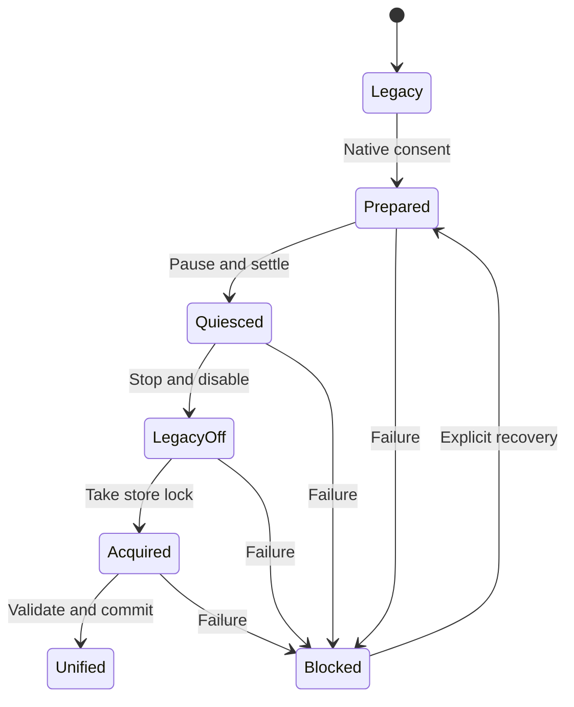

# Code60 unified gateway migration plan

> **Status: proposed migration plan, not implemented functionality.**
> Phases 0–7, including the localhost browser preview in Phase 5a, describe
> future work, not authorization to execute it.
> This document does not change the implemented architecture or service behavior.

## Scope and authorization

The sole deliverable for this task is this Markdown document. Do not implement
any phase, modify application code or configuration, install/start/stop services,
commit, publish, or change release state. Proposed modules, APIs, CLI controls
and lifecycle behavior below are design targets, not claims of availability.

For this documentation-only task, run only `npm run check:instructions` and
review the diff/status against the starting checkout to confirm that only this
file was changed by this task. Preserve unrelated existing changes. The broader
validation requirements below are gates for separately authorized future
implementation, not commands to run now.

The existing [architecture](../ARCHITECTURE.md) remains authoritative for
implemented behavior. In particular, Relay is currently desktop-owned and the
scheduler has its own service. Phase 0 would reconcile the architecture and
boundary rules with an approved implementation scope before behavior changes.

## Proposed final outcome

One per-user **Code60 Gateway** login service hosts the application backend **and scheduler**. Electron and an optional localhost browser frontend are clients of the same backend instance, application API and stores. The React interface is shared through client adapters. There is no separately registered scheduler service after migration.

Agreed behavior:

- Login startup is required, installed only with explicit consent. Execution requires the user to be logged in and the computer awake; no privileged machine service or Linux linger.
- Closing/crashing Electron, closing/refreshing a browser tab or losing its connection does not cancel approved interactive work, memory extraction or scheduled executions once Phase 5 behavior is enabled.
- Browser mode can operate with Electron fully closed. Agents, Git, databases, memory and embeddings run on the gateway's machine under the same local user; serving frontend assets alone provides no execution backend.
- Browser access is explicitly enabled and authenticated, bound only to the IPv4 loopback address `127.0.0.1`. Both clients share execution state; presentation, subscriptions and drafts belong to individual client sessions.
- New interactive permissions require a human. Without a UI, work waits safely where supported or ends safely at its existing deadline; it is never implicitly approved.
- Daemon restart restores evidence and scheduler recurrence metadata, not interactive task authority, live provider sessions or uncertain work.
- Headless `code60 run` remains independent and unchanged. Existing automation commands retain their domain operations and output contracts through compatibility adapters.
- The browser's loopback HTTP/event listener is the only new TCP exposure. No wildcard/LAN/public binding, remote access, reverse-proxy deployment, multi-user hosting, task replay, catch-up or exactly-once claim is included.

Each phase is independently reviewable, runnable and reversible under its stated ownership conditions. The planning session required keeping the pending beta release separate and reconciling the Windows agent’s handoff before implementation changes this checkout. Recheck that handoff and release status before any future implementation; this document authorizes no release action.

## Target architecture

```mermaid
flowchart TD
    R[Shared React UI in Electron] --> P[Preload adapter]
    P --> E[Electron main]
    E <-->|Local IPC| G[Gateway service]
    W[Shared React UI in browser] <-->|Same-origin HTTP and event stream| T[Loopback web adapter]
    T --> G
    G -->|Bundled frontend assets| T
    G --> A[Application host]
    G --> S[Scheduler runtime]
    A --> C[Core and agents]
    A --> B[Stores and Git]
    A --> M[Memory sidecar]
    S --> X[Scheduled agents]
    S --> H[Schedule store]
    L[Automation CLI] --> G
    G -->|Controlling-client approval request| E
    E --> N[Native dialog]
    G -->|Controlling-client approval request| T
    W --> D[Browser confirmation dialog]
```

One service process hosts two separately owned components:

| Concern | Application host | Scheduler runtime |
|---|---|---|
| Authority | Current human requests, accepted plans and live owners | Saved schedules, pinned providers/repositories and saved permissions |
| Work | Interactive conversations, workers and automatic integration | Single-turn isolated scheduled executions |
| Memory/MCP | Existing scoped application behavior | Remains no implicit memory and no MCP |
| Interactive Stop all | Stops application-owned work | Unaffected |
| Pause/cancel schedules | Unaffected | Scheduler-only control |
| Stop gateway/update | Quiesces and stops work | Quiesces and stops work |

Do not merge their permission models, execution queues or state stores. A scheduler startup/storage failure blocks scheduled dispatch and appears as degraded component status; it must not automatically disable healthy chats. An unexpected process-wide crash does affect both components, which is an explicit tradeoff of consolidation.

### Shared backend and client ownership

The gateway constructs exactly one application host and, after Phase 6, one
scheduler runtime. Electron's IPC adapter and the browser's web adapter dispatch
the same typed operations to those owners. Neither adapter opens application
stores, launches agents or constructs another controller. Existing agent-facing
MCP gateways remain scoped agent integrations, not browser UI endpoints.

Each connected client has an authenticated session and its own navigation,
selected project/conversation, visibility, subscriptions, knowledge presentation
reports and unsent drafts. Application resources and execution outcomes remain
shared. Closing or reloading one client releases only its resources; it cannot
clear another client's subscriptions or pause its visible reads. Browser drafts
must remain private to their tab/session and are never automatically submitted.

Initially allow one controlling client across Electron and all browser tabs.
Other authenticated clients may read authorized state but cannot mutate shared
application state, send prompts, accept plans or answer permissions. Control
transfer requires an explicit human action and a gateway-issued lease generation;
connection order, focus and reconnect never confer control. Losing control
invalidates that client's pending confirmations, not already approved work.
Scope browser control to a tab connection as well as its login session, since
tabs may share cookies. Bound leases and detect lost connections without relying
on tab-close notifications. New execution remains disabled until control is
explicitly acquired; there is no collaborative or multi-user permission model.

### Localhost web transport and authentication

- Browser mode is optional and disabled until explicitly enabled by the local
  user. The gateway serves bundled UI assets and a versioned API from one
  canonical origin, `http://127.0.0.1:<port>`. Keep endpoint metadata private;
  reject non-loopback binds, unexpected Host/Origin values and forwarded-host
  assumptions. A port conflict reports unavailable, never a broader bind or a
  second application host. Disabling browser mode detaches browser clients only.
- Provide a local launch/pairing path that works without Electron running and
  requires access to private per-user state. Exchange a short-lived, single-use
  pairing proof for an expiring, revocable HttpOnly, SameSite=Strict session
  cookie. Never put reusable gateway credentials in JavaScript, URLs, browser
  storage, provider environments or logs. If the launcher passes a pairing proof
  in a URL fragment, clear it immediately before loading application state and
  serve the bootstrap without third-party resources or referrer leakage.
- Enforce authentication for application reads and writes, same-origin checks,
  CSRF protection on mutations and authenticated event-stream handshakes. No
  permissive CORS or state-changing GET requests. Loopback location alone is not
  authentication; test malicious sites, DNS rebinding and invalid/missing origins.
  Pairing never supplies task authority or a controlling-client lease.
- Use HTTP requests for typed operations and a bounded server-sent event stream
  for summaries, details and notices. Reuse the local IPC protocol's identities,
  validation, cancellation, outcome lookup and gap recovery. Reconnect does not
  retry consequential mutations. Slow/disconnected clients cannot block backend
  work or another client's stream; expire and release their retained resources.
- Serve only the bundled asset manifest, never arbitrary host paths or repository
  content as executable web assets. Keep API responses uncached, reject framing,
  and provide a browser CSP allowing only required same-origin connections and
  bundled assets/workers. Keep Electron's stricter connection policy intact.
  No service worker or offline mutation queue is introduced. Bind assets,
  protocol and daemon versions so cached/stale tabs cannot use an incompatible API.

### Browser interaction and capability differences

| Interaction | Electron client | Localhost browser client |
|---|---|---|
| Project/database selection | Native pickers through validated interaction ports | Bounded host-side chooser under explicitly configured workspace/database roots; return opaque selection IDs |
| Permissions and destructive confirmations | Native dialogs for the controlling client | Accessible browser dialogs for the controlling client, bound to the same gateway operation |
| Window controls, transparency, backdrop and native menus | Existing native-shell behavior | Hidden or explicitly unsupported; navigation and actions remain available in the UI |
| Web links and clipboard | Existing validated native-link and clipboard behavior | Explicit browser link activation with destination confirmation and opener isolation; clipboard failure remains visible |
| Service installation and package updates | Existing consented local management | Show status/recovery instructions; native installation, repair and binary replacement remain local management actions |

The browser chooser is not an upload flow or a browser filesystem handle. It
selects folders/databases on the gateway's host. Validate canonical paths against
private local root configuration, reject symlink escapes and traversal, bound
listings and recheck selection identity/owner/epoch after confirmation and queue
waits. Changing allowed roots requires an explicit local management action;
browser requests cannot expand their own filesystem scope or request arbitrary
paths, commands or file reads. Existing scoped project/file operations stay scoped.

Both dialog adapters consume gateway-generated interaction IDs with operation,
owner, revision, client/control generation, expiry and single-use decisions.
Validate decisions in the gateway before execution. A boolean supplied with a
mutation is not a substitute for an outstanding confirmation. Publish native and
browser availability in the shared capability catalog; unsupported controls must
not succeed as silent no-ops or depend on an unseen Electron dialog.

### Module boundaries

- `src/application`: extracted Electron-independent backend. Depends on `core`, `contracts`, `platform`; external integrations arrive through injected ports.
- `src/automation`: scheduler domain/runtime, store, executor and compatibility facade. No Electron dependency and no independent service registration in the final design.
- `src/gateway`: composition root, daemon entry point, typed client, validated dispatch, client/control sessions, loopback HTTP/event and static-asset adapters, and component lifecycle. Composes application and automation once, independently of the number of clients.
- `src/platform`: bounded local transport, private state/process ownership and parameterized native registration.
- `src/contracts`: browser-safe protocol/application schemas and types; preserve existing bridge re-exports during migration.
- `src/desktop`: native shell, trusted-renderer validation, native interaction broker and installer integration.
- `src/renderer`: one shared React application with explicit preload and browser API adapters and capability-based shell behavior. Neither adapter imports backend modules, Node.js or Electron; browser transport uses the shared browser-safe contracts.

Update architecture, module instructions and boundary tests together. Backend modules must not import `desktop`. If additive gateway CLI controls need a new dependency, explicitly allow only the public gateway API rather than bypassing module rules.

## Phase 0 — Baseline, inventory and migration contract

**Implementation**

1. Document the target, temporary modes and ownership handoffs.
2. Inventory Electron backend handlers/direct service accesses, native-only operations, shutdown/reload paths, scheduler entry points, CLI operations and update hooks. Classify each UI operation as shared, adapted for browsers or explicitly native-only, and reconcile older CLI/platform assumptions with the current architecture.
3. Classify settings: daemon-owned application configuration versus client presentation, visibility and drafts.
4. Record baseline workflow, process, startup/reconnect and resource measurements. Record existing native failures separately. Define the browser support matrix, pairing/allowed-root setup and controlling-client handoff journeys before browser implementation.

**Workable state:** existing embedded application plus separate scheduler, unchanged.

**Gate:** reviewed operation/lifecycle inventory, instruction/boundary checks, baseline evidence. Do not treat pre-existing failures as passing or silently waive them.

**Rollback:** documentation/test-only changes; no data migration.

## Phase 1 — Introduce a typed backend interface

**Implementation**

1. Create an asynchronous `ApplicationClient` with explicit operations and subscriptions, backed by an in-process adapter over `DesktopController` and its services.
2. Route Electron handlers through it, including memory, RAG, knowledge, custom agents, model settings and automation UI operations. Keep the renderer’s narrow preload API.
3. Make native pickers/confirmations explicit ports. Preserve captured owners, database epochs, and validation after dialogs and queue waits.
4. Introduce client-owned presentation/subscription contexts; selection never supplies execution authority. Remove global selected-view, visibility, renderer-generation and reload cleanup assumptions before attaching a second client.
5. Separate the shared application API from native-shell capabilities. Select the preload or browser adapter explicitly at renderer bootstrap instead of requiring `window.desktop`; keep shared React views and database-epoch binding behavior.

**Workable state:** same app, processes and quit behavior, now behind a replaceable interface.

**Gate:** existing first-use, accepted-plan → automatic edits → diff/reference → declined/confirmed Undo journeys, plus memory/custom-agent/model workflows, run through the adapter. Check failures/cancellation across the new async boundary.

**Rollback:** restore the prior composition; no store or schema change.

## Phase 2 — Extract reusable application and scheduler runtimes

**Implementation**

1. Move the controller’s backend dependency closure into `application` in mechanical, tested steps. Reuse project/execution hosts, application agents, conversation coordination, stores and memory; do not rewrite their behavior.
2. Move shared DTOs into `contracts`, preserving compatible bridge exports. Inject diagnostics, preferences, model/resource roots and environment discovery instead of using Electron globals or its current directory.
3. Split application lifecycle into client detach, stop interactive work and host shutdown. Electron still explicitly shuts down the embedded host in this phase.
4. Establish exclusive application-host ownership before opening backend stores. Preserve existing store locks; never displace live/unverifiable owners.
5. Refactor `startService` in `src/automation/service.ts`: extract `startSchedulerRuntime` with initialize, request, subscribe, tick and stop operations, separate from its listener and OS service entry point. The existing standalone scheduler wraps this runtime unchanged for now.
6. Expose scheduler component health and a start-paused initialization path suitable for a later ownership transfer. Preserve the existing store format and claim-before-launch ordering.

**Workable state:** embedded application and standalone scheduler still behave as before, but neither backend implementation requires Electron.

**Gate:** plain-Node integration tests exercise both runtimes with fake providers and real isolated storage/Git. Boundary tests forbid backend-to-desktop imports. Existing application and scheduler journeys stay green.

**Rollback:** keep old composition entry points. No live owner handover or bulk data moves.

## Phase 3 — Add the gateway transport behind a development/test switch

**Implementation**

1. Reuse/generalize scheduler transport patterns: Unix sockets on macOS/Linux and named pipes on Windows, private endpoint metadata, token authentication and explicit current-user pipe access.
2. Add version handshake, daemon-instance/client-session/request IDs, cancellation, operation status and explicit errors. Keep reusable local-IPC credentials/tokens out of the renderer, provider environments and logs; browser authentication follows the separate session design above.
3. Strictly validate requests in the daemon. Preserve owner/generation/database-epoch/revision checks. Encode native bigint identities as validated decimal strings, not JSON numbers.
4. Implement the local-IPC `ApplicationClient`. Preserve summary/detail pushes, subscribe-before-read, predecessor revisions and bounded gap recovery. Bound clients, frames, queues, subscriptions and outgoing buffers; page/chunk supported large reads instead of truncating silently.
5. Deduplicate requests during the live daemon instance. For consequential mutations, persist bounded acceptance/outcome metadata before dispatch. After crash, unresolved status means unknown/recovery-required, never automatic replay.
6. Implement interaction RPC and controlling-client leases: expiring, operation-bound requests, one controlling UI, single-use decisions and rejection of late/stale/mismatched responses. Initially cancel pending interactions on disconnect. Native and browser adapters share the same approval validation.
7. Keep scheduled execution in its old standalone service at this stage. Gateway automation operations use an injected adapter to that service.
8. Behind the same development/test switch, add the optional loopback HTTP/SSE adapter, bundled-asset serving and browser API adapter. Implement pairing, session/origin/CSRF enforcement, client isolation, host selection and browser confirmation ports. Run both transports against the same application host; require no Electron process for browser-only tests.

**Workable state:** production remains embedded. Development/tests can run Electron and the browser against one foreground gateway child. Its explicit test/development owner stops it at session end; detaching one UI never tears down another client's host. This is not yet the supported browser preview or background-work policy.

**Gate:** run application contract/UI journeys through embedded, local-IPC and HTTP/SSE adapters. Inject lost responses during Send/Accept/Undo, duplicate/conflicting IDs, dropped streams, malformed/oversized frames, slow clients, stale approvals, simultaneous starts and daemon termination. Independently prove no duplicate provider launch, worktree or checkout write. Verify cross-client selection/visibility isolation, tab-bound control transfer, pairing replay/expiry, invalid origins/hosts, unauthorized streams, CSRF, chooser escapes and asset traversal.

**Rollback:** stop and verify gateway/process-tree exit before restarting embedded. Never automatically fall back after IPC failure.

## Phase 4 — Ship a consented installed-gateway preview

**Implementation**

1. Parameterize native registration while preserving scheduler identities. Add a distinct gateway login registration and System Manager install/repair/start/stop/uninstall controls with native consent.
2. Launch the bundled runtime in Node mode. Support macOS, Windows, DEB and AppImage without persisting temporary mount paths; verify native child/job ownership does not belong to Electron.
3. Move provider/PATH discovery into the backend environment. Preserve verified executable identities and existing credentials; do not write credentials into service registration or silently substitute providers.
4. Login starts an idle application host, without prompts, restored live sessions or replayed provider/extraction requests. The standalone scheduler still follows its existing recurrence rules.
5. Implement update coordination before enabling installed mode: fence new dispatch, safely drain/cancel owners, flush stores, stop both existing services as appropriate, replace binaries, repair consented registration and restart idle. Cleanup failure blocks installation; incompatible versions stay in recovery.
6. Explicitly label a temporary preview policy: Electron UI exit stops interactive work through the daemon, while the gateway service remains installed/running. Installed browser access remains disabled until Phase 5a; development/test adapters retain their explicit owner lifecycle.
7. Negotiate binary/protocol compatibility; incompatible clients get recovery UI, not partial access or an embedded fallback.

**Workable state:** embedded mode remains the normal path; consenting preview users run the application backend in an installed gateway. The scheduler remains separate only until Phase 6.

**Gate:** native packaged tests cover consent/decline, login start, service controls, resource discovery, update failure/recovery, reinstall/uninstall preservation and coexistence with the old scheduler.

**Rollback:** drain/stop gateway work, disable/uninstall only its registration, verify ownership release and restart embedded. Do not switch modes with live work.

## Phase 5 — Continue approved work after UI exit

**Implementation**

1. Make UI quit/close/crash detach client-owned reads, pickers, setup transactions and subscriptions without stopping approved application work.
2. Continue live authorized turns, workers, eligible automatic updates/integration and captured-memory extraction in the daemon. UI absence grants no broader permission.
3. Keep bounded, expiring permission requests for the same live turn and present them to the next controlling UI. Where provider waiting is unsupported or a deadline expires, stop safely and require explicit continuation; no replay or automatic approval.
4. Cancel disconnected destructive-operation confirmations such as Undo/forget/retention changes; the human must initiate them again.
5. Reattach by daemon instance and owner identity. Same daemon means existing live work; a restarted daemon means stopped/interrupted evidence, never reconstructed authority. Apply the same semantics to browser refresh, SSE loss and tab closure; reacquiring presentation never restores control or resends an accepted request.
6. Distinguish UI Quit/tab close, Stop all interactive work and service shutdown. Logout/OS shutdown remain backend shutdown events with bounded cleanup. Releasing one client never shuts down the shared host or cancels another client's reads.

**Workable state:** preview users have the target application background behavior; the standalone scheduler still operates independently pending consolidation.

**Gate:** while Electron is absent, observe exact agent PIDs/launch counts, records, Git/index/checkout bytes and memory outcomes. Reopen without redispatch. Cover permission waiting/expiry, renderer crash, daemon crash, Stop all and Undo after reconnect.

**Rollback:** drain interactive work and restore stop-on-UI-exit behavior, or use Phase 4 rollback. Never transfer live authority into another host.

## Phase 5a — Ship the localhost browser preview

**Prerequisites:** Phases 1–5, including authenticated web transport and UI-detach
semantics. Scheduler consolidation in Phase 6 is not required. The gateway still
adapts to the standalone scheduler until its separately consented migration.

**Implementation**

1. Expose explicit browser enable/disable, local pairing/open, session revocation and status controls through local management. Support browser-only use with Electron closed; service installation and private root configuration must be possible through a separately authorized local setup path, without requiring a running Electron window. Keep browser enrollment separate from gateway installation consent.
2. Package the shared frontend, browser bootstrap/CSP and assets with the gateway. Publish the private canonical endpoint and report listener/pairing errors without weakening authentication or constructing an embedded fallback. Package/runtime/model paths must resolve without Electron globals or a running UI.
3. Complete the host repository/database chooser, browser dialogs, keyboard navigation, links, clipboard errors and capability-specific settings. Native-only installation/update controls show accurate status and actionable local recovery guidance. Do not expose a generic command or filesystem endpoint to achieve UI parity.
4. Support simultaneous Electron/browser connections with independent views and explicit controlling-client transfer. Show which client has control and why mutations are disabled. Expire disconnected leases, cancel outstanding destructive confirmations and retain only eligible bounded live-turn permission waits.
5. Integrate browser sessions with update/shutdown barriers. Fence mutations and notify both clients before gateway replacement; expire sessions/control on daemon restart and require re-pairing. A stale tab must reload compatible assets before restoring reads or requesting control. Never replay work or silently restore browser enrollment after it was disabled.

**Workable state:** an explicitly enrolled user can complete the shared application
journeys in a localhost browser with Electron closed, or use either client against
the same installed backend. Approved work survives both UIs disconnecting.

**Gate:** run the shared first-use → request → Accept → edits → diff → declined/
confirmed Undo journey in each supported browser with Electron absent, then attach
Electron and verify identical owners, outcomes and one backend PID. Exercise two
tabs, read-only clients, control transfer during approvals, client-local cleanup,
lost mutation responses, listener disable/re-enable, pairing/session expiry,
daemon restart, stale assets and update barriers. Assert real Git/file/process
outcomes and negative authentication/path-boundary cases, not only UI messages.

**Rollback:** disable the loopback listener and revoke browser sessions, leases and
pending confirmations; preserve approved work, stores and Electron access through
the same gateway. Never start a replacement backend to recover browser access.

## Phase 6 — Consolidate scheduler ownership into the gateway

### Runtime integration

1. Compose the existing scheduler runtime inside the gateway process, with its own store, queues, cancellation, health and bounded timer. Reuse its existing executor and recurrence code.
2. Keep scheduler behavior unchanged: one scheduled execution globally, claim/advance before launch, mandatory worktrees, pinned repository/provider identities, deny-by-default saved permissions, no MCP/implicit memory, no catch-up/retry/automatic integration/cleanup.
3. Use the existing `code60/automations` store in place, under its existing exclusive writer lock. Do not copy schedules into the application database or create a second source of truth.
4. Add typed gateway automation operations and notices. Electron and the browser use the same gateway application/scheduler APIs with client-specific capability limits. A compatibility automation endpoint may be served by the **same gateway process** to preserve the existing automation client contract; it is not another daemon.
5. Isolate scheduler component failures from healthy application operations. Recovery remains explicit; no tight restart/retry loop or silent clearing of history/blocks.

### Consented ownership handoff

Implement a private, bounded migration record with revalidated steps:

- Explain that the shared service will own both interactive and scheduled work. Existing scheduler-install consent is not silently expanded.
- Record the previous scheduler registration and pause policy. Fence supported-client schedule mutations, pause future launches and let active execution finish by default. Cancellation requires explicit approval. If cleanup does not finish, leave migration blocked, not partially successful.
- Revalidate final scheduler state/ownership after settling; concurrent changes invalidate the prepared step. Stop and disable the old native registration and prove the standalone owner and owned work are gone. Failure to disable it blocks integrated startup.
- Only then acquire the **same existing automation-store lock** in the gateway, initialize with dispatch held paused and validate schedules/history/claims/blocks. Never remove another owner’s lock.
- Commit unified ownership and restore only the previously authorized pause/enrollment policy. A previously uninstalled/disabled scheduler must not become active merely because the gateway is installed. Existing recovery blocks remain blocks.
- Use current restart recurrence behavior: advance to future occurrences, preserve claims/history and never catch up occurrences lost during handoff. Make any scheduling gap visible; do not claim seamless or exactly-once transfer.
- A crash at any step leaves enough evidence for explicit recovery. No participant resumes dispatch solely because a migration marker exists. A supervisor restart must respect an incomplete handoff.

### Service and CLI compatibility

- Final native state: one gateway registration; the legacy scheduler registration is removed/disabled and cannot be recreated by updated clients.
- Preserve `code60 automation ...` operations, formats and exit behavior through the automation facade.
- Retain `code60 scheduler ...` as clearly documented **scheduler-component** controls. Stop/uninstall affects scheduling, not unrelated interactive work; install/repair requiring shared-service installation must explicitly disclose and obtain consent for that broader lifecycle. Preserve the existing response shape with component-appropriate values.
- Add explicit `code60 gateway status|install|repair|start|stop|uninstall` for whole-service control. Destructive whole-service controls require explicit noninteractive confirmation; stdout remains machine-readable and diagnostics go to stderr.
- Replace separate gateway/scheduler updater hooks with one shared-service update barrier that settles **both** components before replacing binaries. Do not double-stop or double-restart the same service.
- System Manager shows one service with separate application/scheduler health and workload controls. Uninstalling the gateway stops both components while preserving their stores and evidence.

**Workable state:** consenting preview users now have one service hosting both backends; no competing scheduler process. Users not yet migrated retain the supported legacy mode until final cutover.

**Gate:** test new installations, existing running/idle/paused/blocked schedulers, disabled enrollment, simultaneous startup, legacy-owner contention, disconnects and crashes after every handoff step. Verify exact schedule/claim/history preservation, future recurrence, no duplicate scheduled dispatch, no replay and no checkout integration by scheduled workers. Native checks prove old registration removal, one gateway PID, CLI compatibility, login recurrence and shared update/uninstall cleanup.

**Rollback:** first pause/drain the integrated scheduler, release its lock and verify its agents are gone; explicitly restore the old registration under the saved consent/pause policy. Never restart the old scheduler while the gateway owns that store. If ownership is uncertain, remain blocked and preserve evidence.

## Phase 7 — Make the unified gateway the supported shared backend

**Implementation**

1. Promote unified mode only after all native and localhost-browser gates pass. On first run/upgrade, require explicit installation/migration consent; browser access remains separately enabled and paired.
2. Declining installation or lacking a supported native supervisor leaves a usable recovery/settings shell, not a silently installed service or an embedded backend with duplicate authority. Backend operations remain disabled until resolved.
3. Remove production embedded/standalone mode selectors and automatic fallbacks. Keep isolated in-process adapters for tests/development. Retain only necessary compatibility facades, not legacy OS registrations.
4. Audit Electron and the browser transport for direct application-store access, agent launching, worktree manipulation and application/memory host construction. Only native-shell work remains in Electron; both adapters dispatch shared behavior through the gateway.
5. Complete offline/reconnecting/component-degraded UI states, unsent-request preservation, quit copy, service recovery and operational documentation.
6. Finalize architecture and module rules. For each earlier capability-affecting phase as well as this one, update `src/contracts/knowledge.ts`, availability rules and tests, then run `npm run generate:capabilities`; do not defer those updates until final cutover. Update QA workflow cards to distinguish UI reconnect from daemon restart and domain Stop all from whole-service shutdown.
7. Version/release through the normal separate preparation process; do not piggyback on the pending beta.

**Workable state:** one consented login service, with application and scheduler components; Electron and the optional localhost browser share its backend and React application. Either UI can be absent; ordinary headless runs remain independent.

**Gate:** full default-path first-use/upgrade journeys through both clients, check/build, relevant E2E suites and native package/install/update/uninstall validation. Measure cold startup, browser asset delivery, reconnection, stream latency/backpressure, scheduled dispatch under interactive load, memory usage and process cleanup against Phase 0. Address real regressions without loosening correctness or inventing permissive thresholds.

**Rollback:** controlled service stop and ownership release before reverting a release. Preserve evidence; never promise binary downgrade across an incompatible state schema.

## Future implementation validation and execution rules

- Run `npm run check:instructions` for documentation and instruction changes. Update `ARCHITECTURE.md`, module instructions and `test/boundaries.test.ts` together when changing module rules. Run narrow tests first, then `npm run check` before every commit. Run `npm run build` for changed entry points/build boundaries. Follow the repository’s Linux Node.js 22.12/24 check matrix and release-only native Node.js 24 validation. Model/runtime changes additionally require `npm run prepare:models`, offline smoke and packaged-target checks. Never lower coverage floors or broaden unused-code exclusions to conceal extraction issues.
- Follow the [repository QA skill](../.factory/skills/qa/SKILL.md). Exercise visible first-use setup → human request → plan/Accept → automatic edits → read-only diff/code attachment → declined and confirmed Undo. Assert intermediate authority and independent filesystem/Git/process outcomes.
- Add scheduler, memory On/Off/no-backfill, stale-owner, reconnect, permission, low-disk, multi-owner, update and migration-failure journeys. Test final defaults, not just development switches.
- Run browser journeys against the real Node gateway with isolated stores/Git and fake providers, without Electron; cover the declared browser matrix and then simultaneous native/browser attachment. Add security and slow-client tests for loopback binding, host/origin/CSRF validation, pairing/session isolation, static assets and chooser scope. Record browser-specific PASS/FAIL/BLOCKED separately from desktop results; this documentation revision does not authorize starting either suite.
- Desktop E2E runs locally only through `npm run test:desktop:container`, never `npm run test:desktop` on the host. If Docker is unavailable, report BLOCKED rather than using the host. Current restrictions below prohibit starting a new Docker build for this task. If future container testing is authorized, remove only that session’s containers and built test images afterward, preserve dependency/build caches and host artifacts, and verify cleanup without global prune commands.
- Record PASS/FAIL/BLOCKED with evidence. Unit checks/test collection alone do not establish E2E success.
- Restrictions carried forward from the planning session remain in force for this task and must be revisited explicitly before future execution: no new Docker builds, dependency installation, worktrees or host desktop-test fallback. Use suitable authorized CI/native environments; report blocked local validation. Do not install a real login service on this computer without separate permission.
- Each phase gets its own reviewed changes and verification report. Approval of this plan is not authorization to publish, merge PRs, tag releases or install real services.

## Recovery and preservation requirements

Recovery must follow the existing [recovery runbooks](runbooks/README.md), extended
in a future phase for the unified service. Never repair by erasing history,
deleting locks or replaying uncertain work. Preserve transcripts, run records,
worktrees, checkpoints, memory and scheduler metadata in their existing stores;
there is no bulk import or transcript move in this migration.

- A disconnected UI must show offline/reconnecting status, disable mutations
  until compatibility and ownership are established, and preserve unsent drafts
  as unsent. An accepted request with a lost response is not an unsent draft to
  submit again. Query its outcome by request ID; unknown remains unknown.
- Reconnection to the same daemon rebinds presentation subscriptions to existing
  live owners. Reconnection after daemon restart clears stale authority,
  approvals and detail cursors, reads fresh summaries, and exposes saved
  evidence without restoring sessions or resending requests.
- Browser listener failure is a degraded frontend component, not permission to
  restart the application host. Listener disable/session revocation releases only
  affected browser resources and approvals. Daemon restart invalidates browser
  login/control sessions; pairing again restores access, never live task authority.
- A service restart must first establish exclusive ownership and reconcile owned
  processes. Mark a run interrupted only after proving its owner is gone.
  Unverifiable or surviving processes block conflicting work; do not adopt or
  duplicate their execution.
- Scheduler preservation includes schedule IDs and revisions, enabled/paused
  policy, anchored intervals, saved IANA zones, repository/provider pins, saved
  permissions, occurrence identities, persisted claims, execution history and
  recovery blocks. Legitimate recurrence advancement and migration audit records
  are explicit changes, not permission to rewrite prior evidence.
- Retain existing calendar semantics: skip nonexistent local times and select only
  the first repeated local time. Busy/missed occurrences remain recorded rather
  than queued. Editing does not change an active execution snapshot.
- Persistence failure, unsafe storage or low disk space blocks scheduled dispatch.
  Component degradation must be visible without granting a fallback writer.
- Update/recovery failure leaves a stopped or degraded state with preserved
  evidence and an actionable status. Never install over live owners, automatically
  downgrade incompatible stores, or restart the legacy scheduler as a fallback.

## Final completion criteria

These are acceptance criteria for the future migration, not completed checks:

- [ ] One consented per-user login registration hosts both application and scheduler
  runtimes; no independent legacy scheduler registration remains enabled.
- [ ] Electron and the localhost browser use one gateway/application instance,
  API and stores, with no embedded fallback or competing writer. Browser-only
  operation requires no running Electron process.
- [ ] Optional browser enrollment/pairing, authenticated loopback-only serving,
  bounded host selection and native-only capability limits pass positive and
  negative validation without reusable gateway credentials in the frontend.
- [ ] Simultaneous clients retain independent presentation/subscription state;
  one explicit controlling-client lease governs shared mutations and approvals.
  Reload, disconnect, revocation and handoff cannot clear another client's state
  or reuse stale confirmations.
- [ ] Approved work continues after UI exit, reconnect attaches without redispatch,
  and new permissions still require a human.
- [ ] Daemon restart restores evidence and safe future recurrence only, never
  interactive authority, pending approvals or uncertain execution.
- [ ] Schedules, claims, history, recovery blocks and enrollment policy survive
  tested handoff failures, with no duplicate dispatch and no catch-up/retry.
- [ ] Headless run behavior and automation output/exit contracts remain compatible;
  scheduler-component controls cannot unexpectedly stop interactive work.
- [ ] Shared updates, restart, uninstall and recovery settle both components,
  preserve data and fail closed on uncertain ownership.
- [ ] Repository, browser-only and simultaneous-client journeys, and supported
  native packaging/install/update gates pass with recorded evidence. Stale tabs,
  slow streams and failed authentication fail safely. Blocked validation is not
  completion.

## Intended result

Electron and a localhost browser share one React application and **one Code60 service** for backend state and execution. Either or both UIs can close while approved interactive work, memory and scheduled execution continue. Reopening safely reattaches; new permissions still require a human controlling client. Restart never replays uncertain work. Browser access remains optional, authenticated and loopback-only. The standalone scheduler registration is gone, its schedules/claims/history are preserved, and existing headless run behavior remains intact.
