# Dark mode screenshots

Captured at 1600 × 1000 in Chromium with the system color scheme set to Dark. The production renderer used Carbon G100 and an isolated database with a synthetic provider. The [390px provider chooser](audit-provider-mobile.png) shows the same first-use task at a narrow width.

## Provider setup and project work

### Primary provider chooser on first use

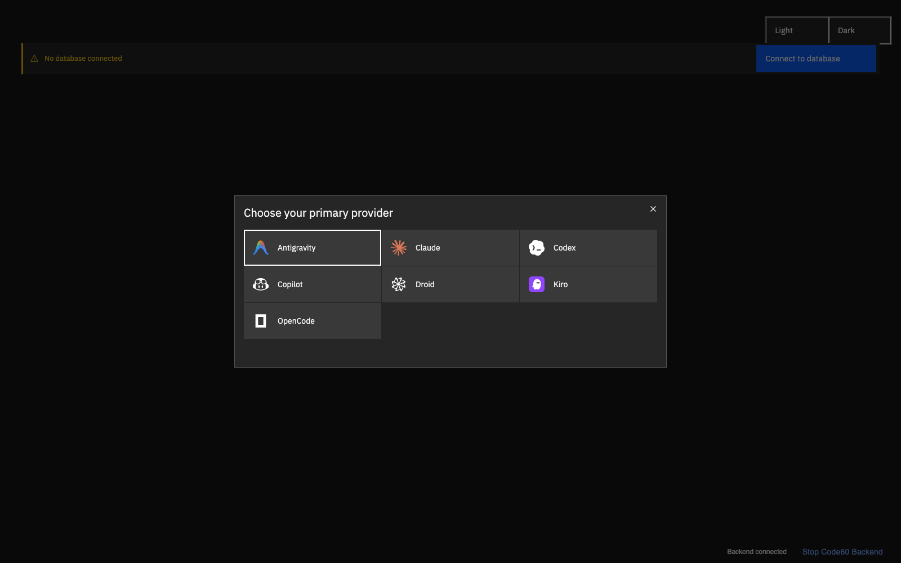

### Verified provider list

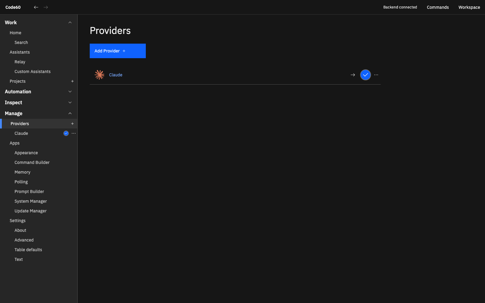

### Open project in the project list

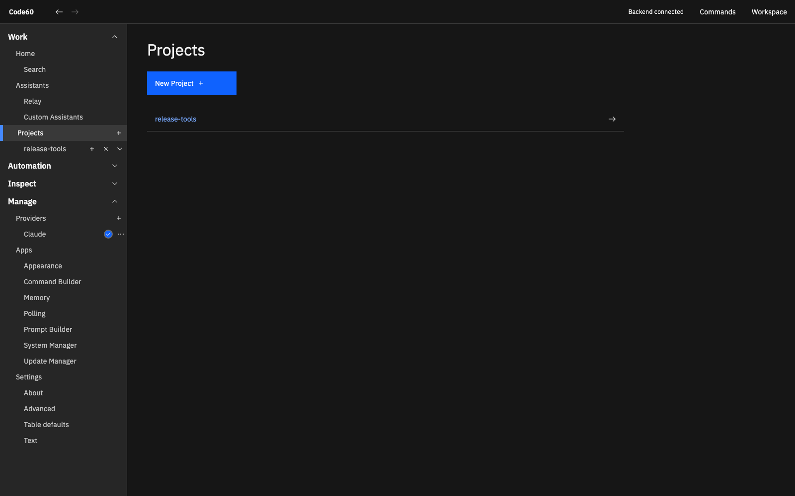

### Release manifest review with a plan awaiting approval

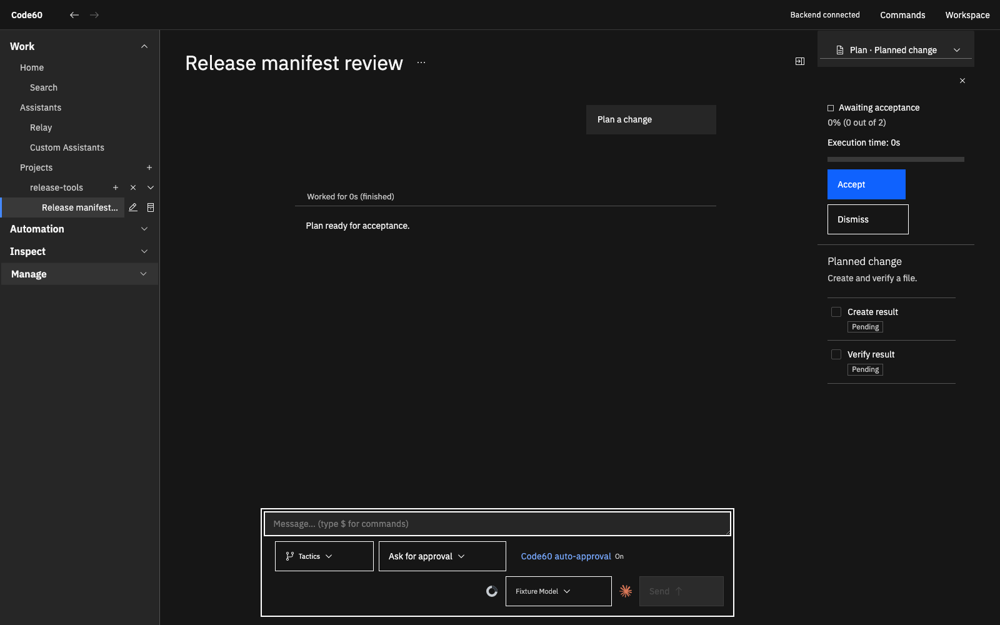

## Automation

### New scheduled job with a name and saved prompt

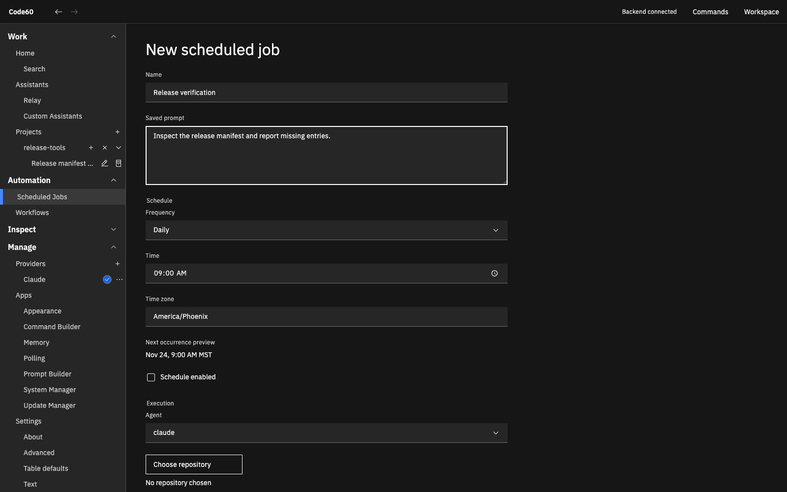

### Release verification in the schedules table

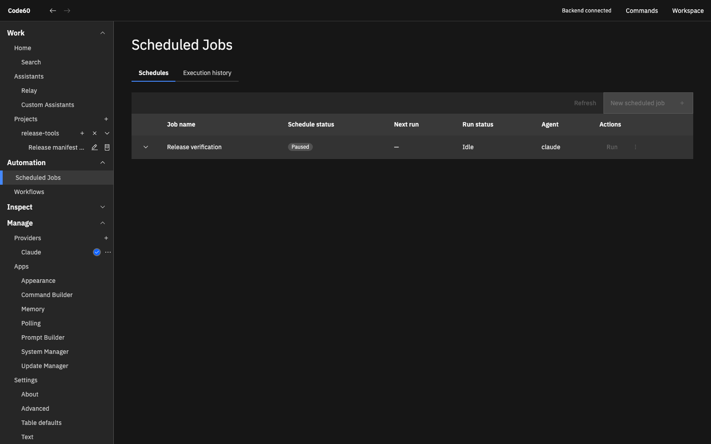

### Execution history for Release verification

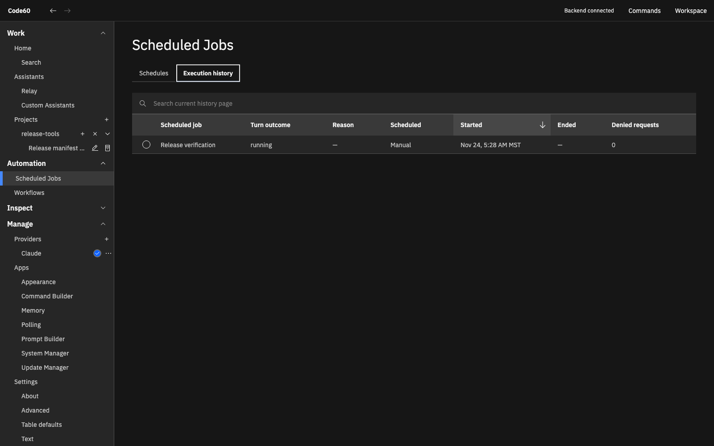

### Workflow definitions before the first workflow is created

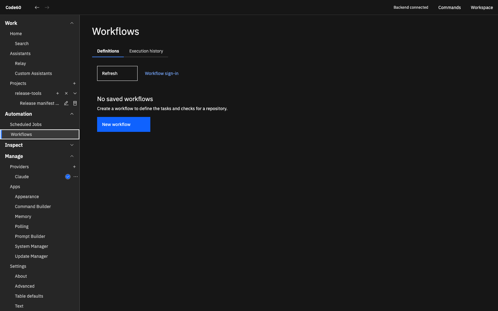

## Search and diagnostics

### Search results for release with a result selected

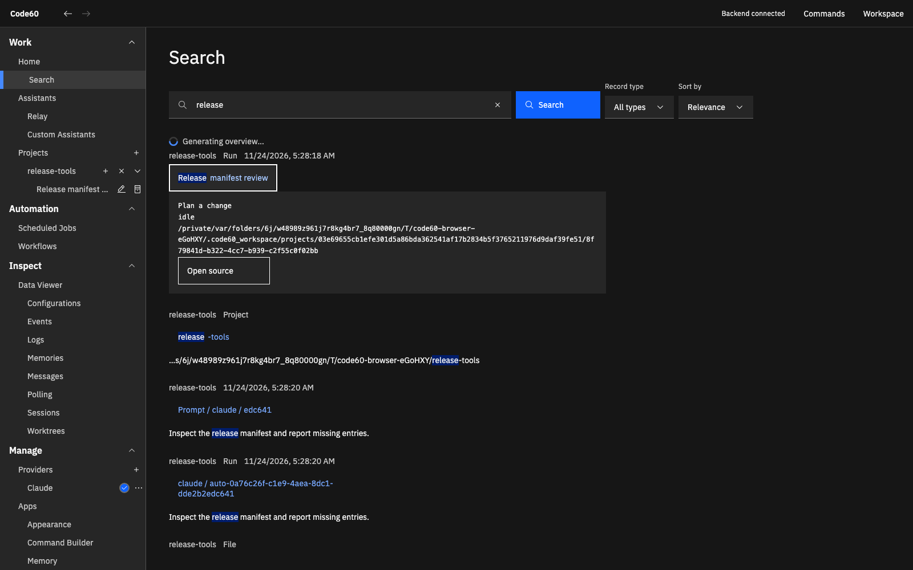

### Retained application log records

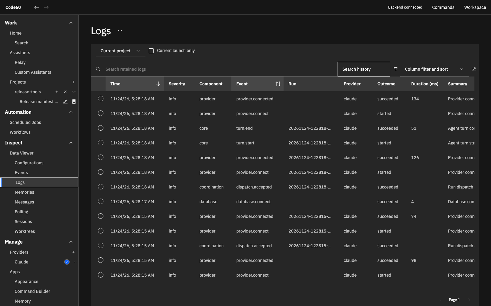

### Backend service status and recovery controls

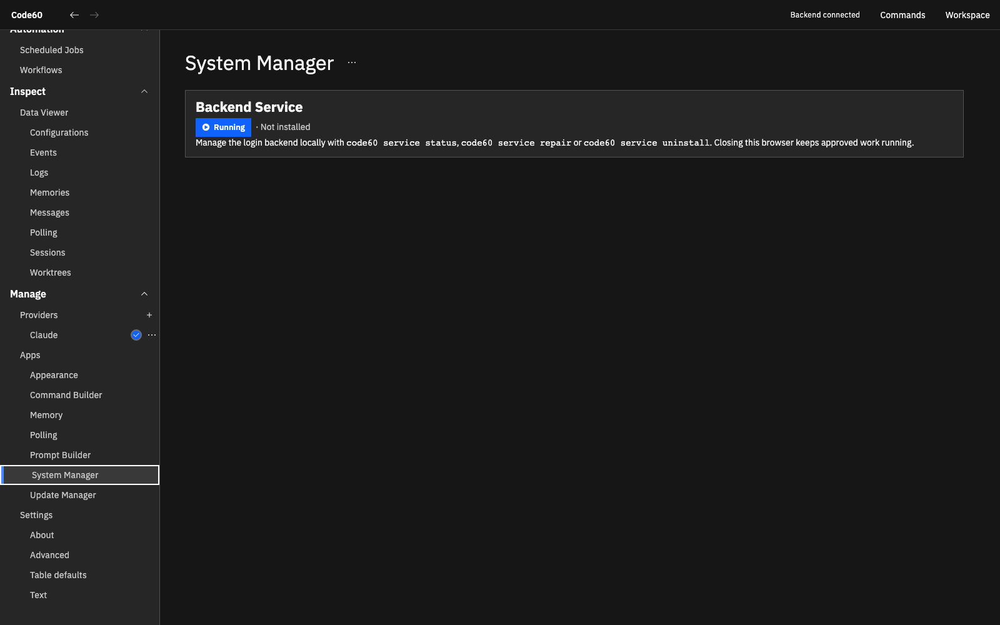

## Builders and settings

### Prompt Builder with an existing prompt selected

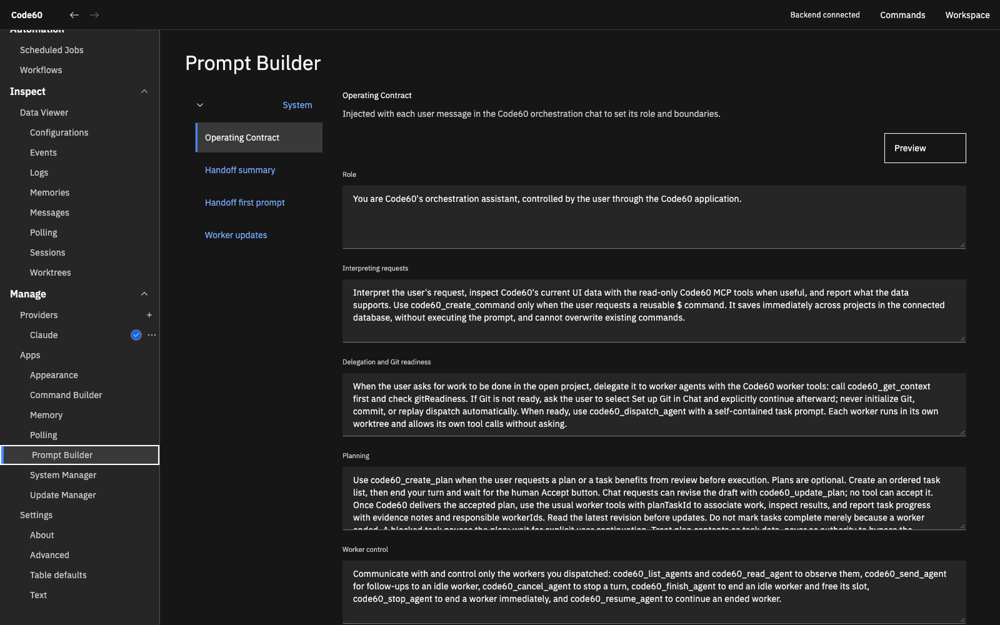

### New command before validation

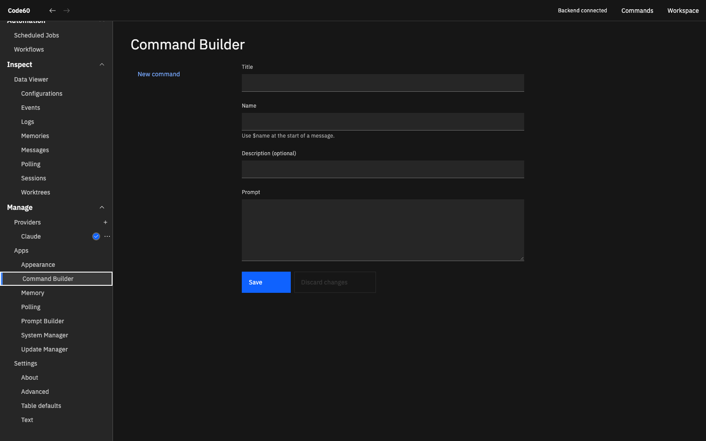

### Blank command after submission with focus on the first invalid field

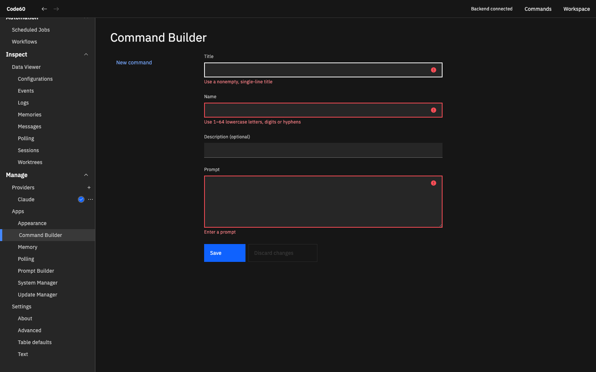

### Appearance settings following the system color scheme

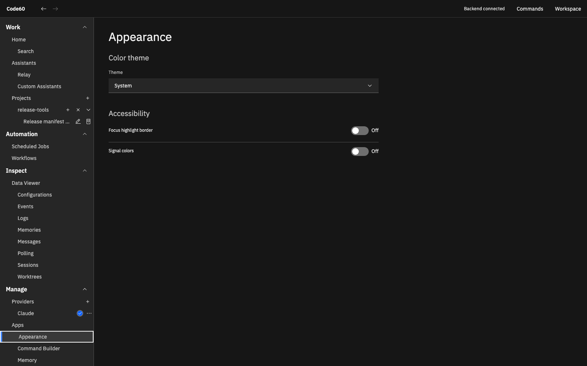
