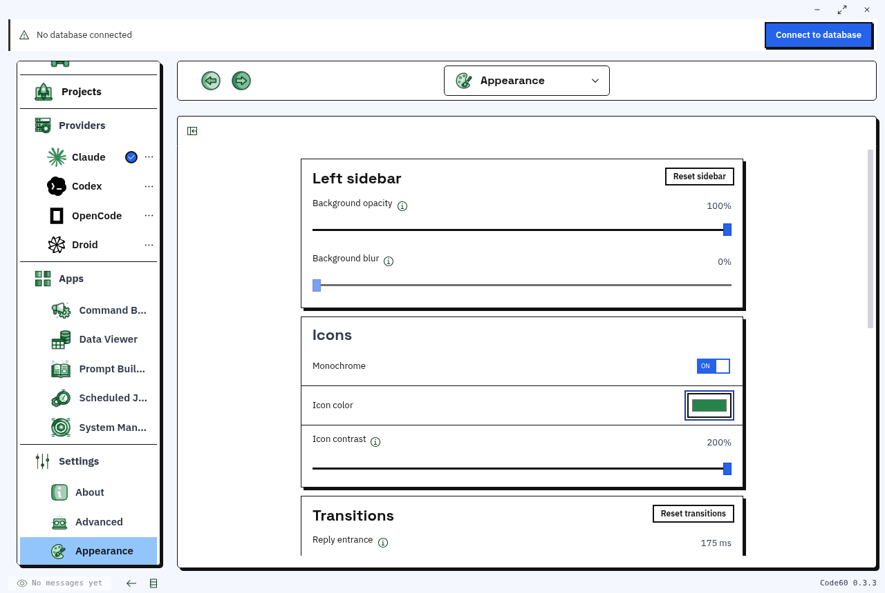
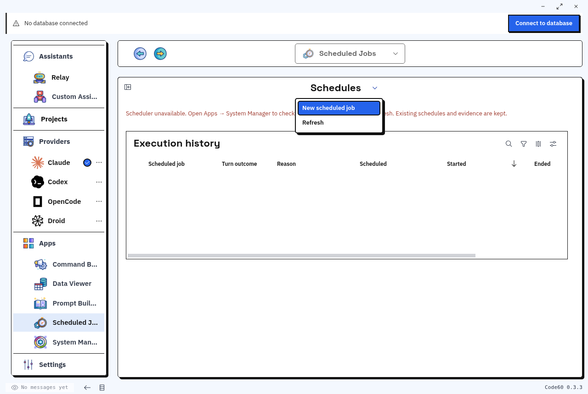
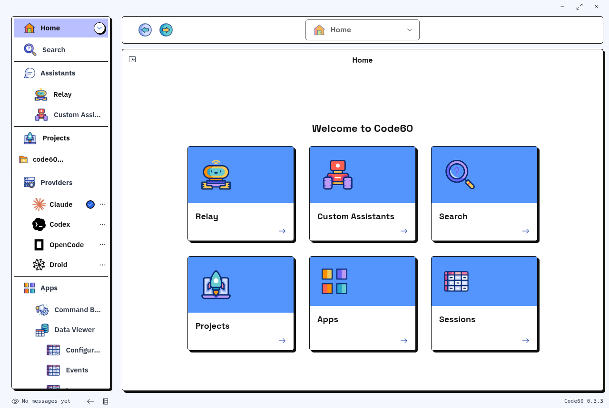
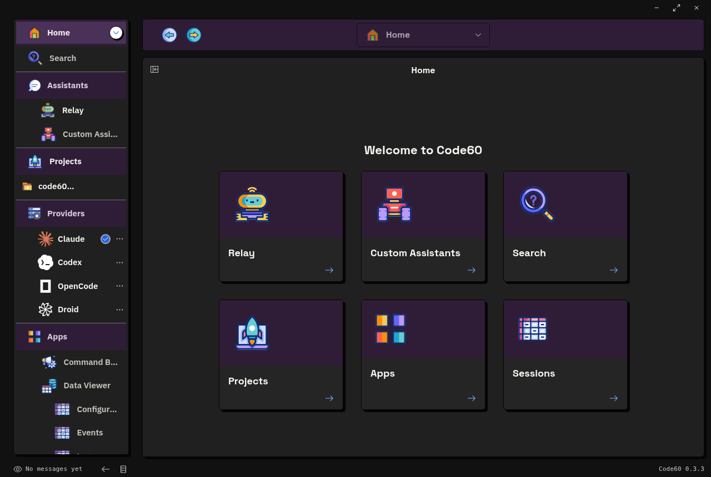
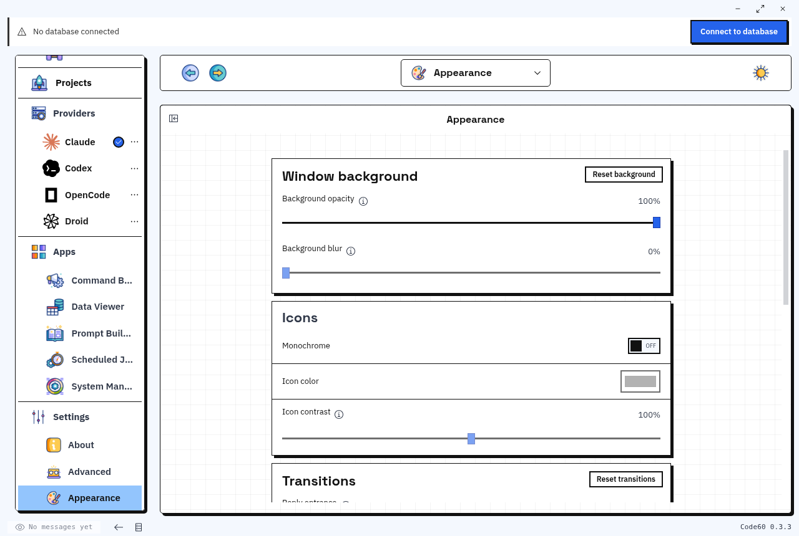

# GUI standardization visual review

Synthetic project fixtures from the Linux Electron/Playwright harness; no real
workspace content or credentials. Before is current main at `053126a`. After
shows this branch's white reading surfaces, unified sidebar, navigation combobox,
main-card panel toggles, Files dropdown and file-only Close action below its header.

| Before | After |
| --- | --- |
|  |  |

Appearance also adds optional locally saved Monochrome icons, a color picker
(gray by default), and a 0–200% contrast slider. Colored artwork remains the
default; system colors bypass the tint. Back/Forward artwork plays once on click.

Dark sidebar headers share the breadcrumb Card's purple fill (`#2f1d37`) and
light foreground; Light and forced colors retain their own palettes.

Primary pages share a centered text-only page title and adjacent chevron menu
for existing page commands, using saved Page Titles typography. Scheduled Jobs
uses its page name. Table tools, creation cards and corner panel toggles stay
visible; pages without commands show only their title. Headers grow with larger
text and remain in their own content card through navigation.

| Shared header in Light | Shared header in Dark |
| --- | --- |
|  |  |

The conversation header and both corner toggles remain reachable after scrolling
a stacked chat with enlarged composer text. Automatic chat naming keeps an open
command menu attached to its owner without resetting keyboard focus.

The right edge of the breadcrumb Card has one Color theme button. It shows the
selected preference and cycles System → Dark → Light → System. System remains
the default; saved selections and the Settings Theme selector stay synchronized.
Artwork plays once on activation; hover/focus stays still and reduced motion or
forced colors uses the poster. The current-page selector stays centered. Main page and conversation backgrounds
also have a subtle stationary 24px grid with 1px lines, using faint black in Light
and faint white in Dark. Nested reading surfaces remain solid; forced colors
suppresses the grid.

| Light mode | Dark mode |
| --- | --- |
|  |  |

The supplied [eclipse](../../../src/renderer/icons/apps/theme-eclipse.gif),
[night](../../../src/renderer/icons/apps/theme-night.gif) and
[sun](../../../src/renderer/icons/apps/theme-sun.gif) assets retain all 48 / 107 / 46
frames and their exact per-frame delays (2.0 / 2.4 / 2.4 seconds). Background-only
white removal preserves enclosed moon detail; source files remain untouched.
