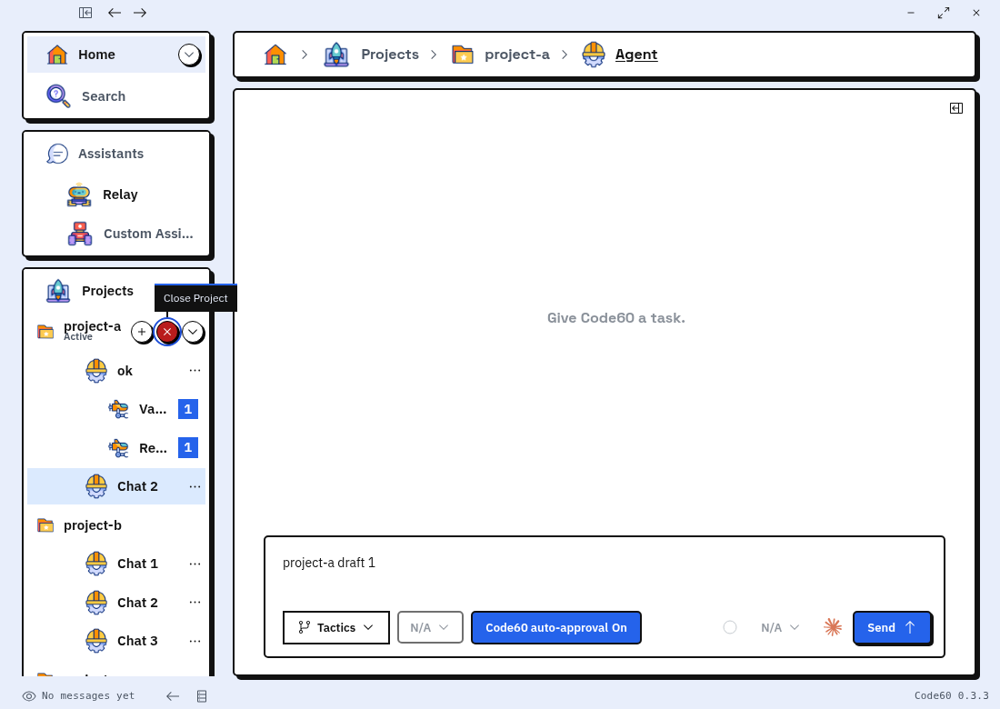
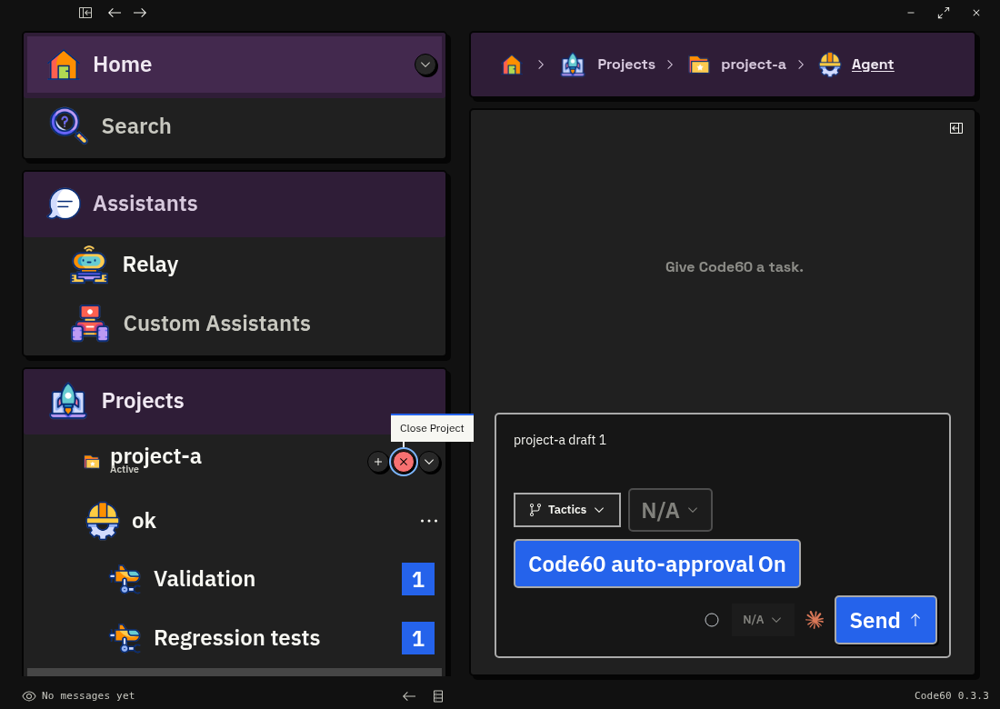

# Project chat navigation icon

Issue [#248](https://github.com/CodeManufactoryLLC/Code60/issues/248) removes the
legacy trailing agent icon from project chat rows. The leading chat artwork
keeps the independent worker disclosure; the label still selects the chat and
More retains its menu. No trailing placeholder is reserved.

These screenshots use synthetic projects and the fake ACP provider in the Linux
container. The Light comparison uses a 220px sidebar and 15px navigation text.
The Dark result uses a 480px sidebar and 24px navigation text. Automated layout
checks also cover a 180px sidebar with 32px navigation text.

| Before (main at 0465f6a) | After |
| --- | --- |
|  |  |

